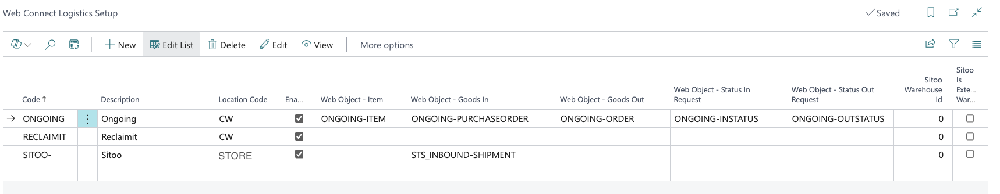
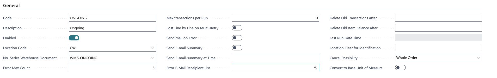
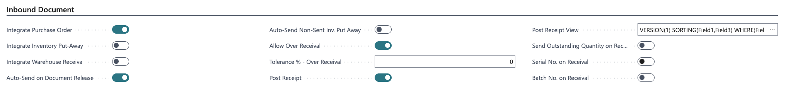
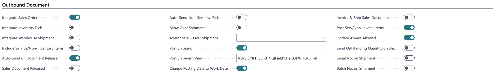
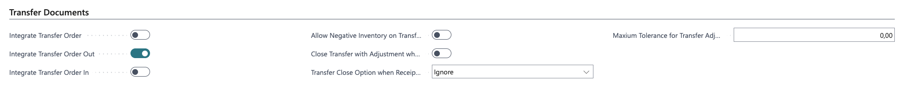
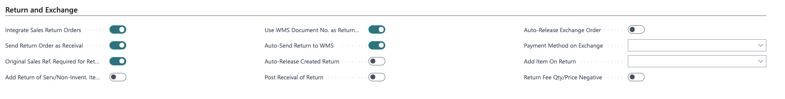
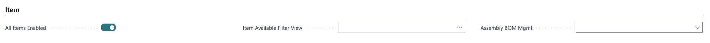
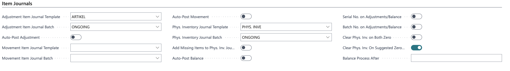
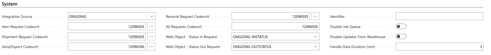

# Web Connect Logistics Setup

> **BC view name:** Web Connect Logistikinställningar

## Overview

Logistics Setup decides how Business Central works with an external system that handles stock: a warehouse management system (WMS) run by a 3PL, a point of sale system with store warehouses, or a returns system. There is one logistics setup per system and location, with a code such as `ONGOING`, `NYCE` or `RECLAIMIT`.

The setup says which documents are sent to the system, which [Web Connect Objects](objects.md) build the messages, when shipments and receipts reported back are posted, and which journals receive stock adjustments and stock counts. Every message in both directions is logged as a [WMS document](wms-documents.md) with the code of the logistics setup.

The integration pages describe how each system uses the setup: [Ongoing WMS](../integrations/ongoing/overview.md), [Nyce Logic WMS](../integrations/nyce/overview.md), [Astro WMS](../integrations/astro/overview.md), [Nowaste](../integrations/nowaste/overview.md), [Shelfless](../integrations/shelfless/overview.md), [Sitoo POS](../integrations/sitoo/overview.md), [Reclaimit](../integrations/reclaimit/overview.md) and [Sello](../integrations/sello/overview.md).

WMS documents are processed automatically by the Logistics job, a job queue entry (codeunit `12096563`) created from the logistics setup. The setup decides, per document type, whether the job only fills in the Business Central document or also posts it. See [Automatic posting](#automatic-posting).

All logistics setups live in your own Business Central. You can see and change every field yourself.

The tables use the names shown on the card. When a field has another name in a configuration export, that name is shown below it.

## Objects

The list shows one row per logistics setup, with the objects that build the messages to the system.

| Field | Description |
|-------|-------------|
| **Web Object - Item** `Web Object Item` | The object that sends item data to the system. |
| **Web Object - Goods In** `Web Object Goods In` | The object that sends expected receipts, such as purchase orders and incoming transfers. |
| **Web Object - Goods Out** `Web Object Goods Out` | The object that sends orders to pick and ship, such as sales orders and outgoing transfers. |
| **Web Object Goods In Return** | The object that sends return orders to the warehouse. When it is empty, the goods in object is used. |
| **Sitoo Warehouse Id** `WCM Sitoo Warehouse Id` | Only for Sitoo POS. The ID of the Sitoo warehouse that this setup handles, which links the Sitoo warehouse to the location. In some versions of Web Connect the field is called `WCM Sitoo Warehouse Id`. |

## General

| Field | Description |
|-------|-------------|
| **Code** | The code of the logistics setup, for example `ONGOING` or `SITOO`. Messages from the system are linked to the setup through this code. |
| **Description** | A readable name for the system or the store. |
| **Enabled** | Only enabled setups send and process documents. |
| **Location Code** | The location in Business Central that the system handles. Documents for this location are sent to the system. |
| **No. Series Warehouse Document** | The number series for the WMS documents of this setup. |
| **Error Max Count** | How many times a WMS document is processed again after an error before it waits for you, for example `3`. |
| **Max transactions per Run** | Limits how many documents are processed in each run of the job queue. |
| **Post Line by Line on Multi-Retry** `Post Line by Line on Retry` | When a document has failed several times, Web Connect posts it one line at a time, so that the lines without errors are posted. |
| **Send mail on Error** | Sends an e-mail for every failed document. |
| **Send E-mail Summary** | Sends one e-mail a day with the documents that have errors. |
| **Send E-mail-summary at Time** `E-mail Summary Time` | The time of day the summary is sent, for example `15:00`. |
| **Error E-Mail Receipient List** | The e-mail addresses that receive error e-mails, separated by commas. |
| **Last Summary Sent** | When the last summary was sent. Filled in by Web Connect. |
| **Delete Old Transactions after** | A date formula for how long old logistics transactions are kept, for example `-1M` or `-3M`. Older ones are deleted. |
| **Delete Old Item Balance after** `Delete Item Balance after` | A date formula for how long item balances from the system are kept, for example `-10D`. Posted physical inventory journals are not affected. |
| **Last Run Date Time** | When the job queue last ran for this setup. Filled in by Web Connect. |
| **Cancel Possibility** `WMS Cancel Possibility` | Whether an order already sent can be cancelled in the system: `No Cancel Possible`, `Whole Order` or `Select Lines`. See [order changes and cancellation](../integrations/ongoing/flows/order-change-cancellation.md) for Ongoing. |
| **Convert to Base Unit of Measure** `Convert to Base UOM` | Quantities are converted to the base unit of measure before they are sent. |
| **Item Variant Delimiter** | The character between item number and variant code when a variant is sent as its own item, for example `-`. See item data for [Nyce](../integrations/nyce/flows/item-data.md) and [Nowaste](../integrations/nowaste/flows/items.md). |

## Inbound documents

Expected receipts that are sent to the system, and the receipts it reports back.

| Field | Description |
|-------|-------------|
| **Integrate Purchase Order** | Purchase orders for the location are sent to the system. |
| **Integrate Inventory Put-Away** | Inventory put-aways are sent to the system. |
| **Integrate Warehouse Receival** | Warehouse receipts are sent to the system. |
| **Integrate Purch. Return Order** | Purchase return orders are sent to the system. |
| **Auto-Send on Document Release** `Send Goods In on Release` | The document is sent when it is released in Business Central. |
| **Auto-Send Non-Sent Inv. Put Away** `Auto-Send Non-Sent Inv.Put.A` | The job queue sends inventory put-aways that have not been sent yet. |
| **Allow Over Receival** | The system may report more received than ordered. |
| **Tolerance % - Over Receival** | How much more than ordered may be received, in percent. Above the tolerance the receipt is not posted and shows up as an error. |
| **Post Receipt** | The receipt is posted automatically when the system reports it. |
| **Post Receipt View** | A filter on the WMS documents that decides which receipts are posted, usually on the status from the system. |
| **Send Outstanding Quantity on Receival** `Send Outstanding Quantity` | The outstanding quantity is sent instead of the ordered quantity. |
| **Serial No. on Receival** `Serial No. - Receival` | Serial numbers from the system are used on the receipt. |
| **Batch No. on Receival** `Batch No. - Receival` | Lot numbers (batch numbers) from the system are used on the receipt. |

## Outbound documents

Orders that are sent to the system to pick and ship, and the shipments it reports back.

| Field | Description |
|-------|-------------|
| **Integrate Sales Order** | Sales orders for the location are sent to the system. The sales order gets a WMS status and a **Warehouse** action. |
| **Integrate Inventory Pick** `Integrate Warehouse Pick` | Inventory picks are sent to the system, as in [Astro WMS](../integrations/astro/overview.md). The sales order gets no WMS status and no WMS actions. |
| **Integrate Warehouse Shipment** | Warehouse shipments are sent to the system. |
| **Include Service/Non-Inventory Items** `Include Serv./Non-Inv. Items` | Lines without stock, such as freight, are sent with the order. Without it they are left out. |
| **Auto-Send on Document Release** `Send on Goods Out on Release` | The order is sent when it is released in Business Central. |
| **Sales Document Released** | The order must be released before it can be sent. |
| **Auto-Send Non-Sent Inv. Pick** `Auto-Send Non-Sent Inv.Pick` | The job queue sends inventory picks that have not been sent yet. |
| **Allow Over Shipment** | The system may report more shipped than ordered. |
| **Tolerance % - Over Shipment** | How much more than ordered may be shipped, in percent. |
| **Post Shipping** | The shipment is posted automatically when the system reports it. Without it, the quantity to ship is filled in on the order and the shipment waits for you to post it. |
| **Post Shipment View** | A filter on the WMS documents that decides which shipments are posted, usually on the status from the system, for example `Sent` in Ongoing. |
| **Change Posting Date to Work Date** `Posting Date to Work Date` | The shipment or receipt is posted with the work date of the job queue run instead of the date from the system. |
| **Invoice & Ship Sales Document** `Invoice and Ship` | The sales order is shipped and invoiced in one posting. |
| **Post Serv/Non-Invent. Items** `Post Serv. Items` | Lines without stock, such as freight, are posted together with the shipment. |
| **Update Always Allowed** | The order can be updated after it has been sent, also after a partial shipment. |
| **Send Outstanding Quantity on Shipment** `Send Outst. Quantity Sales` | The outstanding quantity is sent instead of the ordered quantity. |
| **Serial No. on Shipment** `Serial No. - Shipment` | Serial numbers from the system are used on the shipment. |
| **Batch No. on Shipment** `Batch No. - Shipment` | Lot numbers (batch numbers) from the system are used on the shipment. |

## Transfer documents

Transfer orders between the location and other locations, for example between a central warehouse and a store.

| Field | Description |
|-------|-------------|
| **Integrate Transfer Order** | Transfer orders are part of the integration. Choose the direction with the next two fields. |
| **Integrate Transfer Order Out** `Integrate Trans. Order Out` | Transfer orders from the location are sent to the system as orders to pick and ship. |
| **Integrate Transfer Order In** `Integrate Trans. Order In` | Transfer orders to the location are sent to the system as expected receipts. |
| **Allow Negative Inventory on Transfer** `Allow Neg. Inv. on Transfer` | The transfer may be posted even if the stock goes negative. Negative inventory must also be allowed in the inventory setup of Business Central. |
| **Close Transfer with Adjustment when Receipt Qty < Shipped Qty** `Close Trans. on Low Receipt` | When less is received than was shipped, the transfer is closed and the difference is adjusted. |
| **Transfer Close Option when Receipt Qty > Shipped Qty** `Transfer Close on High Receipt` | What happens when more is received than was shipped: `Ignore`, `Raise Shipped Qty.` or `Adjust Receipt Qty.` |
| **Maximum Tolerance for Transfer Adjustments** `Max Tol. Transfer Adjustment` | The largest difference that is adjusted automatically. `0` means no limit. |

## Returns and exchanges

Return orders from the system, for example a returns portal or a warehouse that receives customer returns.

| Field | Description |
|-------|-------------|
| **Integrate Sales Return Orders** `Integrate Sales Return` | Return orders are part of the integration. Returns reported by the system become sales return orders in Business Central. |
| **Send Return Order as Receival** | The return order is sent to the warehouse as an expected receipt. |
| **Original Sales Ref. Required for Return Order** `Org. Sales Ref. Req. for Ret.` | A return order is only created when the return refers to the original order. |
| **Add Return of Serv/Non-Invent. Items** `Include Serv. Items on Return` | Lines without stock, such as freight, are included in the return order. |
| **Use WMS Document No. as Return Order No.** `User WMS Doc. No. on Return` | The return order gets the number of the WMS document instead of a number from the number series. |
| **Auto-Send Return to WMS** | The return order is sent to the warehouse when it is created. |
| **Auto-Release Created Return** | The created return order is released automatically. |
| **Post Receival of Return** | The return receipt is posted automatically when the warehouse reports it. |
| **Auto-Release Exchange Order** | The exchange order is released automatically. |
| **Payment Method on Exchange** | The payment method used on exchange orders. |
| **Add Item On Return** | An item that is added to the return order, for example a return fee. Can be overridden per return reason in [WMS/Return Reason Codes](wms-return-reason-codes.md). |
| **Return Fee Qty/Price Negative** `Return Fee Qty./Price Neg.` | Whether the return fee line gets a negative quantity or a negative price. |

## Items

| Field | Description |
|-------|-------------|
| **All Items Enabled** | All items are sent to the system. |
| **Item Available Filter View** | A filter that limits which items are sent. |

## Item journals

Stock adjustments and stock counts from the system are written to item journals. Nothing changes the stock in Business Central until a journal is posted, by you or automatically.

| Field | Description |
|-------|-------------|
| **Adjustment Item Journal Template** `Adjust. Item Journal Template` | The item journal template for stock adjustments. |
| **Adjustment Item Journal Batch** | The item journal batch for stock adjustments. |
| **Auto-Post Adjustment** | Stock adjustments are posted as soon as they arrive. Without it they wait in the journal until you post them. |
| **Movement Item Journal Template** | The item journal template for movements. |
| **Movement Item Journal Batch** | The item journal batch for movements. |
| **Auto-Post Movement** | Movements are posted automatically. |
| **Phys. Inventory Journal Template** `Invent. Journal Template` | The physical inventory journal template for stock counts from the system. |
| **Phys. Inventory Journal Batch** `Invent. Journal Batch` | The physical inventory journal batch for stock counts. |
| **Add Missing Items to Phys. Inv. Journal** `Add Missing Items To Journal` | Items in stock in Business Central that are missing in the stock count are added to the journal. |
| **Auto-Post Balance** | The physical inventory journal is posted automatically. Usually off, see [Automatic posting](#automatic-posting). |
| **Serial No. on Adjustments/Balance** `Serial No. - Journal` | Serial numbers from the system are used in the journals. |
| **Batch No. on Adjustments/Balance** `Batch No. - Journal` | Lot numbers (batch numbers) from the system are used in the journals. |
| **Clear Phys. Inv. on Both Zero** | Journal lines where both the counted and the calculated quantity are zero are removed. |
| **Clear Phys. Inv. On Suggested Zero Change** `Clear Phys. Inv. On Zero Ch.` | Journal lines without a difference are removed, so only the differences are left to review. |
| **Balance Process After** | The earliest time of day the stock count is processed, for example `04:00`. |

## System

The technical link to the integration.

| Field | Description |
|-------|-------------|
| **Integration Source** `Integration Source Code` | The [integration](integrations.md) that sends and receives the messages of this setup. |
| **Item Request Codeunit** | The codeunit that handles item data. `12096505` in the setups in use. |
| **Shipment Request Codeunit** | The codeunit that handles orders to ship. `12096505` in the setups in use. |
| **Send/Export Codeunit** | The codeunit that sends the messages to the system. `12096506` in the setups in use. |
| **Receival Request Codeunit** | The codeunit that handles expected receipts. `12096505` in the setups in use. |
| **All Requests Codeunit** | The codeunit that handles all other logistics messages. `12096505` in the setups in use. |
| **Web Object - Status In Request** `Web Status In Req.` | The object that asks the system for the status of expected receipts. |
| **Web Object - Status Out Request** `Web Status Out Req.` | The object that asks the system for the status of orders to ship. |
| **Identifier** | The identifier used in the messages sent to the system, when the system needs one. |
| **Disable Job Queue** | Stops all job queue processing for this setup. Use it with care. |
| **Disable Updates From Warehouse** | Stops all updates from the system to Business Central. Use it with care. |
| **Handle Data Duration (min)** | How many minutes Web Connect waits before it processes a message from the system, for example `3`. |

## Advanced settings

These fields are used in a few setups for special cases. Leave them as they are unless CombineIT has set them up for you.

| Field | Description |
|-------|-------------|
| **Location Filter for Identification** `Allowed Location Filter` | Advanced setting for which locations belong to the setup. |
| **Assembly BOM Mgmt** `Asembly BOM Mgmt` | Advanced setting for assembly BOMs. |
| **Receive and Invoice** | Advanced setting for posting receipts. |
| **Def.Delete Lines at Cancel** | Advanced setting for cancelled orders. |
| **Validate Posting Date** | Advanced setting for the posting date. |
| **Primary** | Advanced setting for several setups on the same location. |
| **Balance Proces. Up-To-Date (h)** | Advanced setting for stock counts. |
| **UoM Rounding Precision** | Advanced setting for rounding quantities. |
| **Doc Type for Check** | Advanced setting for status checks. |
| **Site Code** | Advanced setting for the integration site. |
| **Sitoo Is External Warehouse** `WCM Sitoo Is Ext. Warehouse` | Advanced setting for Sitoo POS. |
| **Sitoo Auto Get Balance** `WCM Sitoo Auto Get Balance` | Advanced setting for stock balances from Sitoo POS. |
| **Sitoo Auto Get Balance Time** `WCM Sitoo Auto Get Bal. Time` | Advanced setting for stock balances from Sitoo POS. |
| **Sitoo Last Balance Time** `WCM Sitoo Last Balance Time` | Advanced setting for stock balances from Sitoo POS. Filled in by Web Connect. |

## Automatic posting

The Logistics job processes every WMS document from the system. Each document type has its own setting that decides whether the job also posts the result.

| Document from the system | Setting | Off | On |
|---|---|---|---|
| Shipping notice | **Post Shipping** and **Post Shipment View** | The quantity to ship is filled in on the order. Nothing is posted | The shipment is posted |
| Receipt notice | **Post Receipt** and **Post Receipt View** | Nothing is posted. The receipt waits for you to post it | The receipt is posted |
| Item adjustment | **Auto-Post Adjustment** | The lines wait in the adjustment journal | The journal is posted |
| Stock count | **Auto-Post Balance** | The lines wait in the physical inventory journal | The journal is posted |

With posting off, everything the warehouse reported is filled in on the Business Central documents, and you review the values before you post. A partial shipment shows up as the quantity to ship on the order lines.

The stock count is rarely posted automatically. It is a control of the stock in Business Central against the warehouse, not something that should change the stock continuously. Review the differences in the physical inventory journal and post them yourself.

## Which documents get WMS actions

The document types you integrate also decide where the WMS actions appear in Business Central.

| Integrated document | On the sales order |
|---|---|
| **Integrate Sales Order** | The WMS status and a **Warehouse** action |
| **Integrate Inventory Pick** | No WMS status and no WMS actions. The pick is the document sent to the system |

## Examples

**A 3PL warehouse:** **Location Code** is the 3PL location, **Integrate Sales Order** and **Integrate Purchase Order** are on, both **Auto-Send on Document Release** are on, and **Post Shipping** and **Post Receipt** are on with views that only post when the warehouse status says the goods are shipped or put away.

**A store in a POS system:** one setup per store location with **Integrate Transfer Order** and **Integrate Transfer Order In** on, so that shipments from the central warehouse become expected receipts in the store. **Transfer Close Option when Receipt Qty > Shipped Qty** decides what happens when the store counts more than was sent.

**Stock counts reviewed before posting:** **Phys. Inventory Journal Template** and **Batch** are set, **Auto-Post Balance** is off and **Clear Phys. Inv. On Suggested Zero Change** is on, so the journal only shows the differences.

## Configure it yourself in Business Central

| What you can change | Where | Example |
|---|---|---|
| Which documents are sent to the system | **Integrate Sales Order**, **Integrate Purchase Order**, the transfer and return fields | Start sending transfer orders to a store |
| When documents are sent | **Auto-Send on Document Release** | Send purchase orders when they are released |
| When shipments and receipts are posted | **Post Shipping**, **Post Receipt** and their views | Post the shipment only when the warehouse reports it as sent |
| How much may differ from the order | **Allow Over Receival** and **Tolerance % - Over Receival** | Accept up to 10 percent more on purchase orders |
| Whether stock changes are posted automatically | **Auto-Post Adjustment**, **Auto-Post Balance** | Review the stock count before it is posted |
| Who gets error e-mails | **Send E-mail Summary**, **Error E-Mail Receipient List** | Send a daily summary to customer service |
| How long history is kept | **Delete Old Transactions after** | Keep one month of transactions |

The objects, codeunits and status views are part of the integration. Change them only together with CombineIT.

## Related

- [Web Connect WMS Documents](wms-documents.md)
- [Web Connect WMS/Return Reason Codes](wms-return-reason-codes.md)
- [Web Connect Integrations](integrations.md)
- [Web Connect Objects](objects.md)
- [Web Connect Outgoing Data](outgoing-mapping/outgoing-data-web.md)
- [Web Connect Incoming Data](incoming-data/README.md)
