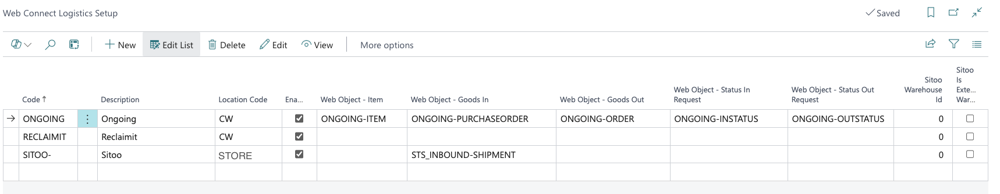
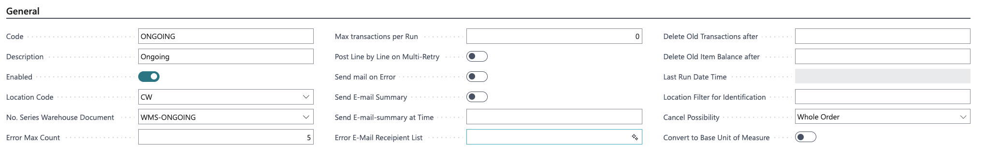
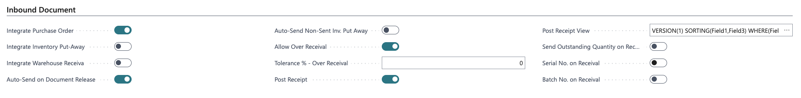
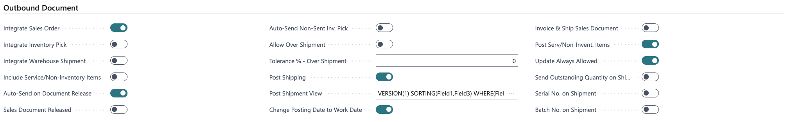
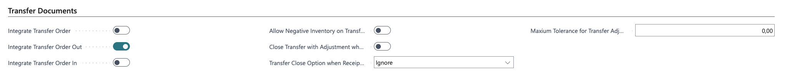
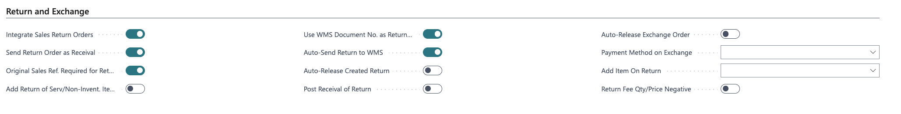
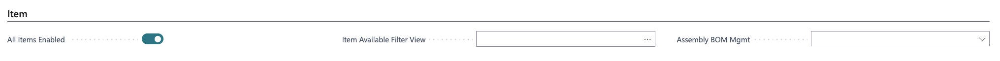
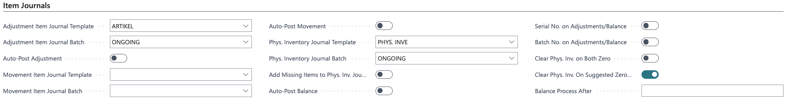
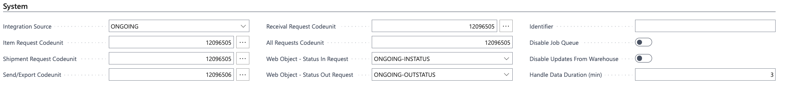

# Web Connect Logistics Setup

_Swedish Business Central view name: Web Connect Logistikinställningar_

Web Connect Logistics Setup defines how Microsoft Business Central communicates with external logistics systems such as Warehouse Management Systems, Point-of-Sale systems, and Return & Exchange platforms.\
It builds on the foundation created in **Web Connect Integrations** and the structure defined in **Web Connect Objects**.

_As always: we recommend modifying object structure through [Web Connect Incoming Data](incoming-data/README.md) or [Web Connect Outgoing Data](outgoing-mapping/outgoing-data-web.md) not manually on the object tree._

### General Object setup

Defines the base settings and behaviour for how this logistics integration interacts with Microsoft Business Central.

Field| Description
---|---
**Code**| Unique identifier for the logistics integration (e.g. “ONGOING”, “SITOO”, “RETURN”).
**Description**| A readable description of the connected system.
**Enabled**| Toggles whether the integration is active. Only enabled setups participate in Web Connect processing.
**Location Code**| The Microsoft Business Central warehouse/location this integration manages.
**Web Object – item**| Which web object should be used in item documents
**Web Object – Goods In**| Which web object should be used in goods receival processes.
Web Object – Goods Out| Which web object should be used in in goods out processes.
Web Object – Status in request| Which web object should be used to check status change on goods receival orders.
Web Object – Status out request| Which web object should be used to check status change on goods out orders.

### General Card Setup

Defines the foundational behaviour for how this logistics integration interacts with Microsoft Business Central. These settings apply across all inbound, outbound, transfer, and return flows.

 Field| Description| Common for
---|---|---
**Code**| Unique identifier for the logistics integration (e.g. “ONGOING”, “SITOO”, “RETURN”).| All logistics integrations
**Description**| A readable description of the connected system.| All logistics integrations
**Enabled**| Toggles whether the integration is active. Only enabled setups participate in Web Connect processing.| All logistics integrations
**Location Code**| The Microsoft Business Central warehouse/location this integration manages.| All logistics integrations
**No. Series Warehouse Document**| Optional number series used when Web Connect creates warehouse documents.| Integrations where Microsoft Business Central handles posting
**Error Max Count**| Maximum number of retry attempts before marking the entry as failed (typically 3–5).| All logistics integrations
**Max Transactions per Run**| Limits how many documents are processed per job-queue execution.| Optional / high-volume environments
**Post Line by Line on Multi-Retry**| After 3 failed attempts, Web Connect posts each line individually. Useful for partial shipments/receivals.| Optional
**Send Email on Error**| Sends an email immediately for every failed transaction.| Recommended
**Send Email Summary**| Sends a summary email with grouped errors.| Recommended
**Send Email Summary at Time**| Time of day when summary email is sent.| Recommended
**Error Email Recipient List**| Comma-separated email addresses receiving error notifications.| Recommended
**Delete Old Transactions After**| Date formula (e.g. `-3M`) for clearing historical logistics entries.| Recommended on high-volume environments
**Delete Old Item Balance After**| Date formula for clearing Item Balance posts (does not delete physical inventory journals).| Optional
**Last Run Date Time**| Timestamp of the last successful job-queue run.| All logistics integrations
**Location Filter for Identification**| Optional filter to identify warehouse-specific documents.| Optional
**Cancel Possibility**| Defines if the external system may cancel orders: No Cancel / Whole Order / Line Level.| Recommended
**Convert to Base Unit of Measure**| Converts all quantities to Base Unit of Measure before sending to the external system.| Optional

### Inbound Document

Defines how Microsoft Business Central receives inbound logistics data such as purchase orders, warehouse receipts, and put-aways from connected systems. These settings control how Web Connect interprets, validates, and posts incoming warehouse-related information.

 Field| Description| Common for
---|---|---
**Integrate Purchase Order**| Enables inbound integration for Purchase Orders created or updated by the external system.| All integrations where Purchase Orders are handled (WMS and POS with store receiving)
**Integrate Inventory Put-Away**| Allows external systems to send Inventory Put-Away documents for processing in Business Central.| Optional
**Integrate Warehouse Receival**| Enables Warehouse Receipt documents to be integrated and posted.| Optional
**Auto-Send on Document Release**| When a document is released in Business Central, it is automatically sent to the external system.| Optional
**Auto-Send Non-Sent Inventory Put-Away**| Job queue automatically sends unsent Put-Away documents.| Optional
**Allow Over Receival**| Permits receiving more quantity than ordered.| Optional
**Tolerance % – Over Receival**| Percentage limit for allowable over-receivals.| Required for “**Allow Over Receival** ” to work
**Post Receipt**| Automatically posts the receipt when received from the external system.| Recommended for all system that handles inbound transactions
**Post Receipt View**| Business Central filter defining which warehouse receipts should be posted (commonly based on external status).| Required for “Post Receipt ” to work
**Send Outstanding Quantity on Receival**| Sends outstanding quantity instead of ordered quantity to the external system.| Optional
**Serial No. on Receival**| Requires serial numbers for inbound operations.| Optional when handling serialized inventory
**Batch No. on Receival**| Requires batch numbers for inbound operations.| Optional when handling batch-tracked inventory

### Outbound Document

Controls how sales orders, picks, and outbound shipments flow from Microsoft Business Central to external systems such as WMS or POS. Determines how data is transmitted, validated, and posted.

 Field| Description| Common for
---|---|---
**Integrate Sales Order**| Sends Sales Orders to the external logistics system.| All integrations where Sales Orders are handled (mainly WMS)
**Integrate Inventory Pick**| Enables external integration for Inventory Pick documents.| Optional
**Integrate Warehouse Shipment**| Enables Warehouse Shipment documents to be sent to the external system.| Optional
**Include Service/Non-Inventory Items**| Determines whether non-inventory lines (e.g., freight) should be included.| Optional
**Auto-Send on Document Release**| Sales Orders are automatically sent when released.| Optional
**Sales Document Released**| Controls if the document must be released before it can be manually sent.| Recommended for all integrations where Sales Orders are handled (Mainly WMS)
**Auto-Send Non-Sent Inventory Pick**| Automatically sends unsent Inventory Picks via job queue.| Optional
**Allow Over Shipment**| Allows shipping more quantity than ordered.| Optional
**Tolerance % – Over Shipment**| Maximum allowed overshipment percentage.| Required for “**Allow Over Shipment** ” to work
**Post Shipping**| Automatically posts shipment documents.| Recommended for all system that handles outbound transactions
**Post Shipment View**| Business Central filter used to determine which shipments should be posted (commonly based on external status).| Required for “Post Shipping ” to work
**Change Posting Date to Work Date**| Changes posting date to the job-queue execution date.| Recommended
**Invoice & Ship Sales Document**| Invoices and ships the document in a single operation.| Optional
**Post Serv./Non-Invent. Items**| Ensures non-inventory lines are posted when shipping.| Optional
**Update Always Allowed**| Allows updates even after partial shipment.| Optional
**Send Outstanding Quantity on Shipment**| Sends outstanding quantity instead of full ordered quantity.| Optional
**Serial No. on Shipment**| Requires serial numbers on shipments.| Optional when handling serialized inventory
**Batch No. on Shipment**| Requires batch numbers on shipments.| Optional when handling batch-tracked inventory

### Transfer Documents

Defines how Transfer Orders move between Microsoft Business Central and external logistics systems. Controls both outbound (transfer-out) and inbound (transfer-in) flows.

 Field| Description| Common for
---|---|---
**Integrate Transfer Order**| Enables Transfer Orders as part of the logistics integration.| Required for “Transfer order in and/orout ” to work
**Integrate Transfer Order Out**| Sends outbound Transfer Orders to the external system.| Required for if external system should handle transfer order out, normally “delivery order out in” in WMS or POS
**Integrate Transfer Order In**| Enables inbound transfer receipts from external systems.| Required for if external system should handle transfer order in, normally “delivery order out in” in WMS or POS
**Allow Negative Inventory on Transfer**| Allows posting negative inventory (must also be enabled in Inventory Setup).| Optional
**Close Transfer with Adjustment when Receipt Qty < Shipped Qty**| Auto-closes the transfer and adjusts remaining quantity.| Optional
**Transfer Close Option when Receipt Qty > Shipped Qty**| Defines behaviour when receiving more than shipped: Ignore / Raise Shipped Qty / Adjust Receipt Qty.| Optional
**Maximum Tolerance for Transfer Adjustments**| Maximum allowed automatic adjustment; 0 = no limit.|

### Return and Exchange

Used primarily by Return & Exchange systems. Controls how return orders flow into Microsoft Business Central and how exchanges are handled.

 Field| Description| Common for
---|---|---
**Integrate Sales Return Orders**| Enables inbound return orders from external systems.| Required for external system that should handle sales return orders
**Send Return Order as Receival**| Sends return orders to WMS as receivals.| Optional
**Original Sales Ref. Required for Return Order**| Requires reference to original sales document.| Optional
**Add Return of Serv./Non-Invent. Items**| Includes service or non-inventory return lines.| Optional
**Use WMS Document No. as Return Order No.**| Uses external ID instead of BC numbering.| Optional
**Auto-Send Return to WMS**| Automatically sends return orders to WMS when created.| Optional
**Auto-Release Created Return**| Automatically releases return orders.| Optional
**Post Receival of Return**| Automatically posts return receivals.| Recommended for external system that should handle sales return orders
**Payment Method on Exchange**| Determines payment method when creating exchange orders.| Optional
**Add Item On Return**| Adds a predefined service item (e.g. “Not Picked”).| Optional
**Return Fee Qty/Price Negative**| Determines whether qty or unit price is negative.| Optional

### Item

Controls which items are synchronized with the external system and how item structures are handled.

 Field| Description| Common for
---|---|---
**All Items Enabled**| Sends all items unless filtered.| Required for external system that receives items from Business Central and have item transactions
**Item Available Filter View**| Business Central filter that limits which items are synchronized.| Optional
**Assembly BOM Management**| Controls if BOM/assembly structures are included.| Optional

### Item Journals

Defines how external systems update Microsoft Business Central with adjustments, movements, and physical inventory.

 Field| Description| Common for
---|---|---
**Adjustment Item Journal Template**| Template used for adjustment journals.| Required for external system that reports stock adjustments
**Adjustment Item Journal Batch**| Batch used for adjustment journals.| Required for external system that reports stock adjustments
**Auto-Post Adjustment**| Automatically posts adjustment journals.| Optional
**Movement Item Journal Template / Batch**| Template and batch for movement journals.| Optional
**Auto-Post Movement**| Automatically posts movement journals.| Optional
**Physical Inventory Journal Template / Batch**| Template used when external system submits inventory counts.| Required for external system that reports stock counts.
**Physical Inventory Journal Batch**| Batch used when external system submits inventory counts.| Required for external system that reports stock counts.
**Add Missing Items to Physical Inventory Journal**| Adds all items to PI journal, even if not included in external payload.| Optional
**Auto-Post Balance**| Automatically posts PI journals.| Optional
**Serial No. on Adjustments/Balance**| Requires serial numbers.| Optional when handling serialized inventory
**Batch No. on Adjustments/Balance**| Requires batch numbers.| Optional when handling batch-tracked inventory
**Clear Phys. Inv. on Both Zero**| Deletes PI lines with zero counted & zero difference.| Optional
**Clear Phys. Inv. On Suggested Zero Change**| Removes PI lines where no adjustment is needed.| Optional
**Balance Process After**| Earliest time of day allowed for processing PI entries.| Optional

### System

Defines the Web Connect technical link between Microsoft Business Central and the external integration source.

 Field| Description| Common for
---|---|---
**Integration Source**| The Web Connect Integration Source connected to this logistics setup.| Required for all external systems
**Item Request Codeunit**| Codeunit used when Business Central sends item data.| Required for external system that receives items from Business Central and have item transactions
**Shipment Request Codeunit**| Codeunit for outbound shipment requests.| All integrations where Sales Orders are handled (mainly WMS)
**Send/Export Codeunit**| Codeunit used when sending data to the external system.| All
**Receival Request Codeunit**| Codeunit used for inbound receivals.| All integrations where receivals are handled (WMS and POS with store receiving)
**All Requests Codeunit**| Handles bulk operations for all logistics messages.| All
**Web Object – Status In Request**| Defines which Web Object retrieves inbound status.| Required if “**Receival Request Codeunit** ” is used
**Web Object – Status Out Request**| Defines which Web Object retrieves outbound status.| Required if “S** hipment Request Codeunit**” is used
**Identifier**| The identifier/name used in all messages sent to the external system.| Optional
**Disable Job Queue**| Disables all job queue processing for this integration.| Sensitive
**Disable Updates from Warehouse**| Blocks WMS-to-Business Central updates.| Sensitive
**Handle Data Duration (min)**| Delay before processing entries (typically 3–5 min).|

#### Related Web Connect Modules

This setup interacts with:

- [Web Connect Outgoing Data](outgoing-mapping/outgoing-data-web.md)
- [Web Connect WMS Documents](wms-documents.md)
