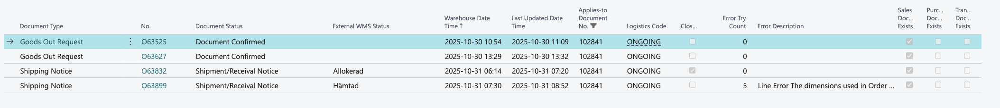
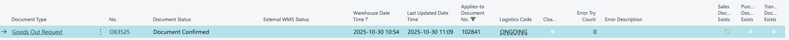

# Web Connect WMS Documents

> **BC view name:** Web Connect WMS-dokument

## Overview

WMS documents are the log of everything Business Central exchanges with a warehouse, a point of sale system or a returns system. Every message about stock, in either direction, becomes a WMS document: an order sent to the warehouse, a shipping notice that comes back, a stock count, a return.

The WMS document says what kind of message it is, which [logistics setup](logistics-setup.md) it belongs to, which Business Central document it applies to, and the status and date the external system reported. Shipments, receipts and journals are posted from the WMS document, following the logistics setup.

You find the WMS documents by searching for Web Connect WMS-dokument, or through the WMS status on an order. Filter on documents that need attention to see the ones with errors.

WMS documents do not decide what is created in Business Central. That is decided by:

- [Web Connect Logistics Setup](logistics-setup.md): which documents are sent, which objects build the messages, and what is posted.
- [Web Connect Incoming Data](incoming-data/README.md): how a message from the system becomes a WMS document.
- [Web Connect Outgoing Data](outgoing-mapping/outgoing-data-web.md): how a WMS document becomes a message to the system.

## Document types

| Document Type | Description | Business Central documents |
|---|---|---|
| **Item Data** | Item data sent to the system | Items and variants |
| **Goods Out Request** | An order to pick and ship | Sales order, outgoing transfer order, inventory pick |
| **Goods In Request** | An expected receipt | Purchase order, incoming transfer order, return order |
| **Shipping Notice** | The system has shipped the goods | Posted sales shipment, transfer shipment |
| **Receipt Notice** | The system has received the goods | Posted purchase receipt, return receipt, transfer receipt |
| **Return Order** | A customer return reported by the system | Sales return order |
| **Item Adjustment** | A stock adjustment made in the system | Item journal |
| **Item Balance** | A stock count from the system | Physical inventory journal |
| **Item Movement** | A movement made in the system | Item journal for movements |
| **Customer** | Customer data to or from the system | Customers |
| **Exchange Order** | An exchange | Exchange order |
| **Assembly Order** | An assembly in the system | Assembly order |
| **Status In Request** | A request for the status of an expected receipt | Purchase order, incoming transfer order, return order |
| **Status Out Request** | A request for the status of an order to ship | Sales order, outgoing transfer order |

## Messages from the system

1. A message arrives from the system, through a [webhook](webhooks.md) or because Web Connect fetched it, and becomes [incoming data](incoming-data/README.md).
2. The mapping creates a WMS document with document type, logistics code, the Business Central document it applies to, and the status and date from the system.
3. The WMS document posts the shipment or receipt, or writes the journal, when the [logistics setup](logistics-setup.md) says so.
4. You can follow the order in the WMS status on the Business Central document.

When something fails, the error is shown in **Error Description** on the WMS document. The document is processed again up to **Error Max Count** in the logistics setup. Correct the cause, and the document is processed on the next run.

## Messages to the system

1. A Business Central document is released, or sent by hand with Send to Warehouse.
2. A WMS document is created with the type of message, for example Goods Out Request. The document mapping fills in values from the Business Central document.
3. [Outgoing data](outgoing-mapping/outgoing-data-web.md) builds the message in the format of the system and sends it.
4. When the system reports a new status, for example picked or shipped, the incoming message updates the WMS document.

## Document mapping

The document mapping copies values between the Business Central document and the WMS document, for values that the standard does not carry. There is one line per value.

- For messages to the system, such as **Goods Out Request** and **Goods In Request**, the value is copied from the Business Central document to the WMS document before the message is built. For example the shipping agent service on the sales order, so that it can be sent as way of delivery.
- For messages from the system, such as **Shipping Notice** and **Return Order**, the value is copied from the WMS document to the Business Central document. For example the tracking number from the shipping notice to **Package Tracking No.** on the sales order.

| Field | Description |
|-------|-------------|
| **Document Type** | The type of WMS document the line is used for, for example `Goods Out Request` or `Shipping Notice`. |
| **Header / Line** | Whether the line is used on the header or the lines of the document. |
| **Entry No.** | The number of the line. |
| **Logistics Code** | Limits the line to one [logistics setup](logistics-setup.md), for example a returns system. |
| **Table No.** | The Business Central table, for example `36` sales header, `37` sales line, `38` purchase header or `5740` transfer header. |
| **Field No.** | The field in the Business Central table. |
| **Field No. WMS Table** | The field on the WMS document that the value is copied to or from. The WMS document has free text fields for values that have no field of their own. |
| **Map Value Code** | Translates the value with a [text mapping](text-mapping.md) on the way, for example to send a fixed currency code. |
| **Validation Order** | The order in which the values are written. |
| **Ignore if Blank** | An empty value does not overwrite the value that is already there. |

## Configure it yourself in Business Central

| What you can change | Where | Example |
|---|---|---|
| Find documents with errors | The WMS documents, filtered on documents that need attention | See all returns that could not be created |
| Process a document again | The WMS document, after correcting the cause | Post a shipment again after unblocking an item |
| Send a value from the order to the system | Document mapping with **Document Type** `Goods Out Request` | Send the shipping agent service as way of delivery |
| Save a value from the system on the order | Document mapping with **Document Type** `Shipping Notice` | Save the tracking number on the sales order |
| Who is told about errors | **Send E-mail Summary** in the [logistics setup](logistics-setup.md) | A daily e-mail to customer service |

## Related

- [Web Connect Logistics Setup](logistics-setup.md)
- [Web Connect WMS/Return Reason Codes](wms-return-reason-codes.md)
- [Web Connect Incoming Data](incoming-data/README.md)
- [Web Connect Outgoing Data](outgoing-mapping/outgoing-data-web.md)
- [Web Connect Webhooks](webhooks.md)
