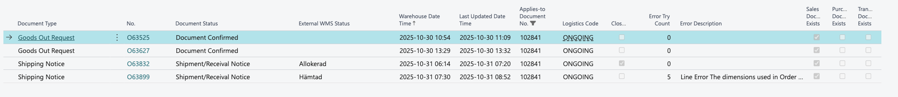
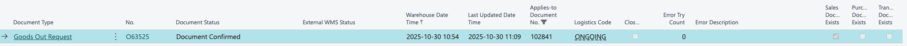

# Web Connect WMS Documents

_Swedish Business Central view name:**Web Connect WMS-dokument**_

## Overview

Web Connect WMS Documents is the central **logging and tracking layer** for all communication between Microsoft Business Central and external logistics systems such as WMS, POS or Returns Management platforms when there is an logistics-related transaction.

Whenever a logistics-related message is **sent from Business Central** ([Web Connect Outgoing Data](outgoing-mapping/outgoing-data-web.md)) or **received from an external system** ([Web Connect Incoming data](incoming-data/README.md)), a _WMS Document entry_ is created.\
These entries allow users to:

- Track all warehouse-related communication
- See the operational history of a Purchase Order, Sales Order, Transfer Order, Exchange Order, Return Order, etc.
- Group and classify different document types using Web Connect Logistics Setup
- Monitor status changes such as picked, packed, shipped, received, adjusted, etc.

**Important:**\
WMS Documents do **not** decide how an operation is processed.\
They act as the _audit log + status tracker + grouping engine_.\
The actual logic for _what is created_ in Business Central is governed by:

- **[Web Connect Incoming Data Web](incoming-data/README.md)** (for inbound messages)
- [Web Connect Outgoing Data](outgoing-mapping/outgoing-data-web.md) (for outbound messages)
- **[Web Connect Logistics Setup](logistics-setup.md)** (for which Web Objects are used for each document type and general settings)

### Document Type Classification

Each WMS document is tagged with a **Document Type** that describes what kind of operation the entry represents.\
This enables Business Central to show a clean timeline of events and helps integrations understand the flow.

Below is a corrected and complete list of all available types.

#### WMS Document Types Overview

Document Type| Description| Examples in Business Central
---|---|---
**Item Data**| Sync of item information to external system| Items, variants, attributes
**Goods Out Request**| Request to pick/ship goods from warehouse| Sales Order, Transfer Order, Exchange Order
**Goods In Request**| Request to receive goods into warehouse| Purchase Order, Transfer Order, Return Order, Purchase Return Order
**Shipping Notice**| External system notifies Business Central that goods have been shipped| Posted Sales Shipment, Transfer Shipment
**Receipt Notice**| External system notifies Business Central that goods have been received| Posted Purchase Receipt, Posted Return Receipt, Transfer Receipt
**Return Order**| External system requests or confirms return| Return Orders
**Item Adjustment**| External adjustment of stock levels done in external system| Item Journal Adjustments (Movement/Adjustment)
**Item Balance**| External inventory snapshots in external system| Item Balance entries
**Item Movement**| External movement in external system| Movement Journals
**Customer**| Customer-related update from or to external system| Customer master data
**Exchange Order**| Exchange flow data| Exchange orders
**Assembly Order**| External assembly/kit processes| Assembly Orders
**Status In Request**| Status check for inbound logistics| Status on Purchase Order, Transfer Order, Return Order, Purchase Return Order
**Status Out Request**| Status check for outbound logistics| Status on Purchase Order, Transfer Order, Return Order, Purchase Return Order

* * *

### How WMS Documents Are Used in the Integration

#### Incoming Messages (from WMS/POS/Returns)

Flow:

  1. Message arrives via **[Web Connect Incoming Data Web](incoming-data/README.md)**
  2. Mapping logic determines _what type of Business Central document should be updated or created_
  3. A **WMS Document** is created to log:
     * Document type
     * External WMS status
     * Warehouse date/time
     * Applies-to Document No.
     * Logistics Code (integration source)
  4. **WMS Document** then creates the inventory transaction in Business Central (Sales Shipment, Transfer Shipment, Purchase Receipt, Return Receipt, Transfer Receipt)
  5. User can follow the full logistics trail in the WMS status factbox on the underlying Business Central document.

_As image shown error message will be displayed in “error description”._

* * *

### Outgoing Messages (from Business Central)

Flow:

  1. A Business Central document (order, transfer order, return, exchange) is released or manually triggered
  2. A **WMS Document** entry is created to record and show which type of message should be sent.
  3. Web Connect Outgoing Data generates a message and transforms it to external system standard
  4. When the external system updates status (picked, packed, shipped) the matching incoming message updates the WMS Document log

### Related docs:

Related: [Web Connect Outgoing Data](outgoing-mapping/outgoing-data-web.md)
