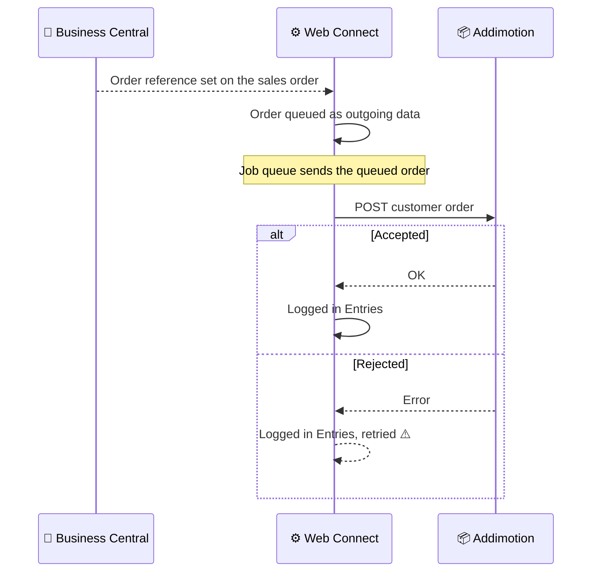

# Business Central to Addimotion: sales orders

When the external order number or the order source changes on a sales order, Web Connect queues the order and the Business Central job queue sends it to Addimotion as a customer order. The order carries the recipient, the payer with the payment, an order event and the item lines with quantities, prices, discounts and VAT.

| | |
|---|---|
| **Direction** | Business Central → Addimotion |
| **Trigger** | Change in Business Central: the external order number or the order source on the sales order header |
| **Result** | A customer order in Addimotion, and a logged message in Web Connect Entries |
| **Part of** | [Business Central and Addimotion integration](../overview.md) |

## Step by step

1. The external order number or the order source is set or changed on a sales order (Business Central).
2. Web Connect queues the order as outgoing data (Web Connect).
3. The job queue builds the customer order with lines, recipient, payer, payment and event, and sends it with the API key in the request header (Web Connect).
4. Addimotion creates the customer order (Addimotion).

## Data mapping

| Business Central field | Addimotion field | Note |
|---|---|---|
| | `postedBy`, `view` | Fixed values in the mapping |
| No. | `customerOrderNo` | |
| Order Date | `orderDate` | |
| Ship-to Post Code, Ship-to Country/Region Code | `zipCode`, `countryKey` | |
| | `warehouseKey`, `departureKey` | Fixed values in the mapping |
| Sell-to Customer No., Sell-to E-Mail, Ship-to Phone No. | `recipient`: `identifier`, `eMail`, `mobile` | |
| Ship-to Name, Ship-to Address, Ship-to Address 2, Ship-to Post Code, Ship-to City, Ship-to Country/Region Code | `recipient`: `firstName`, `address1`, `address2`, `zipCode`, `city`, `countryKey` | The whole name is sent in `firstName` |
| | `recipient`: `languageKey` | Fixed value in the mapping |
| Bill-to Customer No., Sell-to E-Mail, Sell-to Phone No. | `payer`: `identifier`, `eMail`, `mobile` | |
| Bill-to Name, Bill-to Address, Bill-to Address 2, Bill-to Post Code, Bill-to City, Bill-to Country/Region Code | `payer`: `firstName`, `address1`, `address2`, `zipCode`, `city`, `countryKey` | The whole name is sent in `firstName` |
| Payment Method Code, Amount Including VAT, Currency Code | `payer.payment`: `methodKey`, `amount`, `currency` | A blank currency code is translated to the local currency |
| Created date and time of the order | `events`: `dateTime` | The event `code` and the `location` are fixed values in the mapping |
| Line No., No. | `orderLines`: `lineNumber`, `articleNo` | Only lines of type item |
| Description, Description 2 | `orderLines`: `name`, `description` | `name` at most 50 characters |
| Quantity, Unit of Measure | `orderLines`: `orderedQuantity`, `unit` | |
| Unit Price, Line Discount Amount, Amount Including VAT | `orderLines`: `price`, `discount`, `totalPrice` | |
| Amount Including VAT minus Amount | `orderLines`: `tax` | Calculated with a dynamic flow field |
| Currency Code | `orderLines`: `currency` | A blank currency code is translated to the local currency |
| | `orderLines`: `plannedDispatchDate` | Fixed value in the mapping, not taken from the order |

## Web Connect objects

| Object | Role |
|---|---|
| `AIM_ORDER` | Sends the customer order to Addimotion, started by the sync trigger on the sales order |
| `AIM_HEADER` | Request header with the Addimotion API key |
| `AIM_ORDERLINES` | Order lines, from the sales lines of type item |
| `AIM_RECIPIENT` | Recipient with the ship-to address |
| `AIM_PAYER`, `AIM_PAYMENT` | Payer with the bill-to address, and the payment |
| `AIM_EVENTS`, `AIM_LOCATION` | Order event with time and location |

When the same order goes to more than one Addimotion setup, each setup has its own order object and header object with its own API key, and shares the child objects above.

## Error handling

| Situation | What happens | What to do |
|---|---|---|
| Addimotion rejects the order | Retried up to the maximum error count, then included in the daily error email | Read the error in [Entries](../../../general/entries.md), fix the order and [resend the message](../../../../../how-to/web-connect/resend-outgoing-message.md) |
| The API key is wrong or has expired | Addimotion rejects every order | Create a new API key in Addimotion, update the request header and resend the failed messages |
| Orders are not sent at all | The outgoing data stays in the queue | See [Integrations not running](../../../../../how-to/web-connect/integration-not-running.md) |

## Frequently asked questions

### Which sales order lines are sent to Addimotion?

Only lines of type item. Lines for shipping fees, resources or G/L accounts are left out by the relation between the order header and its lines, which you can change in Web Connect.

## Related

- [Business Central and Addimotion integration](../overview.md)
- [Outgoing Mapping](../../../general/outgoing-mapping/README.md) · [Outgoing Sync Triggers](../../../general/outgoing-mapping/outgoing-sync-triggers.md) · [Text Mapping](../../../general/text-mapping.md) · [Dynamic Flow Fields](../../../general/dynamic-flow-fields.md)
