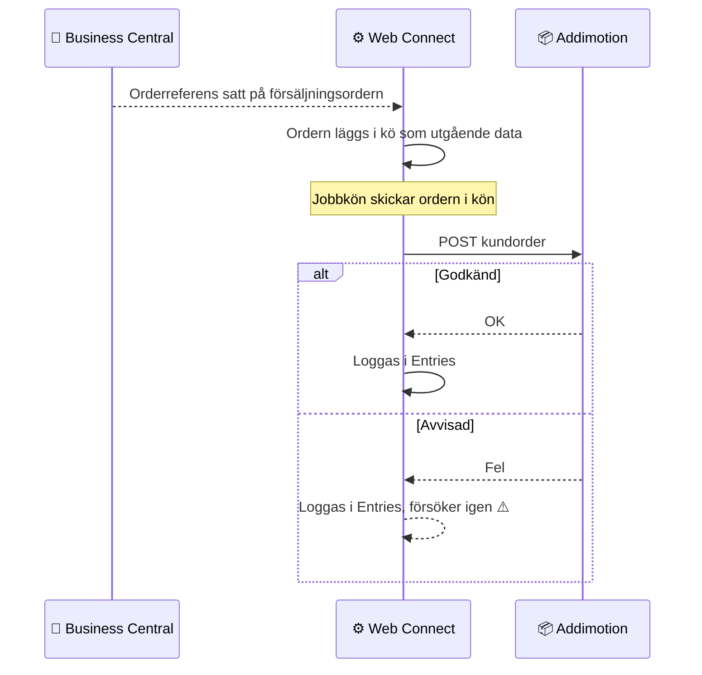

# Från Business Central till Addimotion: försäljningsorder

När det externa ordernumret eller orderkällan ändras på en försäljningsorder lägger Web Connect ordern i kö, och jobbkön i Business Central skickar den till Addimotion som en kundorder. Ordern innehåller mottagaren, betalaren med betalningen, en orderhändelse och artikelraderna med antal, priser, rabatter och moms.

| | |
|---|---|
| **Riktning** | Business Central → Addimotion |
| **Startas av** | En ändring i Business Central: det externa ordernumret eller orderkällan i försäljningsorderns huvud |
| **Resultat** | En kundorder i vyn Warehouse Operations i OurBoxes, och ett loggat meddelande i Web Connect Entries |
| **Del av** | [Business Central och Addimotion: integration](../overview.md) |

## Steg för steg

1. Det externa ordernumret eller orderkällan sätts eller ändras på en försäljningsorder (Business Central).
2. Web Connect lägger ordern i kö som utgående data (Web Connect).
3. Jobbkön bygger kundordern med rader, mottagare, betalare, betalning och händelse, och skickar den med API-nyckeln i anropets header (Web Connect).
4. Addimotion skapar kundordern, eller uppdaterar den om det redan finns en order med samma nummer (Addimotion).

## Mappning av data

| Fält i Business Central | Fält i Addimotion | Kommentar |
|---|---|---|
| | `postedBy` | Fast text i mappningen som anger var datan kommer ifrån |
| | `view` | Fast värde i mappningen: 2000 för Warehouse Operations eller 3000 för Outbound Shipments |
| No. | `customerOrderNo` | |
| Order Date | `orderDate` | |
| Ship-to Post Code, Ship-to Country/Region Code | `zipCode`, `countryKey` | |
| | `warehouseKey`, `departureKey` | Fasta värden i mappningen, som motsvarar nycklarna som är uppsatta i OurBoxes |
| Sell-to Customer No., Sell-to E-Mail, Ship-to Phone No. | `recipient`: `identifier`, `eMail`, `mobile` | |
| Ship-to Name, Ship-to Address, Ship-to Address 2, Ship-to Post Code, Ship-to City, Ship-to Country/Region Code | `recipient`: `firstName`, `address1`, `address2`, `zipCode`, `city`, `countryKey` | Hela namnet skickas i `firstName` |
| | `recipient`: `languageKey` | Fast värde i mappningen |
| Bill-to Customer No., Sell-to E-Mail, Sell-to Phone No. | `payer`: `identifier`, `eMail`, `mobile` | |
| Bill-to Name, Bill-to Address, Bill-to Address 2, Bill-to Post Code, Bill-to City, Bill-to Country/Region Code | `payer`: `firstName`, `address1`, `address2`, `zipCode`, `city`, `countryKey` | Hela namnet skickas i `firstName` |
| Payment Method Code, Amount Including VAT, Currency Code | `payer.payment`: `methodKey`, `amount`, `currency` | En tom valutakod översätts till den lokala valutan |
| Datum och tid när ordern skapades | `events`: `dateTime` | Händelsens `code`, från bilagan till AddBoxes API, och `location` är fasta värden i mappningen |
| Line No., No. | `orderLines`: `lineNumber`, `articleNo` | Bara rader av typen artikel |
| Description, Description 2 | `orderLines`: `name`, `description` | `name` högst 50 tecken |
| Quantity, Unit of Measure | `orderLines`: `orderedQuantity`, `unit` | |
| Unit Price, Line Discount Amount, Amount Including VAT | `orderLines`: `price`, `discount`, `totalPrice` | |
| Amount Including VAT minus Amount | `orderLines`: `tax` | Beräknas med ett dynamiskt flödesfält |
| Currency Code | `orderLines`: `currency` | En tom valutakod översätts till den lokala valutan |
| | `orderLines`: `plannedDispatchDate` | Fast värde i mappningen, hämtas inte från ordern |

## Objekt i Web Connect

| Objekt | Roll |
|---|---|
| `AIM_ORDER` | Skickar kundordern till Addimotion, startas av synktriggern på försäljningsordern |
| `AIM_HEADER` | Anropets header med API-nyckeln till Addimotion |
| `AIM_ORDERLINES` | Orderrader, från försäljningsraderna av typen artikel |
| `AIM_RECIPIENT` | Mottagare med leveransadressen |
| `AIM_PAYER`, `AIM_PAYMENT` | Betalare med fakturaadressen, och betalningen |
| `AIM_EVENTS`, `AIM_LOCATION` | Orderhändelse med tid och plats |

När samma order går till mer än ett Addimotion-upplägg har varje upplägg ett eget orderobjekt och headerobjekt med sin egen API-nyckel, och delar på underobjekten ovan.

## Felhantering

| Situation | Vad som händer | Gör så här |
|---|---|---|
| Addimotion avvisar ordern | Web Connect försöker igen upp till maxantalet fel, och sedan kommer ordern med i det dagliga felmejlet | Läs felet i [Entries](../../../general/entries.md), rätta ordern och [skicka meddelandet igen](../../../../../how-to/web-connect/resend-outgoing-message.md) |
| API-nyckeln är fel eller har gått ut | Addimotion avvisar varje order | Hämta API-användarens API-nyckel i inställningarna i OurBoxes, uppdatera anropets header och skicka de misslyckade meddelandena igen |
| Order skickas inte alls | Den utgående datan ligger kvar i kön | Se [Integrationer körs inte](../../../../../how-to/web-connect/integration-not-running.md) |

## Vanliga frågor

### Vilka rader på försäljningsordern skickas till Addimotion?

Bara rader av typen artikel. Rader för fraktavgifter, resurser eller redovisningskonton sorteras bort av relationen mellan orderhuvudet och raderna, som du kan ändra i Web Connect.

## Relaterat

- [Business Central och Addimotion: integration](../overview.md)
- [Outgoing Mapping](../../../general/outgoing-mapping/README.md) · [Outgoing Sync Triggers](../../../general/outgoing-mapping/outgoing-sync-triggers.md) · [Text Mapping](../../../general/text-mapping.md) · [Dynamic Flow Fields](../../../general/dynamic-flow-fields.md)
