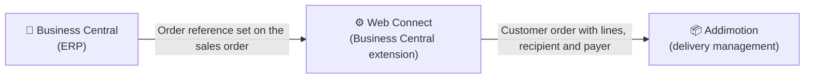
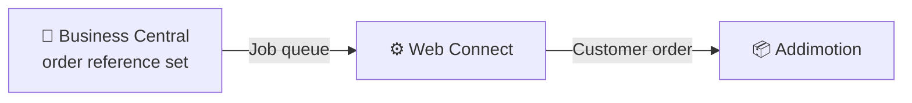

# Business Central and Addimotion integration

Web Connect by CombineIT connects Microsoft Dynamics 365 Business Central with Addimotion, the delivery management platform. When a sales order gets its order reference in Business Central, Web Connect sends it to Addimotion with the recipient, the payer, the payment and the order lines. All mappings and rules live in your own Business Central, where you can see and change them yourself.

## At a glance

| | |
|---|---|
| **System** | Addimotion (delivery management) |
| **Integration product** | Web Connect for Microsoft Dynamics 365 Business Central |
| **Runs in** | Your own Business Central environment, as an extension. An order is queued when its trigger fields change in Business Central, and the Business Central job queue sends it to Addimotion. Nothing is fetched from Addimotion, and there are no webhooks. All processing and configuration stays in Business Central. |
| **Configured by** | You, in Business Central: mappings, conditions, triggers and flows. You can do all of it yourself. If you want, CombineIT takes part in any step, as a sounding board or by doing the work. |
| **Connection** | REST API with JSON. An API key from Addimotion is sent in a request header |
| **Addimotion API** | [ATT FYLLA I: name of and link to the Addimotion API documentation, if it is public] |
| **Data flows** | 1: sales orders |
| **Business Central editions** | All editions, Essentials and Premium, including the latest version |
| **Available from** | [Web Connect on Microsoft AppSource](https://marketplace.microsoft.com/sv-se/product/PUBID.martitab1633951001710%7CAID.webconnect%7CPAPPID.9f3a7223-19db-4ac7-832f-cf8e4699186f?tab=Overview). [ATT FYLLA I: whether Addimotion is part of the Web Connect Ready Integrations app or set up as a configuration in Web Connect] |

## What can be synchronized

Web Connect has one data flow between Business Central and Addimotion.

| Data | Direction | What happens |
|---|---|---|
| [Sales orders](flows/order-outbound.md) | Business Central → Addimotion | The sales order is sent to Addimotion as a customer order, with recipient, payer, payment, an order event and the item lines |

The sales order flow is the whole integration. See [Choose your setup](#choose-your-setup).

## How it works

Web Connect watches two fields on the sales order header: the external order number and the order source. When one of them changes, Web Connect queues the order, and the job queue sends it to the Addimotion customer order endpoint. [ATT FYLLA I: what Addimotion does with the order, for example delivery tracking and notifications to the recipient.] Every message is logged in Web Connect [Entries](../../general/entries.md), where it can be inspected and resent.

## Choose your setup

Each flow has to fit how your business works: which system owns the data, where people do their work, and what the accounting needs. That is why the flows are decided together when a new integration is set up. The options below are the ones Web Connect customers use today. **Common setup** marks the option most Web Connect customers with Addimotion use. **Recommended** marks CombineIT's best practice, where there is one.

Only one Web Connect customer runs Addimotion today, so no option is marked as common setup. The area below shows how that integration is set up.

### Sales orders

| Option | How it works | When it fits |
|---|---|---|
| **Sent when the order reference changes** | When the external order number or the order source on the sales order changes, the job queue sends the order to Addimotion. The same order can be sent to more than one Addimotion setup, each with its own API key | Orders come into Business Central from an e-commerce platform through Web Connect, and Addimotion should get every order |

#### Sales orders sent when the order reference changes

[ATT FYLLA I: what is always maintained in Addimotion, for example carriers and the communication with the recipient.]

## What you need

- Microsoft Dynamics 365 Business Central, any edition (Essentials or Premium), including the latest version
- Web Connect installed from Microsoft AppSource, with an activated Web Connect license
- Your approval for Web Connect to be installed and to act in your Business Central environment
- An API key, created in Addimotion
- [ATT FYLLA I: the values Addimotion gives you for the order, such as the view, the warehouse and departure keys and the event code]

## Setting it up

1. Decide which flows to use and which option to choose for each, see [Choose your setup](#choose-your-setup).
2. Install Web Connect in Business Central, activate the license and give your approval.
3. Import the Addimotion configuration with the integration turned off.
4. Add the API key from Addimotion to the request header object.
5. Set the fixed values Addimotion expects on the order, and translate a blank currency code to your local currency.
6. Test with a few orders before going live.

## Configure it yourself in Business Central

All configuration and logic in the integration is visible and editable in Business Central. There is no external integration platform where the logic is hidden.

| What you can change | Where in Web Connect | Example |
|---|---|---|
| What is sent to Addimotion | [Outgoing Mapping](../../general/outgoing-mapping/README.md) | Add weight or freight cost to the order lines |
| What triggers an order | [Outgoing Sync Triggers](../../general/outgoing-mapping/outgoing-sync-triggers.md) | Send the order when it is released instead of when the order reference is set |
| Which orders are sent | [Outgoing Sync Triggers](../../general/outgoing-mapping/outgoing-sync-triggers.md) and [Condition List](../../general/condition-list.md) | Only send orders from one sales channel |
| How values are translated | [Text Mapping](../../general/text-mapping.md) | Translate a blank currency code to your local currency |
| Calculated values | [Dynamic Flow Fields](../../general/dynamic-flow-fields.md) | The VAT amount per line, calculated as the amount including VAT minus the amount |
| Monitoring and resending | [Entries](../../general/entries.md) | See every order sent, and [resend a message](../../../../how-to/web-connect/resend-outgoing-message.md) |

## Configuration choices

- **Trigger:** which fields on the sales order start the flow. In the standard setup they are the external order number and the order source.
- **Addimotion setups:** how many Addimotion setups get the order. Each one is its own object in Web Connect with its own API key.
- **Fixed values:** the sender name, view, warehouse and departure keys, event code and location that Addimotion expects on every order.
- **Order currency:** a blank currency code on the order means your local currency, and it is translated with a text mapping.
- **Order lines:** only lines of type item are sent.
- **Error handling:** how many times a failed message is retried, and who receives the daily error summary email.

## Limitations

- **Orders go one way.** Nothing is fetched from Addimotion, and no field in Business Central is updated from it.
- **Only sales orders are sent.** Shipments, invoices, credit memos and returns are not sent to Addimotion.
- **Only item lines are sent.** Lines for shipping fees, resources or G/L accounts are left out.
- **Not every Addimotion field is mapped.** Weight, volume, freight cost, dangerous goods and planned dispatch per line are not taken from the order in the standard setup. They can be added in the mapping.
- **Item names are cut.** The item name on the order line is sent with at most 50 characters.
- [ATT FYLLA I: whether a change to an order that has already been sent updates the order in Addimotion, or whether a cancellation is sent]

## Frequently asked questions

### Can Business Central be integrated with Addimotion?

Yes. Web Connect sends sales orders from Business Central to Addimotion through the Addimotion REST API. Each order carries the recipient, the payer, the payment and the order lines with quantities and prices.

### Does anything come back from Addimotion to Business Central?

No. The integration sends orders from Business Central to Addimotion. Nothing is fetched from Addimotion, and no fields in Business Central are updated from it.

### Can we change what is sent to Addimotion ourselves?

Yes. The fields on the order, the trigger fields and the currency translation are configured in Web Connect inside your own Business Central. You can see and change them without asking a supplier to change an external platform.

## Related

- Flows: [Sales orders](flows/order-outbound.md)
- How-to: [Resend an outgoing message](../../../../how-to/web-connect/resend-outgoing-message.md) · [Integrations not running](../../../../how-to/web-connect/integration-not-running.md)
- Web Connect: [Outgoing Mapping](../../general/outgoing-mapping/README.md) · [Outgoing Sync Triggers](../../general/outgoing-mapping/outgoing-sync-triggers.md) · [Text Mapping](../../general/text-mapping.md) · [Dynamic Flow Fields](../../general/dynamic-flow-fields.md)
- [Web Connect general documentation](../../general/README.md)
- [Addimotion](https://www.addimotion.com/)

## About Web Connect

Web Connect is an integration platform for Microsoft Dynamics 365 Business Central, developed by CombineIT. It is installed in your own Business Central and connects it with e-commerce platforms, warehouse systems, POS, returns, marketplaces and EDI. Every flow, mapping and rule is configured in Business Central, where you can see and change it yourself, without custom code for each integration. [Web Connect on Microsoft AppSource](https://marketplace.microsoft.com/sv-se/product/PUBID.martitab1633951001710%7CAID.webconnect%7CPAPPID.9f3a7223-19db-4ac7-832f-cf8e4699186f?tab=Overview) · [Contact CombineIT](https://www.combineit.se/contact/)
