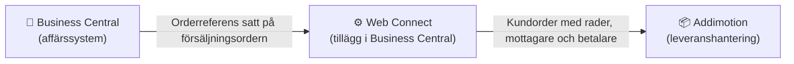
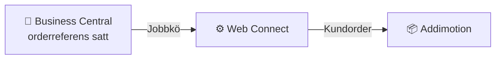

# Business Central och Addimotion: integration

Web Connect från CombineIT kopplar Microsoft Dynamics 365 Business Central till Addimotion, plattformen för leveranshantering. När en försäljningsorder får sin orderreferens i Business Central skickar Web Connect den till Addimotion med mottagare, betalare, betalning och orderrader. Alla mappningar och regler finns i ditt eget Business Central, där du själv kan se och ändra dem.

## I korthet

| | |
|---|---|
| **System** | Addimotion och dess tjänst OurBoxes (leveranshantering) |
| **Integrationsprodukt** | Web Connect för Microsoft Dynamics 365 Business Central |
| **Körs i** | Din egen Business Central-miljö, som ett tillägg. En order läggs i kö när dess triggerfält ändras i Business Central, och jobbkön i Business Central skickar den till Addimotion. Ingenting hämtas från Addimotion, och det finns inga webhooks. All bearbetning och konfiguration stannar i Business Central. |
| **Konfigureras av** | Dig, i Business Central: mappningar, villkor, triggers och flöden. Du kan göra allt själv. Om du vill är CombineIT med i vilket steg som helst, som bollplank eller genom att göra jobbet. |
| **Koppling** | Addimotions REST API AddBoxes med JSON. API-nyckeln för en API-användare i OurBoxes skickas i en header i anropet |
| **Addimotions API** | [AddBoxes API](https://addboxes.addimotion.com/docs/), som lägger till orderinformation i OurBoxes. Orderstatus kan läsas med [YourBoxes API](https://api.addimotion.com/docs/), som den här integrationen inte använder |
| **Dataflöden** | 1: försäljningsorder |
| **Business Central-utgåvor** | Alla utgåvor, Essentials och Premium, även den senaste versionen |
| **Finns på** | [Web Connect på Microsoft AppSource](https://marketplace.microsoft.com/sv-se/product/PUBID.martitab1633951001710%7CAID.webconnect%7CPAPPID.9f3a7223-19db-4ac7-832f-cf8e4699186f?tab=Overview). Integrationen med Addimotion ingår inte i appen Web Connect Ready Integrations. Den sätts upp som en konfiguration i Web Connect |

## Det här kan synkas

Web Connect har ett dataflöde mellan Business Central och Addimotion.

| Data | Riktning | Vad som händer |
|---|---|---|
| [Försäljningsorder](flows/order-outbound.md) | Business Central → Addimotion | Försäljningsordern skickas till Addimotion som en kundorder, med mottagare, betalare, betalning, en orderhändelse och artikelraderna |

Flödet för försäljningsorder är hela integrationen. Se [Välj upplägg](#choose-your-setup).

## Så fungerar det

Web Connect bevakar två fält i försäljningsorderns huvud: det externa ordernumret och orderkällan. När något av dem ändras lägger Web Connect ordern i kö, och jobbkön skickar den till endpointen för kundorder i AddBoxes API. Addimotion visar kundordern i vyn Warehouse Operations i OurBoxes, där lagerorder och sändningar kan hänvisa till den. Varje meddelande loggas i Web Connect [Entries](../../general/entries.md), där det kan granskas och skickas igen.

## Välj upplägg

Varje flöde måste passa hur er verksamhet fungerar: vilket system som äger datan, var folk gör sitt jobb och vad redovisningen behöver. Därför bestäms flödena tillsammans när en ny integration sätts upp. Alternativen nedan är de som Web Connect-kunder använder i dag. **Vanligt upplägg** markerar det alternativ som de flesta Web Connect-kunder med Addimotion använder. **Rekommenderas** markerar CombineIT:s bästa praxis, där det finns en.

Bara en Web Connect-kund kör Addimotion i dag, så inget alternativ är markerat som vanligt upplägg. Området nedan visar hur den integrationen är uppsatt.

### Försäljningsorder

| Alternativ | Så fungerar det | När det passar |
|---|---|---|
| **Skickas när orderreferensen ändras** | När det externa ordernumret eller orderkällan på försäljningsordern ändras skickar jobbkön ordern till Addimotion. Samma order kan skickas till mer än ett Addimotion-upplägg, var och ett med sin egen API-nyckel | Order kommer in i Business Central från en e-handelsplattform via Web Connect, och Addimotion ska få varje order |

#### Försäljningsorder skickas när orderreferensen ändras

Lager, avgångar och API-användaren sätts alltid upp i inställningarna i OurBoxes.

## Det här behöver du

- Microsoft Dynamics 365 Business Central, valfri utgåva (Essentials eller Premium), även den senaste versionen
- Web Connect installerat från Microsoft AppSource, med en aktiverad Web Connect-licens
- Ditt godkännande av att Web Connect installeras och agerar i din Business Central-miljö
- En API-användare i OurBoxes, vars API-nyckel skickas med varje anrop
- Nycklarna för lager och avgång uppsatta i inställningarna i OurBoxes, och händelsekoden för nya order från bilagan till AddBoxes API

## Så kommer du igång

1. Bestäm vilka flöden ni ska använda och vilket alternativ ni väljer för varje, se [Välj upplägg](#choose-your-setup).
2. Installera Web Connect i Business Central, aktivera licensen och ge ditt godkännande.
3. Importera Addimotion-konfigurationen med integrationen avstängd.
4. Lägg in API-nyckeln för er API-användare i OurBoxes i objektet för anropets header.
5. Ange de fasta värden som Addimotion förväntar sig på ordern, och översätt en tom valutakod till er lokala valuta.
6. Testa med några order innan ni går live.

## Konfigurera själv i Business Central

All konfiguration och logik i integrationen syns och går att ändra i Business Central. Det finns ingen extern integrationsplattform där logiken är dold.

| Det här kan du ändra | Var i Web Connect | Exempel |
|---|---|---|
| Vad som skickas till Addimotion | [Outgoing Mapping](../../general/outgoing-mapping/README.md) | Lägg till vikt eller fraktkostnad på orderraderna |
| Vad som startar en order | [Outgoing Sync Triggers](../../general/outgoing-mapping/outgoing-sync-triggers.md) | Skicka ordern när den släpps i stället för när orderreferensen sätts |
| Vilka order som skickas | [Outgoing Sync Triggers](../../general/outgoing-mapping/outgoing-sync-triggers.md) och [Condition List](../../general/condition-list.md) | Skicka bara order från en försäljningskanal |
| Hur värden översätts | [Text Mapping](../../general/text-mapping.md) | Översätt en tom valutakod till er lokala valuta |
| Beräknade värden | [Dynamic Flow Fields](../../general/dynamic-flow-fields.md) | Momsbeloppet per rad, beräknat som beloppet inklusive moms minus beloppet |
| Övervakning och omsändning | [Entries](../../general/entries.md) | Se varje skickad order, och [skicka ett meddelande igen](../../../../how-to/web-connect/resend-outgoing-message.md) |

## Val i konfigurationen

- **Trigger:** vilka fält på försäljningsordern som startar flödet. I standardupplägget är det det externa ordernumret och orderkällan.
- **Addimotion-upplägg:** hur många Addimotion-upplägg som får ordern. Varje upplägg är ett eget objekt i Web Connect med sin egen API-nyckel.
- **Fasta värden:** avsändarnamnet, vyn (2000 för Warehouse Operations eller 3000 för Outbound Shipments), nycklarna för lager och avgång, händelsekoden och platsen som Addimotion förväntar sig på varje order.
- **Orderns valuta:** en tom valutakod på ordern betyder er lokala valuta, och den översätts med en textmappning.
- **Orderrader:** bara rader av typen artikel skickas.
- **Felhantering:** hur många gånger Web Connect försöker skicka ett misslyckat meddelande igen, och vem som får den dagliga sammanställningen av fel via mejl.

## Begränsningar

- **Orderna går åt ett håll.** Ingenting hämtas från Addimotion, och inget fält i Business Central uppdateras därifrån.
- **Bara försäljningsorder skickas.** Leveranser, fakturor, kreditnotor och returer skickas inte till Addimotion.
- **Bara artikelrader skickas.** Rader för fraktavgifter, resurser eller redovisningskonton utelämnas.
- **Alla fält i Addimotion är inte mappade.** Vikt, volym, fraktkostnad, farligt gods och planerad avsändning per rad hämtas inte från ordern i standardupplägget. De kan läggas till i mappningen.
- **Artikelnamn kortas.** Artikelnamnet på orderraden skickas med högst 50 tecken.
- **Bara en ändring av orderreferensen skickar ordern igen.** När den skickas igen uppdaterar Addimotion kundordern med samma nummer. Ändringar i andra fält och makuleringar skickas inte.

## Vanliga frågor

### Går det att integrera Business Central med Addimotion?

Ja. Web Connect skickar försäljningsorder från Business Central till Addimotion via Addimotions REST API. Varje order innehåller mottagare, betalare, betalning och orderrader med antal och priser.

### Kommer något tillbaka från Addimotion till Business Central?

Nej. Integrationen skickar order från Business Central till Addimotion. Ingenting hämtas från Addimotion, och inga fält i Business Central uppdateras därifrån.

### Kan vi själva ändra vad som skickas till Addimotion?

Ja. Fälten på ordern, triggerfälten och valutaöversättningen konfigureras i Web Connect i ditt eget Business Central. Du kan se och ändra dem utan att be en leverantör ändra i en extern plattform.

## Relaterat

- Flöden: [Försäljningsorder](flows/order-outbound.md)
- Instruktioner: [Skicka ett utgående meddelande igen](../../../../how-to/web-connect/resend-outgoing-message.md) · [Integrationer körs inte](../../../../how-to/web-connect/integration-not-running.md)
- Web Connect: [Outgoing Mapping](../../general/outgoing-mapping/README.md) · [Outgoing Sync Triggers](../../general/outgoing-mapping/outgoing-sync-triggers.md) · [Text Mapping](../../general/text-mapping.md) · [Dynamic Flow Fields](../../general/dynamic-flow-fields.md)
- [Allmän dokumentation om Web Connect](../../general/README.md)
- [Addimotion](https://www.addimotion.com/) · [AddBoxes API](https://addboxes.addimotion.com/docs/)

## Om Web Connect

Web Connect är en integrationsplattform för Microsoft Dynamics 365 Business Central, utvecklad av CombineIT. Den installeras i ditt eget Business Central och kopplar det till e-handelsplattformar, lagersystem, kassasystem, returer, marknadsplatser och EDI. Varje flöde, varje mappning och varje regel konfigureras i Business Central, där du själv kan se och ändra dem, utan specialkod för varje integration. [Web Connect på Microsoft AppSource](https://marketplace.microsoft.com/sv-se/product/PUBID.martitab1633951001710%7CAID.webconnect%7CPAPPID.9f3a7223-19db-4ac7-832f-cf8e4699186f?tab=Overview) · [Kontakta CombineIT](https://www.combineit.se/contact/)
