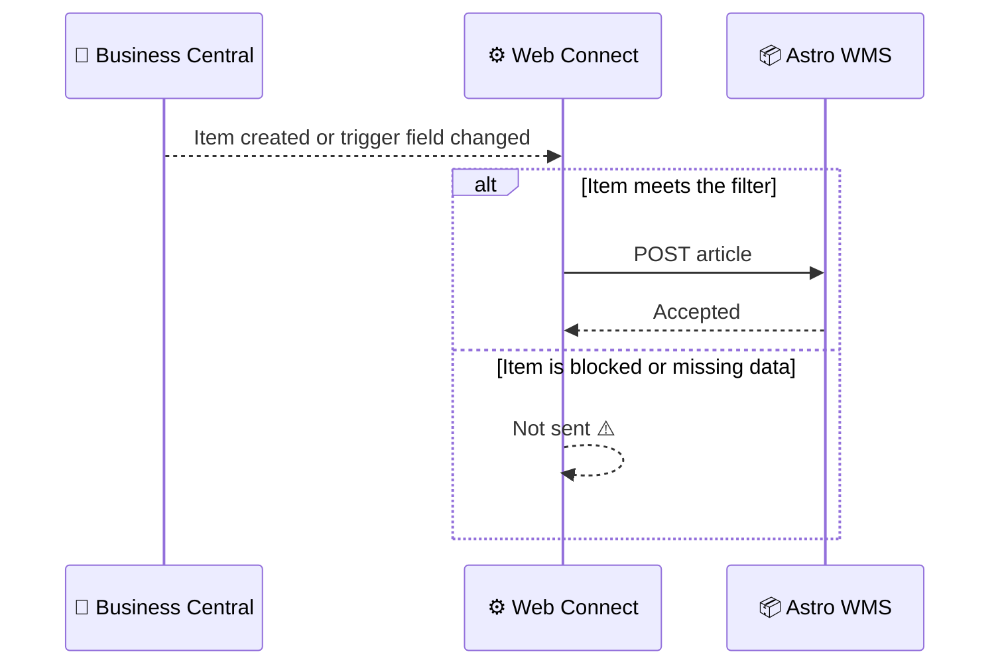

# Business Central to Astro WMS: items

When the name, base unit of measure, type or tariff number of an item changes in Business Central, Web Connect sends the item to Astro WMS as an article. Barcodes, dimensions, weight, country of origin, tariff number and batch handling are sent with it. Only inventory items that are not blocked and have the required data are sent.

| | |
|---|---|
| **Direction** | Business Central → Astro WMS |
| **Trigger** | Change in Business Central: an outgoing sync trigger on the item |
| **Result** | The article exists in Astro WMS with the same number as the item |
| **Part of** | [Business Central and Astro WMS integration](../overview.md) |

## Step by step

1. An item is created or one of the trigger fields changes: description, base unit of measure, type or tariff number (Business Central).
2. Web Connect checks that the item is an inventory item, is not blocked and has a description, a base unit of measure and a tariff number (Web Connect).
3. Web Connect builds the article with barcodes from the item references, dimensions from the item unit of measure and custom properties for country of origin, tariff number and batch handling (Web Connect).
4. The article is sent to the warehouse API (Web Connect).
5. Astro WMS creates or updates the article (Astro WMS).

## Data mapping

| Business Central field | Astro WMS field | Note |
|---|---|---|
| No. | `baseItem` | Article number in the warehouse |
| Description | `baseItemName` | At most 60 characters |
| Item references (barcode) | `barCodes` | Only references of type barcode |
| Item unit of measure: length, width, height | `measurements` | Rounded to whole numbers |
| Item unit of measure: weight | `measurements.weight` | |
| Country/Region of Origin Code | Custom property `CountryOfOrigin` | |
| Tariff No. | Custom property `CustomDeclarationNo` | |
| Item Tracking Code | Custom property `BatchHandling` | Translated with text mapping. Batch tracking becomes batch handling at goods receipt |
| | `status` | Always sent as active |

## Web Connect objects

| Object | Role |
|---|---|
| `SPD_ITEM` | Sends the article to the warehouse API |
| `SPD_ITEMDETAIL` | The article with name and status |
| `SPD_BARCODES`, `SPD_MEASUREMENTS`, `SPD_CUSTOMPROPERTIES` | Barcodes, dimensions and custom properties on the article |

## Error handling

| Situation | What happens | What to do |
|---|---|---|
| The item is blocked or misses required data | The item is not sent | Fill in the missing data on the item |
| The warehouse API rejects the article | The error is shown in Entries | Read the error in [Entries](../../../general/entries.md), fix the item and [resend the message](../../../../../how-to/web-connect/resend-outgoing-message.md) |
| The access token cannot be fetched | Nothing is sent | Check the client secret from the 3PL in Secret Value Storage |

## Frequently asked questions

### Why is an item not sent to Astro WMS?

Only inventory items that are not blocked and have a description, a base unit of measure and a tariff number are sent. Check those fields on the item, then change one of the trigger fields or resend the item from Web Connect.

## Related

- [Business Central and Astro WMS integration](../overview.md)
- [Outbound orders](order-outbound.md) · [Purchase orders](purchase-order.md)
- [Outgoing Sync Triggers](../../../general/outgoing-mapping/outgoing-sync-triggers.md) · [Text Mapping](../../../general/text-mapping.md)
