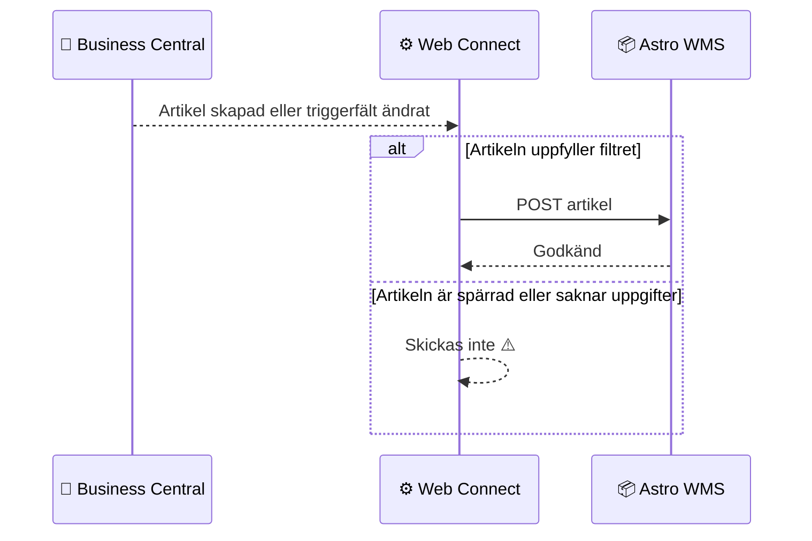

# Från Business Central till Astro WMS: artiklar

När namn, basenhet, typ eller tullnummer på en artikel ändras i Business Central skickar Web Connect artikeln till Astro WMS. Streckkoder, mått, vikt, ursprungsland, tullnummer och batchhantering skickas med. Bara lagerartiklar som inte är spärrade och som har de uppgifter som krävs skickas.

| | |
|---|---|
| **Riktning** | Business Central → Astro WMS |
| **Startas av** | Ändring i Business Central: en utgående synktrigger på artikeln |
| **Resultat** | Artikeln finns i Astro WMS med samma nummer som i Business Central |
| **Del av** | [Business Central och Astro WMS: integration](../overview.md) |

## Steg för steg

1. En artikel skapas eller ett av triggerfälten ändras: beskrivning, basenhet, typ eller tullnummer (Business Central).
2. Web Connect kontrollerar att artikeln är en lagerartikel, inte är spärrad och har beskrivning, basenhet och tullnummer (Web Connect).
3. Web Connect bygger upp artikeln med streckkoder från artikelreferenserna, mått från artikelns enhet och egna egenskaper för ursprungsland, tullnummer och batchhantering (Web Connect).
4. Artikeln skickas till lagrets API (Web Connect).
5. Astro WMS skapar eller uppdaterar artikeln (Astro WMS).

## Mappning av data

| Fält i Business Central | Fält i Astro WMS | Kommentar |
|---|---|---|
| No. | `baseItem` | Artikelnummer i lagret |
| Description | `baseItemName` | Högst 60 tecken |
| Artikelreferenser (streckkod) | `barCodes` | Bara referenser av typen streckkod |
| Artikelns enhet: längd, bredd, höjd | `measurements` | Avrundas till heltal |
| Artikelns enhet: vikt | `measurements.weight` | |
| Country/Region of Origin Code | Egen egenskap `CountryOfOrigin` | |
| Tariff No. | Egen egenskap `CustomDeclarationNo` | |
| Item Tracking Code | Egen egenskap `BatchHandling` | Översätts med Text Mapping. Batchspårning blir batchhantering vid inleverans |
| | `status` | Skickas alltid som aktiv |

## Objekt i Web Connect

| Objekt | Roll |
|---|---|
| `SPD_ITEM` | Skickar artikeln till lagrets API |
| `SPD_ITEMDETAIL` | Artikeln med namn och status |
| `SPD_BARCODES`, `SPD_MEASUREMENTS`, `SPD_CUSTOMPROPERTIES` | Streckkoder, mått och egna egenskaper på artikeln |

## Felhantering

| Situation | Vad som händer | Vad du gör |
|---|---|---|
| Artikeln är spärrad eller saknar uppgifter som krävs | Artikeln skickas inte | Fyll i de uppgifter som saknas på artikeln |
| Lagrets API avvisar artikeln | Felet visas i Entries | Läs felet i [Entries](../../../general/entries.md), rätta artikeln och [skicka om meddelandet](../../../../../how-to/web-connect/resend-outgoing-message.md) |
| Åtkomsttoken kan inte hämtas | Ingenting skickas | Kontrollera klienthemligheten från 3PL-företaget i Secret Value Storage |

## Vanliga frågor

### Varför skickas inte en artikel till Astro WMS?

Bara lagerartiklar som inte är spärrade och som har beskrivning, basenhet och tullnummer skickas. Kontrollera de fälten på artikeln, och ändra sedan ett av triggerfälten eller skicka om artikeln från Web Connect.

## Relaterat

- [Business Central och Astro WMS: integration](../overview.md)
- [Utgående order](order-outbound.md) · [Inköpsorder](purchase-order.md)
- [Outgoing Sync Triggers](../../../general/outgoing-mapping/outgoing-sync-triggers.md) · [Text Mapping](../../../general/text-mapping.md)
