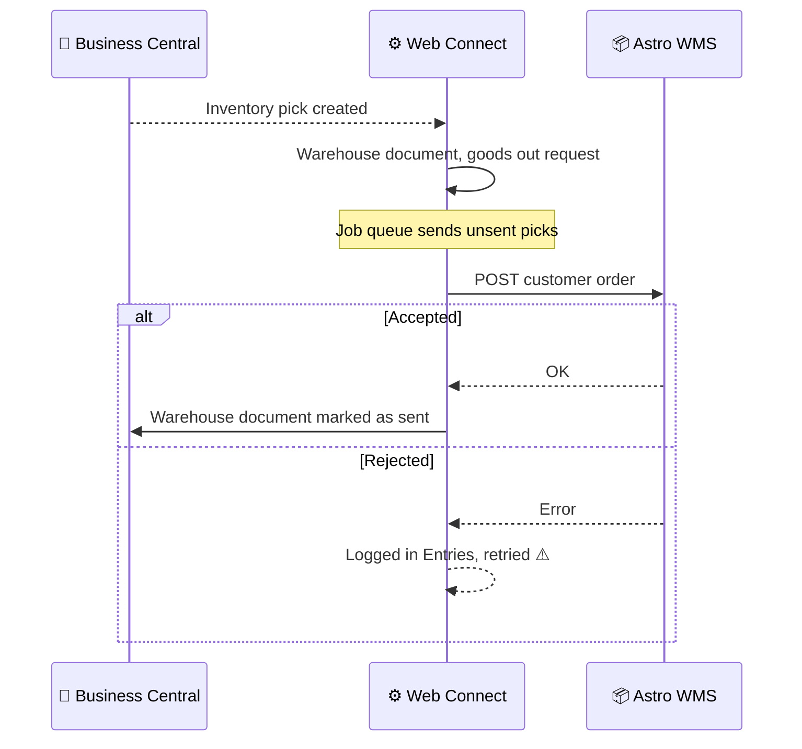

# Business Central to Astro WMS: outbound orders

When an inventory pick is created for a sales order at the warehouse location, the Business Central job queue sends it to Astro WMS as a customer order. The order carries the buyer, the delivery address, the way of delivery and the lines with quantities and prices. The warehouse then picks and ships the order.

| | |
|---|---|
| **Direction** | Business Central → Astro WMS |
| **Trigger** | Schedule in the Business Central job queue, which sends inventory picks that have not been sent |
| **Result** | A customer order in Astro WMS, and a warehouse document in Business Central that follows it |
| **Part of** | [Business Central and Astro WMS integration](../overview.md) |

## Step by step

1. An inventory pick is created for a sales order at the warehouse location (Business Central).
2. Web Connect creates a warehouse document of type goods out request, with the shipping agent from the sales order and the reference from the pick (Web Connect).
3. The job queue sends picks that have not been sent to the warehouse API, through the Azure endpoint (Web Connect).
4. Astro WMS creates the customer order (Astro WMS).
5. When the order is delivered, the [shipment](shipment.md) flow brings the result back.

## Data mapping

| Business Central field | Astro WMS field | Note |
|---|---|---|
| Warehouse document no. | `docNbr` | |
| Order date | `orderDate` | |
| External reference on the pick | `OrderReference` | |
| Customer name | `customerRef` | At most 35 characters |
| Sell-to customer: number, name, email, phone, address | `party` with qualifier `BY` | Buyer |
| Ship-to: number, name, email, phone, address | `party` with qualifier `DP` | Delivery party |
| Shipping agent | `deliveryWayCode`, `deliveryWayDescription` | Translated with text mapping. No shipping agent means pickup |
| | `currency` | Set in the mapping |
| Line no., item no., description | `orderLineNbr`, `articleNbr`, `articleDescription` | Description at most 60 characters |
| Quantity, unit price | `quantity`, `price` | |

## Web Connect objects

| Object | Role |
|---|---|
| `SPD_SHIPPING-ORDER` | Sends the customer order to the warehouse API |
| `SPD_ORDERHEAD`, `SPD_ORDERLINE` | Order header and lines |
| `SPD_BUYER_PARTY`, `SPD_CONSIGNEE_PARTY` | Buyer and delivery party with addresses |

## Error handling

| Situation | What happens | What to do |
|---|---|---|
| The pick is not sent | The warehouse document stays unsent | See [WMS request not sent](../../../../../how-to/web-connect/wms-request-not-sent-error.md) |
| The warehouse API rejects the order | Retried up to the maximum error count, then included in the daily error email | Read the error in [Entries](../../../general/entries.md), fix the order and [resend the message](../../../../../how-to/web-connect/resend-outgoing-message.md) |
| The shipping agent has no translation | The order is sent without the right delivery code | Add the shipping agent to the text mapping |

## Frequently asked questions

### How does the warehouse know which carrier to use?

The shipping agent on the sales order is translated to a delivery code in the warehouse with a text mapping in Web Connect. When the order has no shipping agent, a pickup code is used. You can change the translations yourself.

## Related

- [Business Central and Astro WMS integration](../overview.md)
- [Shipments](shipment.md) · [Items](items.md)
- [WMS documents](../../../general/wms-documents.md) · [Logistics Setup](../../../general/logistics-setup.md) · [Text Mapping](../../../general/text-mapping.md)
