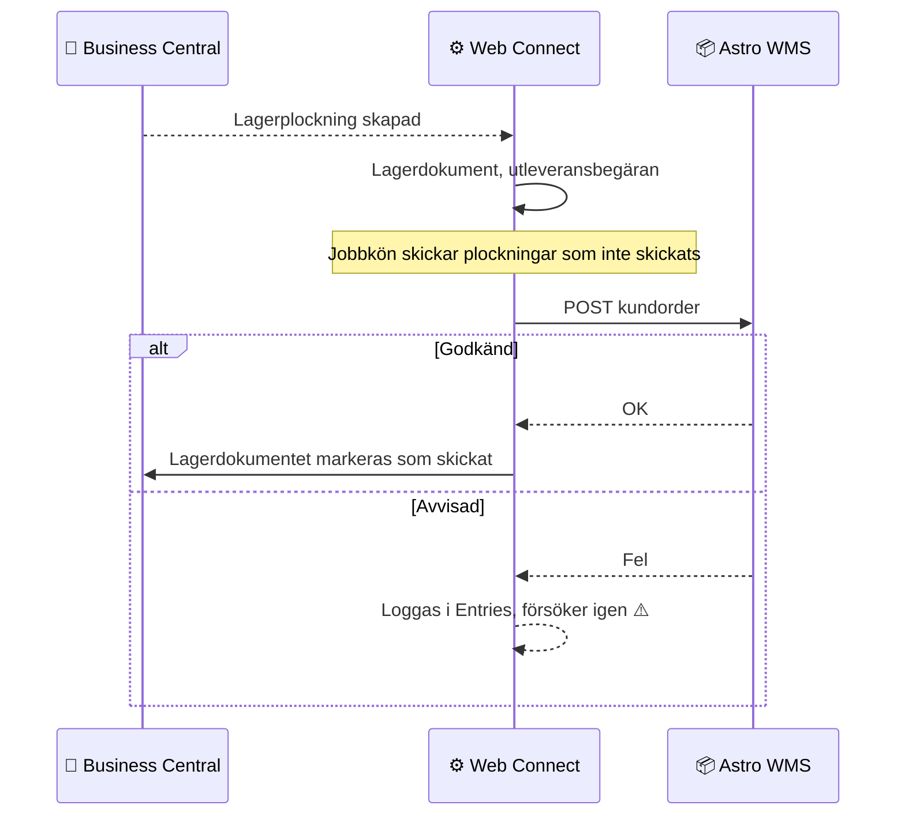

# Från Business Central till Astro WMS: utgående order

När en lagerplockning skapas för en försäljningsorder på lagrets lagerställe skickar jobbkön i Business Central den till Astro WMS som en kundorder. Ordern innehåller köparen, leveransadressen, leveranssättet och raderna med antal och priser. Sedan plockar och skickar lagret ordern.

| | |
|---|---|
| **Riktning** | Business Central → Astro WMS |
| **Startas av** | Schema i jobbkön i Business Central, som skickar lagerplockningar som inte har skickats |
| **Resultat** | En kundorder i Astro WMS, och ett lagerdokument i Business Central som följer den |
| **Del av** | [Business Central och Astro WMS: integration](../overview.md) |

## Steg för steg

1. En lagerplockning skapas för en försäljningsorder på lagrets lagerställe (Business Central).
2. Web Connect skapar ett lagerdokument av typen utleveransbegäran, med speditören från försäljningsordern och referensen från plockningen (Web Connect).
3. Jobbkön skickar plockningar som inte har skickats till lagrets API (Web Connect).
4. Astro WMS skapar kundordern (Astro WMS).
5. När ordern är levererad kommer resultatet tillbaka med flödet för [leveranser](shipment.md).

## Mappning av data

| Fält i Business Central | Fält i Astro WMS | Kommentar |
|---|---|---|
| Lagerdokumentets nummer | `docNbr` | |
| Orderdatum | `orderDate` | |
| Extern referens på plockningen | `OrderReference` | |
| Kundnamn | `customerRef` | Högst 35 tecken |
| Försäljningskund: nummer, namn, e-post, telefon, adress | `party` med kvalificeraren `BY` | Köpare |
| Leveransadress: nummer, namn, e-post, telefon, adress | `party` med kvalificeraren `DP` | Mottagare |
| Speditör | `deliveryWayCode`, `deliveryWayDescription` | Översätts med Text Mapping. Ingen speditör betyder upphämtning |
| | `currency` | Ställs in i mappningen |
| Radnummer, artikelnummer, beskrivning | `orderLineNbr`, `articleNbr`, `articleDescription` | Beskrivningen högst 60 tecken |
| Antal, enhetspris | `quantity`, `price` | |

## Objekt i Web Connect

| Objekt | Roll |
|---|---|
| `SPD_SHIPPING-ORDER` | Skickar kundordern till lagrets API |
| `SPD_ORDERHEAD`, `SPD_ORDERLINE` | Orderhuvud och orderrader |
| `SPD_BUYER_PARTY`, `SPD_CONSIGNEE_PARTY` | Köpare och mottagare med adresser |

## Felhantering

| Situation | Vad som händer | Vad du gör |
|---|---|---|
| Plockningen skickas inte | Lagerdokumentet förblir oskickat | Se [WMS-anrop skickas inte](../../../../../how-to/web-connect/wms-request-not-sent-error.md) |
| Lagrets API avvisar ordern | Nya försök görs upp till det högsta antalet fel, sedan kommer ordern med i det dagliga felmejlet | Läs felet i [Entries](../../../general/entries.md), rätta ordern och [skicka om meddelandet](../../../../../how-to/web-connect/resend-outgoing-message.md) |
| Speditören saknar översättning | Ordern skickas utan rätt leveranskod | Lägg till speditören i textmappningen |

## Vanliga frågor

### Hur vet lagret vilken transportör som ska användas?

Speditören på försäljningsordern översätts till en leveranskod i lagret med en textmappning i Web Connect. Saknar ordern speditör används en kod för upphämtning. Du kan själv ändra översättningarna.

## Relaterat

- [Business Central och Astro WMS: integration](../overview.md)
- [Leveranser](shipment.md) · [Artiklar](items.md)
- [WMS-dokument](../../../general/wms-documents.md) · [Logistics Setup](../../../general/logistics-setup.md) · [Text Mapping](../../../general/text-mapping.md)
