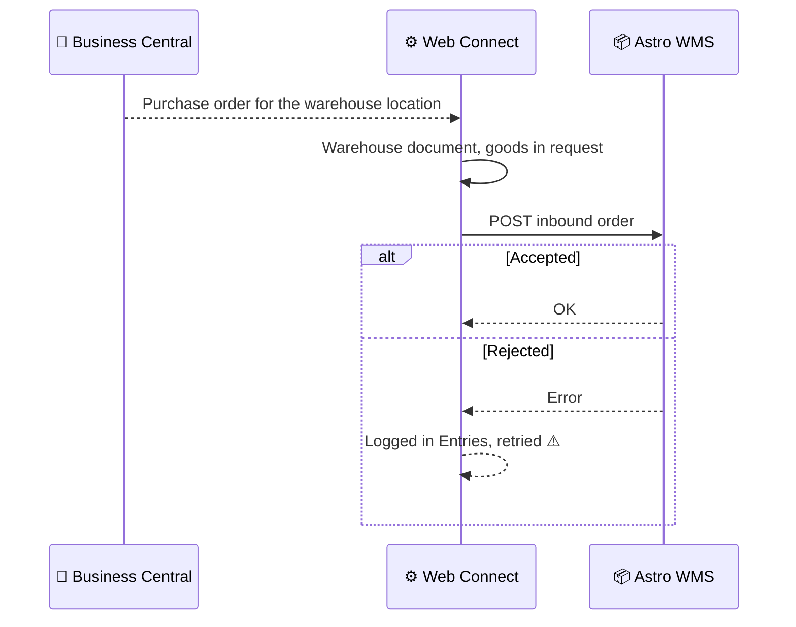

# Business Central to Astro WMS: purchase orders

A purchase order for the warehouse location is sent from Business Central to Astro WMS as an inbound order. The order carries the supplier, the expected receipt date and the lines with quantities. When the goods arrive, the [receipt](receipt.md) flow brings the received quantities back.

| | |
|---|---|
| **Direction** | Business Central → Astro WMS |
| **Trigger** | Change in Business Central: the purchase order is released, or sent with an action on the purchase order |
| **Result** | An inbound order in Astro WMS, and a warehouse document in Business Central that follows it |
| **Part of** | [Business Central and Astro WMS integration](../overview.md) |

## Step by step

1. A purchase order for the warehouse location is released, or someone sends it with the action on the purchase order (Business Central).
2. Web Connect creates a warehouse document of type goods in request, with the expected receipt date from the purchase order (Web Connect).
3. The inbound order is sent to the warehouse API (Web Connect).
4. Astro WMS creates the inbound order and waits for the goods (Astro WMS).

## Data mapping

| Business Central field | Astro WMS field | Note |
|---|---|---|
| Warehouse document no. | `docNbr` | |
| Order date | `orderDate` | |
| Expected Receipt Date | `deliveryDate` | |
| Vendor no., name, phone | `party` with qualifier `SU` | Supplier. Name at most 35 characters |
| | `party` with qualifier `BY` | Your company as buyer, set in the mapping |
| Line no., item no., quantity | `orderLineNbr`, `articleNbr`, `quantity` | |

## Web Connect objects

| Object | Role |
|---|---|
| `SPD_RECEIVAL-ORDER` | Sends the inbound order to the warehouse API |
| `SPD_ORDERHEAD_RECEIVAL`, `SPD_ORDERLINE_RECEIVAL` | Order header and lines |
| `SPD_PARTY_SUPPLIER`, `SPD_PARTY_RECEIVAL` | Supplier and buyer |

## Error handling

| Situation | What happens | What to do |
|---|---|---|
| The warehouse API rejects the order | Retried up to the maximum error count, then included in the daily error email | Read the error in [Entries](../../../general/entries.md) and [resend the message](../../../../../how-to/web-connect/resend-outgoing-message.md) |
| An item on the order does not exist in the warehouse | The order is rejected | Send the [item](items.md) first, then resend the order |

## Frequently asked questions

### Which date does the warehouse see as the expected arrival?

The expected receipt date on the purchase order in Business Central is sent as the delivery date of the inbound order.

## Related

- [Business Central and Astro WMS integration](../overview.md)
- [Receipts](receipt.md) · [Items](items.md)
- [WMS documents](../../../general/wms-documents.md) · [Logistics Setup](../../../general/logistics-setup.md)
