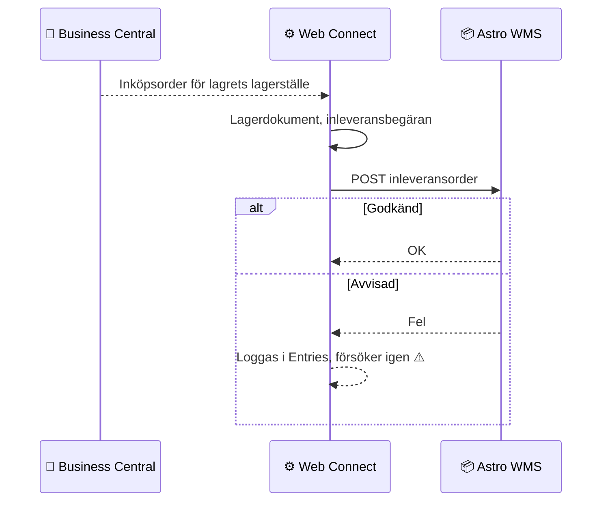

# Från Business Central till Astro WMS: inköpsorder

En inköpsorder för lagrets lagerställe skickas från Business Central till Astro WMS som en inleveransorder. Ordern innehåller leverantören, det förväntade inleveransdatumet och raderna med antal. När varorna kommer fram skickar flödet för [inleveranser](receipt.md) tillbaka de mottagna antalen.

| | |
|---|---|
| **Riktning** | Business Central → Astro WMS |
| **Startas av** | Ändring i Business Central: inköpsordern släpps, eller skickas med en åtgärd på inköpsordern |
| **Resultat** | En inleveransorder i Astro WMS, och ett lagerdokument i Business Central som följer den |
| **Del av** | [Business Central och Astro WMS: integration](../overview.md) |

## Steg för steg

1. En inköpsorder för lagrets lagerställe släpps, eller någon skickar den med åtgärden på inköpsordern (Business Central).
2. Web Connect skapar ett lagerdokument av typen inleveransbegäran, med det förväntade inleveransdatumet från inköpsordern (Web Connect).
3. Inleveransordern skickas till lagrets API (Web Connect).
4. Astro WMS skapar inleveransordern och väntar på varorna (Astro WMS).

## Mappning av data

| Fält i Business Central | Fält i Astro WMS | Kommentar |
|---|---|---|
| Lagerdokumentets nummer | `docNbr` | |
| Orderdatum | `orderDate` | |
| Expected Receipt Date | `deliveryDate` | |
| Leverantörsnummer, namn, telefon | `party` med kvalificeraren `SU` | Leverantör. Namnet högst 35 tecken |
| | `party` med kvalificeraren `BY` | Ditt företag som köpare, ställs in i mappningen |
| Radnummer, artikelnummer, antal | `orderLineNbr`, `articleNbr`, `quantity` | |

## Objekt i Web Connect

| Objekt | Roll |
|---|---|
| `SPD_RECEIVAL-ORDER` | Skickar inleveransordern till lagrets API |
| `SPD_ORDERHEAD_RECEIVAL`, `SPD_ORDERLINE_RECEIVAL` | Orderhuvud och orderrader |
| `SPD_PARTY_SUPPLIER`, `SPD_PARTY_RECEIVAL` | Leverantör och köpare |

## Felhantering

| Situation | Vad som händer | Vad du gör |
|---|---|---|
| Lagrets API avvisar ordern | Nya försök görs upp till det högsta antalet fel, sedan kommer ordern med i det dagliga felmejlet | Läs felet i [Entries](../../../general/entries.md) och [skicka om meddelandet](../../../../../how-to/web-connect/resend-outgoing-message.md) |
| En artikel på ordern finns inte i lagret | Ordern avvisas | Skicka [artikeln](items.md) först och skicka sedan om ordern |

## Vanliga frågor

### Vilket datum ser lagret som förväntad ankomst?

Det förväntade inleveransdatumet på inköpsordern i Business Central skickas som leveransdatum på inleveransordern.

## Relaterat

- [Business Central och Astro WMS: integration](../overview.md)
- [Inleveranser](receipt.md) · [Artiklar](items.md)
- [WMS-dokument](../../../general/wms-documents.md) · [Logistics Setup](../../../general/logistics-setup.md)
