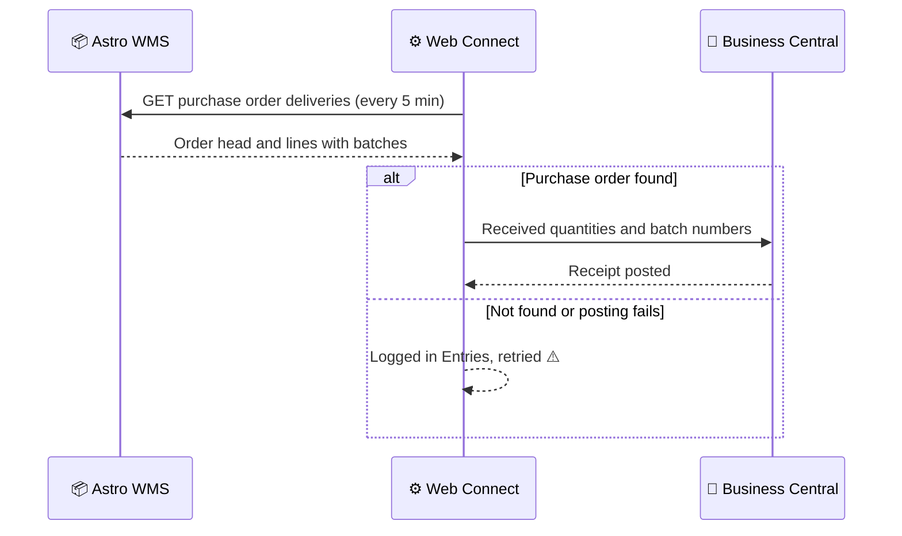

# Astro WMS to Business Central: receipts

Every five minutes between early morning and late evening, Web Connect asks Astro WMS for new purchase order deliveries. Received quantities and batch numbers are written to the warehouse document in Business Central, and the receipt can be posted automatically. Each delivery is read once, based on the order number.

| | |
|---|---|
| **Direction** | Astro WMS → Business Central |
| **Trigger** | Schedule in Web Connect: every five minutes between 04:00 and 22:00 |
| **Result** | A posted receipt in Business Central with received quantities and batch numbers |
| **Part of** | [Business Central and Astro WMS integration](../overview.md) |

## Step by step

1. The warehouse receives the goods on the inbound order (Astro WMS).
2. Web Connect fetches new purchase order deliveries from the warehouse API, through the Azure endpoint (Web Connect).
3. Each delivery is matched to its warehouse document by the document number that was sent with the [purchase order](purchase-order.md) (Web Connect).
4. Received quantity per line, and the batch numbers with their quantities, are written to the warehouse document (Web Connect).
5. The receipt is posted with the work date as posting date, with batch numbers on the lines (Business Central).

## Data mapping

| Astro WMS field | Business Central field | Note |
|---|---|---|
| `ORDERHEAD.DocNbr` | Warehouse document no. and external ID | Each delivery is read once |
| `ORDERHEAD.DocDate` | Date on the warehouse document | |
| `OrderLineNbr` | Line no. | |
| `ArticleNbr` | Item No. | |
| `Quantity` | Received quantity | |
| `Batches.BatchId`, `Quantity` | Lot No. and quantity per batch | |

## Web Connect objects

| Object | Role |
|---|---|
| `SPD_RECEIPT-NOTICE` | Fetches purchase order deliveries from the warehouse API |
| `SPD_ORDERLINE1`, `SPD_LINE` | Received lines |
| `SPD_BATCHES`, `SPD_BATCH1` | Batch numbers and quantities per line |

## Error handling

| Situation | What happens | What to do |
|---|---|---|
| A batch number is missing | The receipt is not posted, because batch numbers are required on receipts | Check the batch in [Entries](../../../general/entries.md) and the item tracking on the item |
| The posting fails | Retried up to the maximum error count, then included in the daily error email | Fix the cause in Business Central and process the entry again |
| Nothing arrives | No receipts are fetched | See [Nothing downloads to Business Central](../../../../../how-to/web-connect/nothing-downloads-to-business-central.md) |

## Frequently asked questions

### How soon is a receipt visible in Business Central?

Web Connect fetches receipts every five minutes during the day. When the warehouse has registered the receipt, it is usually posted in Business Central within a few minutes. The schedule can be changed in Web Connect.

## Related

- [Business Central and Astro WMS integration](../overview.md)
- [Purchase orders](purchase-order.md) · [Shipments](shipment.md)
- [WMS documents](../../../general/wms-documents.md) · [Logistics Setup](../../../general/logistics-setup.md)
