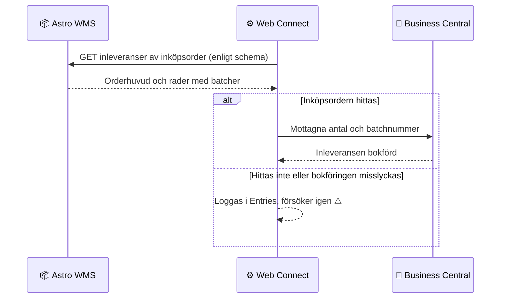

# Från Astro WMS till Business Central: inleveranser

Enligt schema, till exempel var femte minut under dagen, frågar Web Connect Astro WMS efter nya inleveranser av inköpsorder. Mottagna antal och batchnummer skrivs till lagerdokumentet i Business Central, och inleveransen kan bokföras automatiskt. Varje inleverans läses en gång, utifrån ordernumret.

| | |
|---|---|
| **Riktning** | Astro WMS → Business Central |
| **Startas av** | Schema i Web Connect, anpassat efter dina behov, till exempel var femte minut mellan 04.00 och 22.00 |
| **Resultat** | En bokförd inleverans i Business Central med mottagna antal och batchnummer |
| **Del av** | [Business Central och Astro WMS: integration](../overview.md) |

## Steg för steg

1. Lagret tar emot varorna på inleveransordern (Astro WMS).
2. Web Connect hämtar nya inleveranser av inköpsorder från lagrets API (Web Connect).
3. Varje inleverans matchas mot sitt lagerdokument med dokumentnumret som skickades med [inköpsordern](purchase-order.md) (Web Connect).
4. Mottaget antal per rad, och batchnumren med sina antal, skrivs till lagerdokumentet (Web Connect).
5. Inleveransen bokförs med arbetsdatumet som bokföringsdatum, med batchnummer på raderna (Business Central).

## Mappning av data

| Fält i Astro WMS | Fält i Business Central | Kommentar |
|---|---|---|
| `ORDERHEAD.DocNbr` | Lagerdokumentets nummer och externt ID | Varje inleverans läses en gång |
| `ORDERHEAD.DocDate` | Datum på lagerdokumentet | |
| `OrderLineNbr` | Radnummer | |
| `ArticleNbr` | Item No. | |
| `Quantity` | Mottaget antal | |
| `Batches.BatchId`, `Quantity` | Lot No. och antal per batch | |

## Objekt i Web Connect

| Objekt | Roll |
|---|---|
| `SPD_RECEIPT-NOTICE` | Hämtar inleveranser av inköpsorder från lagrets API |
| `SPD_ORDERLINE1`, `SPD_LINE` | Mottagna rader |
| `SPD_BATCHES`, `SPD_BATCH1` | Batchnummer och antal per rad |

## Felhantering

| Situation | Vad som händer | Vad du gör |
|---|---|---|
| Ett batchnummer saknas | Inleveransen bokförs inte, eftersom batchnummer krävs på inleveranser | Kontrollera batchen i [Entries](../../../general/entries.md) och artikelspårningen på artikeln |
| Bokföringen misslyckas | Nya försök görs upp till det högsta antalet fel, sedan kommer posten med i det dagliga felmejlet | Rätta orsaken i Business Central och bearbeta posten igen |
| Ingenting kommer in | Inga inleveranser hämtas | Se [Ingenting hämtas till Business Central](../../../../../how-to/web-connect/nothing-downloads-to-business-central.md) |

## Vanliga frågor

### Hur snabbt syns en inleverans i Business Central?

Web Connect hämtar inleveranser enligt schema, till exempel var femte minut under dagen. När lagret har registrerat inleveransen bokförs den oftast i Business Central inom några minuter. Schemat kan ändras i Web Connect.

## Relaterat

- [Business Central och Astro WMS: integration](../overview.md)
- [Inköpsorder](purchase-order.md) · [Leveranser](shipment.md)
- [WMS-dokument](../../../general/wms-documents.md) · [Logistics Setup](../../../general/logistics-setup.md)
