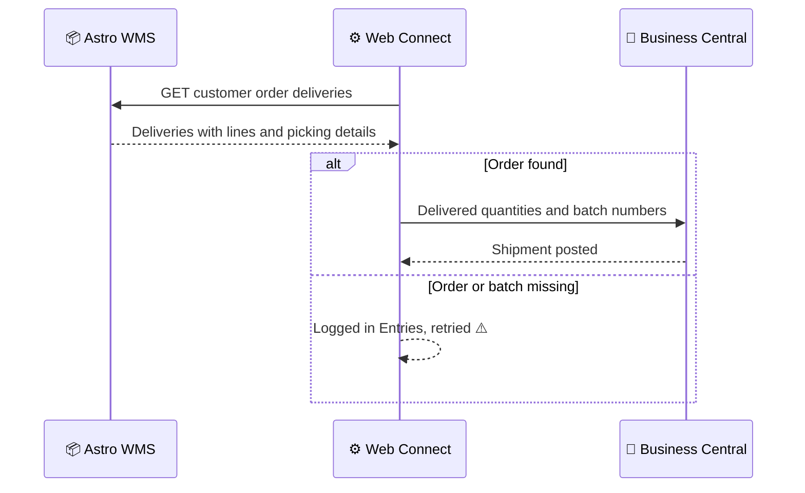

# Astro WMS to Business Central: shipments

Web Connect asks Astro WMS on a schedule for new customer order deliveries. Delivered quantities and the batch numbers that were picked are written to the warehouse document in Business Central, and the shipment can be posted automatically. Each delivery is read once, based on its delivery number.

| | |
|---|---|
| **Direction** | Astro WMS → Business Central |
| **Trigger** | Schedule in Web Connect, set to your needs |
| **Result** | A posted shipment in Business Central with delivered quantities, batch numbers and the tracking reference |
| **Part of** | [Business Central and Astro WMS integration](../overview.md) |

## Step by step

1. The warehouse picks and ships the customer order (Astro WMS).
2. Web Connect fetches new customer order deliveries from the warehouse API (Web Connect).
3. Each delivery is matched to its warehouse document by the order number. The delivery number is stored, so the same delivery is not read twice (Web Connect).
4. Ordered and delivered quantity per line, the batch numbers from the picking details and the tracking reference are written to the warehouse document (Web Connect).
5. The shipment is posted with the work date as posting date, with batch numbers on the lines (Business Central).

## Data mapping

| Astro WMS field | Business Central field | Note |
|---|---|---|
| `Delivery.DeliveryNumber` | Warehouse document external ID | Each delivery is read once |
| `Delivery.DeliveryDate` | Date on the warehouse document | |
| `CustomerOrderNumber` | Order number | Matches the warehouse document |
| `OrderLineNumber` | Line no. | |
| `Sku` | Item No. | |
| `OrderedQuantity`, `DeliveredQuantity` | Ordered and delivered quantity | |
| `PickingDetails.BatchId`, `DeliveredQuantity` | Lot No. and quantity per batch | |
| `TrackTrace` | Tracking reference | Stored on the inventory pick or on the sales order, chosen at setup |

The SSCC that the warehouse returns is not stored.

## Web Connect objects

| Object | Role |
|---|---|
| `SPD_SHIPMENT-NOTICE` | Fetches customer order deliveries from the warehouse API |
| `SPD_DELIVERY`, `SPD_DELIVERYLINES`, `SPD_DELIVERYLINE` | Delivery header and lines |
| `SPD_PICKINGDETAILS`, `SPD_PICKINGDETAIL` | Batch numbers and quantities per line |

## Error handling

| Situation | What happens | What to do |
|---|---|---|
| A batch number is missing | The shipment is not posted, because batch numbers are required on shipments | Check the batch in [Entries](../../../general/entries.md) and the item tracking on the item |
| The posting fails | Retried up to the maximum error count, then included in the daily error email | Fix the cause in Business Central and process the entry again |
| Nothing arrives | No deliveries are fetched | See [Nothing downloads to Business Central](../../../../../how-to/web-connect/nothing-downloads-to-business-central.md) |

## Frequently asked questions

### What happens if the warehouse delivers less than ordered?

Web Connect writes both the ordered and the delivered quantity per line. The shipment is posted with the delivered quantity, and the rest of the order stays open in Business Central.

## Related

- [Business Central and Astro WMS integration](../overview.md)
- [Outbound orders](order-outbound.md) · [Receipts](receipt.md)
- [WMS documents](../../../general/wms-documents.md) · [Logistics Setup](../../../general/logistics-setup.md)
