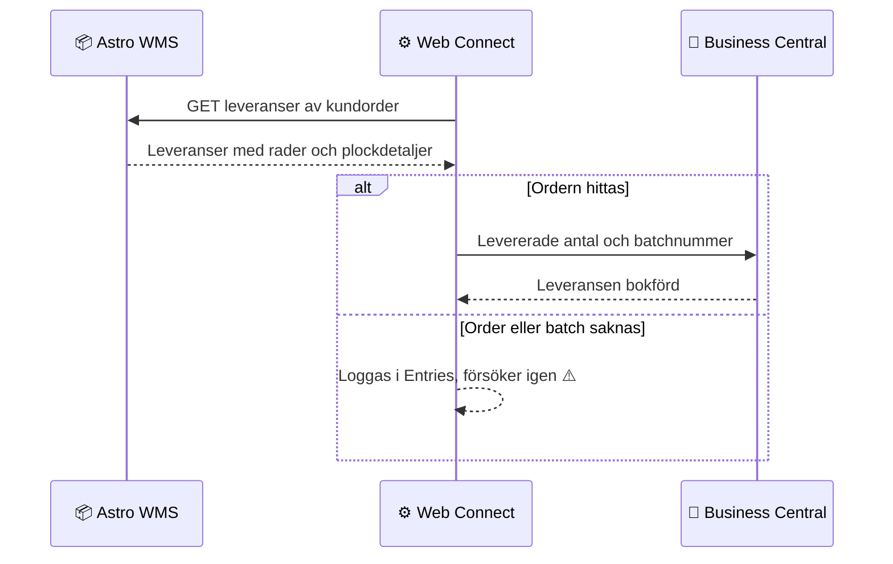

# Från Astro WMS till Business Central: leveranser

Web Connect frågar Astro WMS enligt schema efter nya leveranser av kundorder. Levererade antal och de batchnummer som plockats skrivs till lagerdokumentet i Business Central, och leveransen kan bokföras automatiskt. Varje leverans läses en gång, utifrån sitt leveransnummer.

| | |
|---|---|
| **Riktning** | Astro WMS → Business Central |
| **Startas av** | Schema i Web Connect, anpassat efter dina behov |
| **Resultat** | En bokförd leverans i Business Central med levererade antal, batchnummer och spårningsreferens |
| **Del av** | [Business Central och Astro WMS: integration](../overview.md) |

## Steg för steg

1. Lagret plockar och skickar kundordern (Astro WMS).
2. Web Connect hämtar nya leveranser av kundorder från lagrets API (Web Connect).
3. Varje leverans matchas mot sitt lagerdokument med ordernumret. Leveransnumret sparas, så att samma leverans inte läses två gånger (Web Connect).
4. Beställt och levererat antal per rad, batchnumren från plockdetaljerna och spårningsreferensen skrivs till lagerdokumentet (Web Connect).
5. Leveransen bokförs med arbetsdatumet som bokföringsdatum, med batchnummer på raderna (Business Central).

## Mappning av data

| Fält i Astro WMS | Fält i Business Central | Kommentar |
|---|---|---|
| `Delivery.DeliveryNumber` | Externt ID på lagerdokumentet | Varje leverans läses en gång |
| `Delivery.DeliveryDate` | Datum på lagerdokumentet | |
| `CustomerOrderNumber` | Ordernummer | Matchar lagerdokumentet |
| `OrderLineNumber` | Radnummer | |
| `Sku` | Item No. | |
| `OrderedQuantity`, `DeliveredQuantity` | Beställt och levererat antal | |
| `PickingDetails.BatchId`, `DeliveredQuantity` | Lot No. och antal per batch | |
| `TrackTrace` | Spårningsreferens | Sparas på lagerplockningen eller på försäljningsordern, enligt valet vid uppsättningen |

SSCC som lagret skickar tillbaka sparas inte.

## Objekt i Web Connect

| Objekt | Roll |
|---|---|
| `SPD_SHIPMENT-NOTICE` | Hämtar leveranser av kundorder från lagrets API |
| `SPD_DELIVERY`, `SPD_DELIVERYLINES`, `SPD_DELIVERYLINE` | Leveranshuvud och leveransrader |
| `SPD_PICKINGDETAILS`, `SPD_PICKINGDETAIL` | Batchnummer och antal per rad |

## Felhantering

| Situation | Vad som händer | Vad du gör |
|---|---|---|
| Ett batchnummer saknas | Leveransen bokförs inte, eftersom batchnummer krävs på leveranser | Kontrollera batchen i [Entries](../../../general/entries.md) och artikelspårningen på artikeln |
| Bokföringen misslyckas | Nya försök görs upp till det högsta antalet fel, sedan kommer posten med i det dagliga felmejlet | Rätta orsaken i Business Central och bearbeta posten igen |
| Ingenting kommer in | Inga leveranser hämtas | Se [Ingenting hämtas till Business Central](../../../../../how-to/web-connect/nothing-downloads-to-business-central.md) |

## Vanliga frågor

### Vad händer om lagret levererar mindre än vad som beställts?

Web Connect skriver både beställt och levererat antal per rad. Leveransen bokförs med det levererade antalet, och resten av ordern står kvar som öppen i Business Central.

## Relaterat

- [Business Central och Astro WMS: integration](../overview.md)
- [Utgående order](order-outbound.md) · [Inleveranser](receipt.md)
- [WMS-dokument](../../../general/wms-documents.md) · [Logistics Setup](../../../general/logistics-setup.md)
