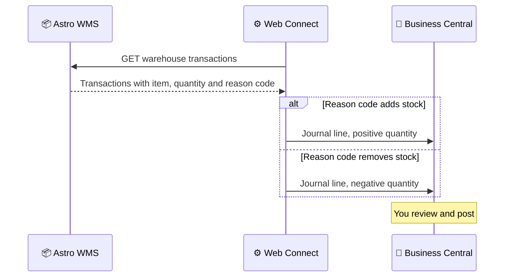

# Astro WMS to Business Central: stock adjustments

Web Connect fetches stock transactions from Astro WMS, such as corrections made in the warehouse. Each transaction is written to the item journal batch for the warehouse in Business Central, and its reason code decides whether the quantity is added or removed. You review the journal and post it.

| | |
|---|---|
| **Direction** | Astro WMS → Business Central |
| **Trigger** | Schedule. [ATT FYLLA I: hur ofta lagertransaktioner hämtas, objektet har inget eget schema i exporten] |
| **Result** | Lines in the item journal batch for the warehouse, ready to post |
| **Part of** | [Business Central and Astro WMS integration](../overview.md) |

## Step by step

1. Stock is corrected in the warehouse (Astro WMS).
2. Web Connect fetches new warehouse transactions from the warehouse API, through the Azure endpoint (Web Connect).
3. Conditions on the reason code decide the sign of each transaction: one reason code adds the quantity, two others remove it (Web Connect).
4. The transactions are written to the adjustment item journal batch set in the logistics setup (Business Central).
5. You review the journal and post it (you).

## Data mapping

| Astro WMS field | Business Central field | Note |
|---|---|---|
| `Sku` | Item No. | |
| `Quantity` | Quantity | Sign set by the reason code |
| `DestStockAvailabilityReasonCode` | Reason on the line | Decides plus or minus. [ATT FYLLA I: vad orsakskoderna 10, 20 och 300 betyder i Astro WMS] |
| `DateTime` | Date and time | |

## Web Connect objects

| Object | Role |
|---|---|
| `SPD_SDP_WAREHOUSETRANS` | Fetches warehouse transactions from the warehouse API |
| `SPD_TRANSACTIONS`, `SPD_TRANSACTION` | The transactions, with the conditions on the reason code |

## Error handling

| Situation | What happens | What to do |
|---|---|---|
| A reason code matches no condition | The quantity is not written | Add the reason code to the conditions in the [Condition List](../../../general/condition-list.md) |
| The item does not exist in Business Central | The line is not created | Check the item number in [Entries](../../../general/entries.md) |

## Frequently asked questions

### Are stock adjustments from the warehouse posted automatically?

Not in the current setup. Adjustments are written to the item journal batch for the warehouse, and you post the journal. Automatic posting can be switched on in the logistics setup.

## Related

- [Business Central and Astro WMS integration](../overview.md)
- [Stock reconciliation](stock-reconciliation.md)
- [Logistics Setup](../../../general/logistics-setup.md) · [Condition List](../../../general/condition-list.md)
