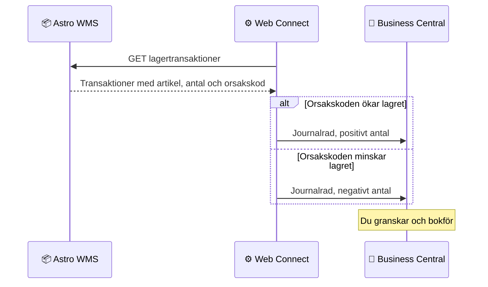

# Från Astro WMS till Business Central: lagerjusteringar

Web Connect hämtar lagertransaktioner från Astro WMS, till exempel rättningar som gjorts i lagret. Varje transaktion skrivs till lagrets artikeljournalsats i Business Central, och orsakskoden avgör om antalet läggs till eller dras av. Du granskar journalen och bokför den.

| | |
|---|---|
| **Riktning** | Astro WMS → Business Central |
| **Startas av** | Schema i Web Connect, anpassat efter dina behov |
| **Resultat** | Rader i lagrets artikeljournalsats, klara att bokföra |
| **Del av** | [Business Central och Astro WMS: integration](../overview.md) |

## Steg för steg

1. Lagersaldot rättas i lagret (Astro WMS).
2. Web Connect hämtar nya lagertransaktioner från lagrets API (Web Connect).
3. Villkor på orsakskoden avgör tecknet på varje transaktion: en orsakskod lägger till antalet, två andra drar av det (Web Connect).
4. Transaktionerna skrivs till den artikeljournalsats för justeringar som anges i logistikinställningarna (Business Central).
5. Du granskar journalen och bokför den (du).

## Mappning av data

| Fält i Astro WMS | Fält i Business Central | Kommentar |
|---|---|---|
| `Sku` | Item No. | |
| `Quantity` | Quantity | Tecknet bestäms av orsakskoden |
| `DestStockAvailabilityReasonCode` | Orsak på raden | Avgör plus eller minus. Vilka koder som ökar och vilka som minskar ställs in i Condition List |
| `DateTime` | Datum och tid | |

## Objekt i Web Connect

| Objekt | Roll |
|---|---|
| `SPD_SDP_WAREHOUSETRANS` | Hämtar lagertransaktioner från lagrets API |
| `SPD_TRANSACTIONS`, `SPD_TRANSACTION` | Transaktionerna, med villkoren på orsakskoden |

## Felhantering

| Situation | Vad som händer | Vad du gör |
|---|---|---|
| En orsakskod matchar inget villkor | Antalet skrivs inte | Lägg till orsakskoden i villkoren i [Condition List](../../../general/condition-list.md) |
| Artikeln finns inte i Business Central | Raden skapas inte | Kontrollera artikelnumret i [Entries](../../../general/entries.md) |

## Vanliga frågor

### Bokförs lagerjusteringar från lagret automatiskt?

Inte i det nuvarande upplägget. Justeringarna skrivs till lagrets artikeljournalsats, och du bokför journalen. Automatisk bokföring kan slås på i logistikinställningarna.

## Relaterat

- [Business Central och Astro WMS: integration](../overview.md)
- [Lageravstämning](stock-reconciliation.md)
- [Logistics Setup](../../../general/logistics-setup.md) · [Condition List](../../../general/condition-list.md)
