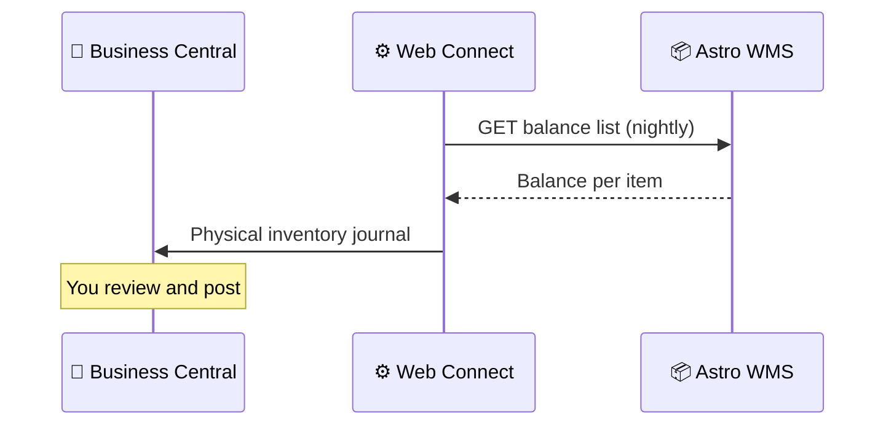

# Astro WMS to Business Central: stock reconciliation

Usually once a night, Web Connect reads the stock balance per item from Astro WMS. The balances are put in the physical inventory journal for the warehouse in Business Central, where you review the differences and post. It catches anything the other flows missed.

| | |
|---|---|
| **Direction** | Astro WMS → Business Central |
| **Trigger** | Schedule in Web Connect, usually once a night |
| **Result** | A physical inventory journal in Business Central with the balances from the warehouse |
| **Part of** | [Business Central and Astro WMS integration](../overview.md) |

## Step by step

1. Web Connect asks the warehouse API for the balance list, through the Azure endpoint (Web Connect).
2. Astro WMS returns the balance per item (Astro WMS).
3. The balances are stored with the time of the reading (Web Connect).
4. The quantities are written to the physical inventory journal batch set in the logistics setup (Business Central).
5. You review the journal and post it (you).

## Data mapping

| Astro WMS field | Business Central field | Note |
|---|---|---|
| `Sku` | Item No. | |
| `Balance` | Physical quantity on the journal line | |
| | Date and time | The time of the reading |

## Web Connect objects

| Object | Role |
|---|---|
| `SPD_BALANCE` | Fetches the balance list from the warehouse API |
| `SPD_ITEMBALANCE` | Balance per item |

## Error handling

| Situation | What happens | What to do |
|---|---|---|
| The reading has not run | No new balances in the journal | See [Integrations not running](../../../../../how-to/web-connect/integration-not-running.md) |
| Large differences in the journal | Nothing is posted until you post | Check shipments, receipts and adjustments in [Entries](../../../general/entries.md) before you post |

## Frequently asked questions

### Is the stock in Business Central overwritten with the stock in Astro WMS?

No. The balances are put in a physical inventory journal, and nothing changes until you post it.

## Related

- [Business Central and Astro WMS integration](../overview.md)
- [Stock adjustments](stock-adjustment.md)
- [Item Inventory](../../../general/item-inventory.md) · [Logistics Setup](../../../general/logistics-setup.md)
