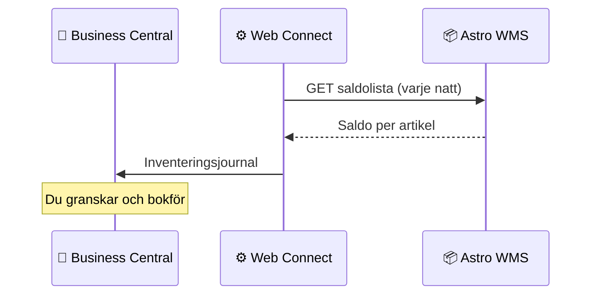

# Från Astro WMS till Business Central: lageravstämning

Oftast en gång per natt läser Web Connect lagersaldot per artikel från Astro WMS. Saldona läggs i lagrets inventeringsjournal i Business Central, där du granskar skillnaderna och bokför. Det fångar upp det som de andra flödena har missat.

| | |
|---|---|
| **Riktning** | Astro WMS → Business Central |
| **Startas av** | Schema i Web Connect, oftast en gång per natt |
| **Resultat** | En inventeringsjournal i Business Central med saldona från lagret |
| **Del av** | [Business Central och Astro WMS: integration](../overview.md) |

## Steg för steg

1. Web Connect ber lagrets API om saldolistan, via Azure-endpointen (Web Connect).
2. Astro WMS skickar tillbaka saldot per artikel (Astro WMS).
3. Saldona sparas med tidpunkten för avläsningen (Web Connect).
4. Antalen skrivs till den inventeringsjournalsats som anges i logistikinställningarna (Business Central).
5. Du granskar journalen och bokför den (du).

## Mappning av data

| Fält i Astro WMS | Fält i Business Central | Kommentar |
|---|---|---|
| `Sku` | Item No. | |
| `Balance` | Inventerat antal på journalraden | |
| | Datum och tid | Tidpunkten för avläsningen |

## Objekt i Web Connect

| Objekt | Roll |
|---|---|
| `SPD_BALANCE` | Hämtar saldolistan från lagrets API |
| `SPD_ITEMBALANCE` | Saldo per artikel |

## Felhantering

| Situation | Vad som händer | Vad du gör |
|---|---|---|
| Avläsningen har inte körts | Inga nya saldon i journalen | Se [Integrationer körs inte](../../../../../how-to/web-connect/integration-not-running.md) |
| Stora skillnader i journalen | Ingenting bokförs förrän du bokför | Kontrollera leveranser, inleveranser och justeringar i [Entries](../../../general/entries.md) innan du bokför |

## Vanliga frågor

### Skrivs lagersaldot i Business Central över med saldot i Astro WMS?

Nej. Saldona läggs i en inventeringsjournal, och ingenting ändras förrän du bokför den.

## Relaterat

- [Business Central och Astro WMS: integration](../overview.md)
- [Lagerjusteringar](stock-adjustment.md)
- [Item Inventory](../../../general/item-inventory.md) · [Logistics Setup](../../../general/logistics-setup.md)
