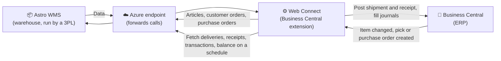
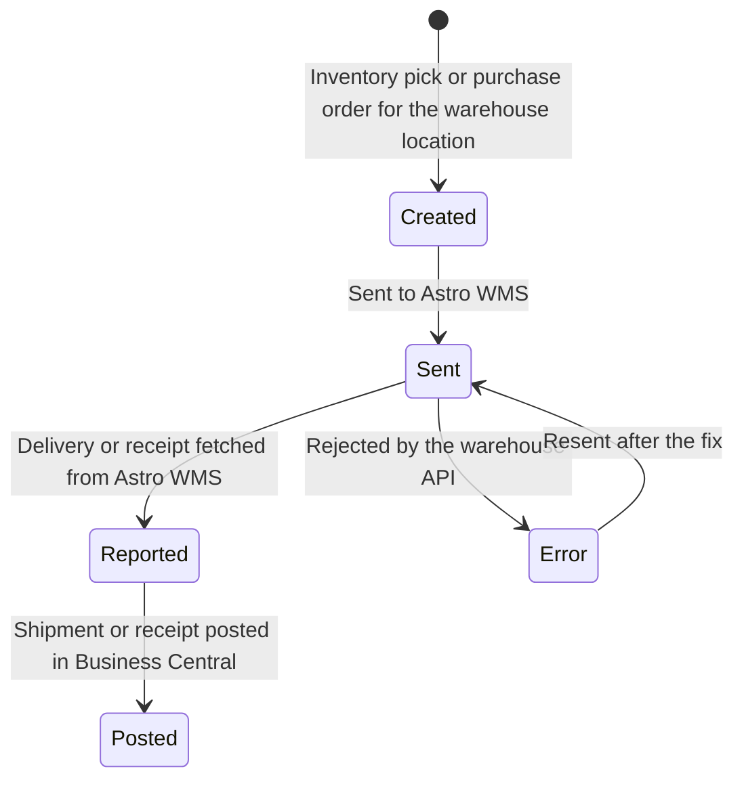
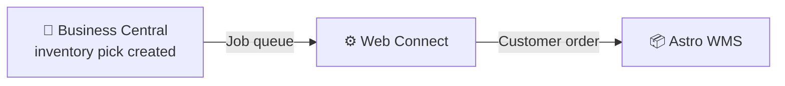
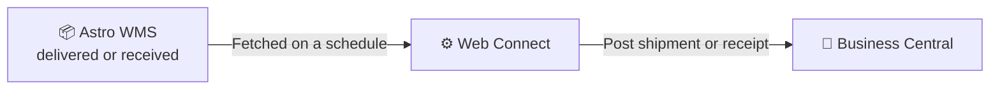
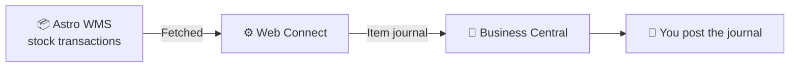
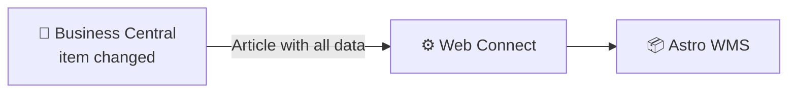

# Business Central and Astro WMS integration

Web Connect by CombineIT connects Microsoft Dynamics 365 Business Central with Astro WMS, the warehouse management system from Consafe Logistics, when a 3PL warehouse runs it for you. Items, outbound orders and purchase orders are sent from Business Central to the warehouse, and shipments, receipts, stock adjustments and stock balances come back to Business Central. All mappings and rules live in your own Business Central, where you can see and change them yourself.

## At a glance

| | |
|---|---|
| **System** | Astro WMS from Consafe Logistics (warehouse management system, here run by a 3PL) |
| **Integration product** | Web Connect for Microsoft Dynamics 365 Business Central |
| **Runs in** | Your own Business Central environment, as an extension. Items are sent when they change, and outbound orders are sent from the Business Central job queue. Web Connect fetches deliveries, receipts, stock transactions and stock balances from the warehouse on a schedule. Calls to the warehouse API pass through an Azure endpoint that only forwards them. [ATT FYLLA I: varför anropen går via Azure-endpointen, till exempel IP-spärr hos 3PL:en] All processing and configuration stays in Business Central. |
| **Configured by** | You, in Business Central: mappings, conditions, triggers and flows. You can do all of it yourself. If you want, CombineIT takes part in any step, as a sounding board or by doing the work. |
| **Connection** | REST API with JSON, provided by the 3PL in front of Astro WMS. OAuth 2.0 client credentials, with tokens from Microsoft Entra ID |
| **Astro WMS API** | [ATT FYLLA I: länk till API-dokumentationen, från 3PL:en eller Consafe Logistics] |
| **Data flows** | 7: items, outbound orders, purchase orders, shipments, receipts, stock adjustments and stock reconciliation |
| **Business Central editions** | [ATT FYLLA I: vilka utgåvor av Business Central som stöds (Essentials, Premium)] |
| **Available from** | [Web Connect on Microsoft AppSource](https://marketplace.microsoft.com/sv-se/product/PUBID.martitab1633951001710%7CAID.webconnect%7CPAPPID.9f3a7223-19db-4ac7-832f-cf8e4699186f?tab=Overview). [ATT FYLLA I: om Astro-integrationen ingår i appen Web Connect Ready Integrations eller levereras som konfiguration] |

## What can be synchronized

Web Connect has seven data flows between Business Central and Astro WMS.

| Data | Direction | What happens |
|---|---|---|
| [Items](flows/items.md) | Business Central → Astro WMS | Items are created or updated as articles, with barcodes, dimensions, country of origin, tariff number and batch handling |
| [Outbound orders](flows/order-outbound.md) | Business Central → Astro WMS | An inventory pick for a sales order is sent to the warehouse as a customer order, with buyer, delivery address and way of delivery |
| [Purchase orders](flows/purchase-order.md) | Business Central → Astro WMS | A purchase order is sent to the warehouse as an inbound order, with supplier and expected receipt date |
| [Shipments](flows/shipment.md) | Astro WMS → Business Central | Delivered quantities and batch numbers come back, and the shipment can be posted automatically |
| [Receipts](flows/receipt.md) | Astro WMS → Business Central | Received quantities and batch numbers come back, and the receipt can be posted automatically |
| [Stock adjustments](flows/stock-adjustment.md) | Astro WMS → Business Central | Stock transactions from the warehouse are written to an item journal in Business Central |
| [Stock reconciliation](flows/stock-reconciliation.md) | Astro WMS → Business Central | The stock balance per item is read once a day and put in a physical inventory journal |

All seven flows are part of the one Astro WMS integration in production today. See [Choose your setup](#choose-your-setup).

## How it works

Astro WMS is run by the 3PL warehouse, and the 3PL provides a REST API in front of it. Web Connect uses the [WMS documents](../../general/wms-documents.md) in Business Central: an inventory pick or a purchase order for the warehouse location gets a warehouse document, which is sent to the warehouse. Web Connect asks the warehouse API on a schedule for new deliveries, receipts, stock transactions and stock balances, updates the warehouse documents and posts shipments and receipts. Before each call, Web Connect gets an access token from Microsoft Entra ID. Every message in both directions is logged in Web Connect [Entries](../../general/entries.md), where it can be inspected and resent.

### Warehouse document status in Business Central

## Choose your setup

Each flow has to fit how your business works: which system owns the data, where people do their work, and what the accounting needs. That is why the flows are decided together when a new integration is set up. The options below are the ones Web Connect customers use today. **Common setup** marks the option most Web Connect customers with Astro WMS use. **Recommended** marks CombineIT's best practice, where there is one.

Only one Web Connect customer runs Astro WMS today, so no option is marked as common setup. Each area below shows how that integration is set up. Other options in the [logistics setup](../../general/logistics-setup.md) work the same way as for other warehouse systems, but they have not been used with Astro WMS yet.

### Outbound orders

| Option | How it works | When it fits |
|---|---|---|
| **Inventory picks sent from the job queue** | When an inventory pick is created for a sales order at the warehouse location, the job queue sends picks that have not been sent yet to Astro WMS as customer orders | Business Central is where orders are handled, and the warehouse should get them without a manual step |

#### Outbound orders as inventory picks sent from the job queue

### Shipments and receipts

| Option | How it works | When it fits |
|---|---|---|
| **Posted automatically** | When Astro WMS reports a delivery or a receipt, the quantities and batch numbers are written to the warehouse document and the shipment or receipt is posted with the work date as posting date | The warehouse's quantities can be trusted without a manual check |

#### Shipments and receipts posted automatically

### Stock adjustments

| Option | How it works | When it fits |
|---|---|---|
| **Written to the journal, posted by you** | Stock transactions from Astro WMS are written to an item journal batch for the warehouse. The reason code on each transaction decides whether the quantity is added or removed | You want to review adjustments before they affect stock value |

#### Stock adjustments posted by you

### Item data

| Option | How it works | When it fits |
|---|---|---|
| **All item data from Business Central** | Item number, name, barcodes, dimensions, weight, country of origin, tariff number and batch handling are sent from Business Central when one of the trigger fields changes | Business Central owns the item data |

#### All item data from Business Central

Warehouse locations, picking, packing and carrier booking are always maintained in Astro WMS.

## What you need

- Microsoft Dynamics 365 Business Central [ATT FYLLA I: utgåva och lägsta version]
- Web Connect installed from Microsoft AppSource, with an activated Web Connect license
- Your approval for Web Connect to be installed and to act in your Business Central environment
- API access from the 3PL: a client ID and client secret registered in the 3PL's Microsoft Entra ID, the API scope, and your partner ID in the warehouse API
- A location in Business Central for the warehouse the 3PL runs, a number series for warehouse documents, an item journal batch for stock adjustments and a physical inventory journal batch for the stock reconciliation
- Item tracking codes in Business Central if you use batch numbers, since batch numbers are required on shipments and receipts when batch handling is used

## Setting it up

1. Decide which flows to use and which option to choose for each, see [Choose your setup](#choose-your-setup).
2. Install Web Connect in Business Central, activate the license and give your approval.
3. Import the Astro WMS configuration with the integration turned off, then set your location, journal batches and partner ID.
4. Store the client ID and client secret from the 3PL in [Secret Value Storage](../../general/secret-value-storage.md) and set up the token request.
5. Translate your shipping agents to the warehouse's delivery codes in [Text Mapping](../../general/text-mapping.md).
6. Test items, orders and purchase orders against the 3PL's test environment before going live. [ATT FYLLA I: om 3PL:en har en testmiljö för API:t]

## Configure it yourself in Business Central

All configuration and logic in the integration is visible and editable in Business Central. There is no external integration platform where the logic is hidden. The Azure endpoint between Web Connect and the warehouse API only forwards the calls.

| What you can change | Where in Web Connect | Example |
|---|---|---|
| Which documents are integrated | [Logistics Setup](../../general/logistics-setup.md) | Send inventory picks and purchase orders for the warehouse location |
| Whether shipments and receipts are posted | [Logistics Setup](../../general/logistics-setup.md) | Post shipments and receipts automatically, with the work date as posting date |
| What is sent to the warehouse | [Outgoing Mapping](../../general/outgoing-mapping/README.md) | Add or remove a field on the article or the customer order |
| What triggers an item update | [Outgoing Sync Triggers](../../general/outgoing-mapping/outgoing-sync-triggers.md) | Resend the article when the name, base unit of measure or tariff number changes |
| Which items are sent | [Outgoing Sync Triggers](../../general/outgoing-mapping/outgoing-sync-triggers.md) | Only send inventory items that are not blocked and have a tariff number |
| How values are translated | [Text Mapping](../../general/text-mapping.md) | Translate the shipping agent in Business Central to the delivery code in the warehouse |
| How stock transactions are read | [Condition List](../../general/condition-list.md) | Decide which reason codes add stock and which remove it |
| Monitoring and resending | [Entries](../../general/entries.md) | See every order and delivery message, and [resend a message](../../../../how-to/web-connect/resend-outgoing-message.md) |

## Configuration choices

- **Location:** which Business Central location the 3PL runs. Only documents for that location are sent to the warehouse.
- **Document types:** inventory picks and purchase orders are switched on one by one in the logistics setup.
- **Posting rules:** whether shipments and receipts are posted automatically, and which posting date is used.
- **Batch numbers:** whether batch numbers are required on shipments and receipts.
- **Way of delivery:** how each shipping agent in Business Central is translated to a delivery code in the warehouse, and which code is used when the order has no shipping agent.
- **Item data:** which item fields are sent, and which items are included.
- **Order currency:** the currency sent on customer orders is set in the mapping.
- **Cancellation:** whether the warehouse may cancel orders. The setting allows whole orders. [ATT FYLLA I: hur en avbokning skickas till Astro WMS, det finns inget avbokningsobjekt i konfigurationen]
- **Error handling:** how many times a failed message is retried, and who receives the daily error summary email.

## Limitations

- **The integration uses the 3PL's API in front of Astro WMS.** Web Connect does not connect to an Astro WMS installation directly, so a new 3PL means checking its API first. [ATT FYLLA I: om Astro WMS hos andra lager har samma API eller filöverföring]
- **Deliveries, receipts and stock are fetched on a schedule.** Business Central is not told about changes in the warehouse in real time.
- **The stock balance is read once a day.** Differences are put in a physical inventory journal for you to review and post.
- **Stock adjustments are not posted automatically.** They are written to an item journal, and you post it.
- **The tracking reference from the warehouse is not stored in Business Central** in the current configuration. [ATT FYLLA I: om spårningsnumret ska sparas på leveransen]
- **Order changes and cancellations are not sent to the warehouse.** [ATT FYLLA I: hur en ändrad eller avbokad order hanteras mot lagret]
- **Long texts are cut.** Item names and order line descriptions are sent with at most 60 characters, and customer references and supplier names with at most 35.

## Frequently asked questions

### Can Business Central be integrated with Astro WMS?

Yes. Web Connect connects Business Central with Astro WMS through the REST API that the 3PL warehouse provides in front of Astro WMS. Items, outbound orders and purchase orders are sent to the warehouse, and shipments, receipts, stock adjustments and stock balances come back to Business Central.

### Are shipments and receipts posted automatically in Business Central?

They can be. When the warehouse reports a delivery or a receipt, Web Connect updates the warehouse document in Business Central and can post the shipment or receipt, including batch numbers. Whether posting is automatic is a setting in the logistics setup.

### Is the stock in Business Central overwritten with the stock in Astro WMS?

No. The stock balance from the warehouse is put in a physical inventory journal, and stock adjustments are put in an item journal. Nothing changes the stock in Business Central until the journal is posted.

### Can we change what is sent between Business Central and Astro WMS ourselves?

Yes. Field mappings, carrier translations, triggers and which document types are integrated are configured in Web Connect inside your own Business Central. You can see and change them without asking a supplier to change an external platform.

## Related

- Flows: [Items](flows/items.md) · [Outbound orders](flows/order-outbound.md) · [Purchase orders](flows/purchase-order.md) · [Shipments](flows/shipment.md) · [Receipts](flows/receipt.md) · [Stock adjustments](flows/stock-adjustment.md) · [Stock reconciliation](flows/stock-reconciliation.md)
- How-to: [WMS request not sent](../../../../how-to/web-connect/wms-request-not-sent-error.md) · [Resend an outgoing message](../../../../how-to/web-connect/resend-outgoing-message.md) · [Integrations not running](../../../../how-to/web-connect/integration-not-running.md) · [Unauthorized after the job queue stopped](../../../../how-to/web-connect/unauthorized-after-job-queue-stopped.md)
- Web Connect: [Logistics Setup](../../general/logistics-setup.md) · [WMS documents](../../general/wms-documents.md) · [Secret Value Storage](../../general/secret-value-storage.md)
- [Web Connect general documentation](../../general/README.md)
- [Astro WMS from Consafe Logistics](https://www.consafelogistics.com/)

## About Web Connect

Web Connect is an integration platform for Microsoft Dynamics 365 Business Central, developed by CombineIT. It is installed in your own Business Central and connects it with e-commerce platforms, warehouse systems, POS, returns, marketplaces and EDI. Every flow, mapping and rule is configured in Business Central, where you can see and change it yourself, without custom code for each integration. [Web Connect on Microsoft AppSource](https://marketplace.microsoft.com/sv-se/product/PUBID.martitab1633951001710%7CAID.webconnect%7CPAPPID.9f3a7223-19db-4ac7-832f-cf8e4699186f?tab=Overview) · [Contact CombineIT](https://www.combineit.se/contact/)
