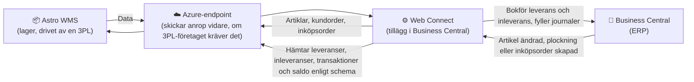
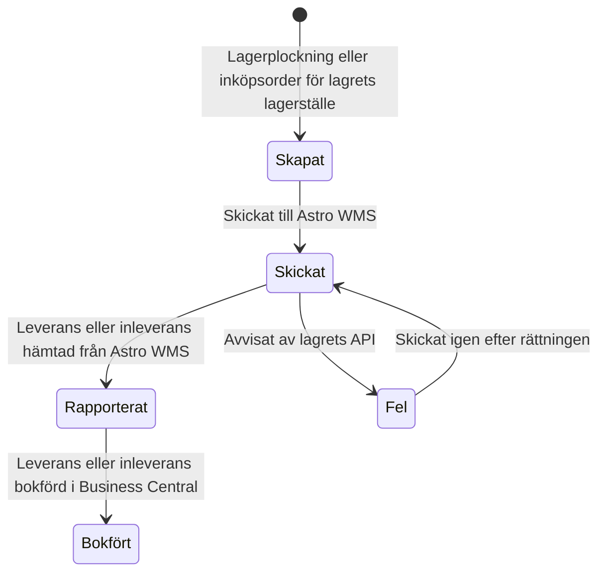
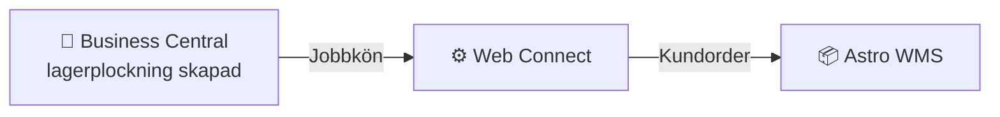
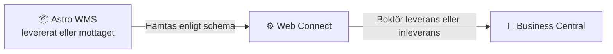
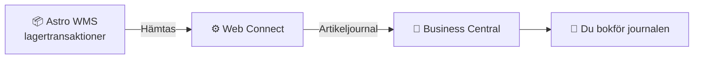
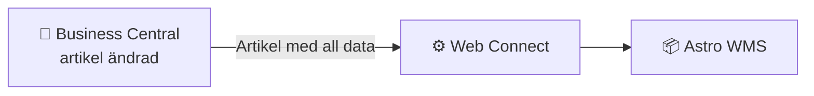

# Business Central och Astro WMS: integration

Web Connect från CombineIT kopplar Microsoft Dynamics 365 Business Central till Astro WMS, lagersystemet från Consafe Logistics, när ett 3PL-lager kör det åt dig. Artiklar, utgående order och inköpsorder skickas från Business Central till lagret, och leveranser, inleveranser, lagerjusteringar och lagersaldon kommer tillbaka till Business Central. Alla mappningar och regler finns i ditt eget Business Central, där du själv kan se och ändra dem.

## I korthet

| | |
|---|---|
| **System** | Astro WMS från Consafe Logistics (lagersystem, här drivet av en 3PL) |
| **Integrationsprodukt** | Web Connect för Microsoft Dynamics 365 Business Central |
| **Körs i** | Din egen Business Central-miljö, som ett tillägg. Artiklar skickas när de ändras, och utgående order skickas från jobbkön i Business Central. Web Connect hämtar leveranser, inleveranser, lagertransaktioner och lagersaldon från lagret enligt schema. Om 3PL-företagets miljö bara tar emot anrop från kända adresser går anropen via en Azure-endpoint som bara skickar dem vidare. Annars anropar Web Connect lagrets API direkt. All bearbetning och konfiguration stannar i Business Central. |
| **Konfigureras av** | Dig, i Business Central: mappningar, villkor, triggers och flöden. Du kan göra allt själv. Vill du kan CombineIT vara med i vilket steg som helst, som bollplank eller genom att göra jobbet. |
| **Koppling** | REST API med JSON, som 3PL-företaget har framför Astro WMS. OAuth 2.0 client credentials, med token från Microsoft Entra ID |
| **API för Astro WMS** | Astro WMS har ingen publik API-dokumentation. API:et och dokumentationen kommer från 3PL-företaget som driver lagret |
| **Dataflöden** | 7: artiklar, utgående order, inköpsorder, leveranser, inleveranser, lagerjusteringar och lageravstämning |
| **Business Central-utgåvor** | Alla utgåvor, Essentials och Premium, även den senaste versionen |
| **Finns på** | [Web Connect på Microsoft AppSource](https://marketplace.microsoft.com/sv-se/product/PUBID.martitab1633951001710%7CAID.webconnect%7CPAPPID.9f3a7223-19db-4ac7-832f-cf8e4699186f?tab=Overview). Integrationen med Astro WMS ingår inte i appen Web Connect Ready Integrations. Den sätts upp som en konfiguration i Web Connect |

## Det här kan synkas

Web Connect har sju dataflöden mellan Business Central och Astro WMS.

| Data | Riktning | Vad som händer |
|---|---|---|
| [Artiklar](flows/items.md) | Business Central → Astro WMS | Artiklar skapas eller uppdateras i Astro WMS, med streckkoder, mått, ursprungsland, tullnummer och batchhantering |
| [Utgående order](flows/order-outbound.md) | Business Central → Astro WMS | En lagerplockning för en försäljningsorder skickas till lagret som kundorder, med köpare, leveransadress och leveranssätt |
| [Inköpsorder](flows/purchase-order.md) | Business Central → Astro WMS | En inköpsorder skickas till lagret som inleveransorder när den släpps eller med en åtgärd på ordern |
| [Leveranser](flows/shipment.md) | Astro WMS → Business Central | Levererade antal, batchnummer och spårningsreferensen kommer tillbaka, och leveransen kan bokföras automatiskt |
| [Inleveranser](flows/receipt.md) | Astro WMS → Business Central | Mottagna antal och batchnummer kommer tillbaka, och inleveransen kan bokföras automatiskt |
| [Lagerjusteringar](flows/stock-adjustment.md) | Astro WMS → Business Central | Lagertransaktioner från lagret skrivs till en artikeljournal i Business Central |
| [Lageravstämning](flows/stock-reconciliation.md) | Astro WMS → Business Central | Lagersaldot per artikel läses enligt schema, oftast en gång per natt, och läggs i en inventeringsjournal |

Alla sju flödena ingår i den enda integrationen med Astro WMS som är i drift i dag. Se [Välj upplägg](#choose-your-setup).

## Så fungerar det

Astro WMS drivs av 3PL-lagret, och 3PL-företaget har ett REST API framför det. Web Connect använder [WMS-dokumenten](../../general/wms-documents.md) i Business Central: en lagerplockning eller en inköpsorder för lagrets lagerställe får ett lagerdokument, som skickas till lagret. Web Connect frågar lagrets API enligt schema efter nya leveranser, inleveranser, lagertransaktioner och lagersaldon, uppdaterar lagerdokumenten och bokför leveranser och inleveranser. Före varje anrop hämtar Web Connect en åtkomsttoken från Microsoft Entra ID. Varje meddelande i båda riktningarna loggas i Web Connect [Entries](../../general/entries.md), där det kan granskas och skickas om.

### Lagerdokumentets status i Business Central

## Välj upplägg

Varje flöde måste passa hur ditt företag arbetar: vilket system som äger datan, var personalen gör sitt arbete och vad bokföringen behöver. Därför bestäms flödena tillsammans när en ny integration sätts upp. Alternativen nedan är de som Web Connect-kunder använder i dag. **Vanligt upplägg** markerar det alternativ som flest Web Connect-kunder med Astro WMS använder. **Rekommenderas** markerar CombineIT:s bästa praxis, där det finns en.

Bara en Web Connect-kund kör Astro WMS i dag, så inget alternativ är markerat som vanligt upplägg. Varje område nedan visar hur den integrationen är uppsatt. Andra alternativ i [logistikinställningarna](../../general/logistics-setup.md) fungerar på samma sätt som för andra lagersystem, men de har inte använts med Astro WMS än.

### Utgående order

| Alternativ | Så fungerar det | När det passar |
|---|---|---|
| **Lagerplockningar skickas från jobbkön** | När en lagerplockning skapas för en försäljningsorder på lagrets lagerställe skickar jobbkön de plockningar som inte skickats än till Astro WMS som kundorder | Orderna hanteras i Business Central, och lagret ska få dem utan något manuellt steg |

#### Utgående order som lagerplockningar från jobbkön

### Leveranser och inleveranser

| Alternativ | Så fungerar det | När det passar |
|---|---|---|
| **Bokförs automatiskt** | När Astro WMS rapporterar en leverans eller en inleverans skrivs antal och batchnummer till lagerdokumentet, och leveransen eller inleveransen bokförs med arbetsdatumet som bokföringsdatum | Lagrets antal går att lita på utan manuell kontroll |

#### Leveranser och inleveranser som bokförs automatiskt

### Lagerjusteringar

| Alternativ | Så fungerar det | När det passar |
|---|---|---|
| **Skrivs till journalen, du bokför** | Lagertransaktioner från Astro WMS skrivs till en artikeljournal för lagret. Orsakskoden på varje transaktion avgör om antalet läggs till eller dras av | Du vill granska justeringarna innan de påverkar lagervärdet |

#### Lagerjusteringar som du bokför

### Artikeldata

| Alternativ | Så fungerar det | När det passar |
|---|---|---|
| **All artikeldata från Business Central** | Artikelnummer, namn, streckkoder, mått, vikt, ursprungsland, tullnummer och batchhantering skickas från Business Central när något av triggerfälten ändras | Business Central äger artikeldatan |

#### All artikeldata från Business Central

Lagerplatser, plockning, packning och transportbokning sköts alltid i Astro WMS.

## Det här behöver du

- Microsoft Dynamics 365 Business Central, valfri utgåva (Essentials eller Premium), även den senaste versionen
- Web Connect installerat från Microsoft AppSource, med en aktiverad Web Connect-licens
- Ditt godkännande av att Web Connect installeras och får agera i din Business Central-miljö
- API-åtkomst från 3PL-företaget: ett klient-ID och en klienthemlighet registrerade i 3PL-företagets Microsoft Entra ID, API-scopet och ditt partner-ID i lagrets API
- Ett lagerställe i Business Central för lagret som 3PL-företaget driver, en nummerserie för lagerdokument, en artikeljournalsats för lagerjusteringar och en inventeringsjournalsats för lageravstämningen
- Artikelspårningskoder i Business Central om du använder batchnummer, eftersom batchnummer krävs på leveranser och inleveranser när batchhantering används

## Så kommer du igång

1. Bestäm vilka flöden du ska använda och vilket alternativ du väljer för varje, se [Välj upplägg](#choose-your-setup).
2. Installera Web Connect i Business Central, aktivera licensen och ge ditt godkännande.
3. Importera konfigurationen för Astro WMS med integrationen avstängd, och ställ sedan in lagerställe, journalsatser och partner-ID.
4. Spara klient-ID:t och klienthemligheten från 3PL-företaget i [Secret Value Storage](../../general/secret-value-storage.md) och sätt upp anropet som hämtar token.
5. Översätt dina speditörer till lagrets leveranskoder i [Text Mapping](../../general/text-mapping.md).
6. Ställ in hur ofta leveranser, inleveranser, lagertransaktioner och lagersaldon hämtas.
7. Testa artiklar, order och inköpsorder innan ni går live.

## Konfigurera själv i Business Central

All konfiguration och logik i integrationen syns och kan ändras i Business Central. Det finns ingen extern integrationsplattform där logiken är dold. När anrop går via en Azure-endpoint skickar den bara anropen vidare.

| Det här kan du ändra | Var i Web Connect | Exempel |
|---|---|---|
| Vilka dokument som integreras | [Logistics Setup](../../general/logistics-setup.md) | Skicka lagerplockningar och inköpsorder för lagrets lagerställe |
| Om leveranser och inleveranser bokförs | [Logistics Setup](../../general/logistics-setup.md) | Bokför leveranser och inleveranser automatiskt, med arbetsdatumet som bokföringsdatum |
| Hur ofta data hämtas | [Objects](../../general/objects.md) | Hämta inleveranser var femte minut under dagen och lagersaldot en gång per natt |
| Vad som skickas till lagret | [Outgoing Mapping](../../general/outgoing-mapping/README.md) | Lägg till eller ta bort ett fält på artikeln eller kundordern |
| Vad som startar en artikeluppdatering | [Outgoing Sync Triggers](../../general/outgoing-mapping/outgoing-sync-triggers.md) | Skicka artikeln igen när namnet, basenheten eller tullnumret ändras |
| Vilka artiklar som skickas | [Outgoing Sync Triggers](../../general/outgoing-mapping/outgoing-sync-triggers.md) | Skicka bara lagerartiklar som inte är spärrade och som har tullnummer |
| Hur värden översätts | [Text Mapping](../../general/text-mapping.md) | Översätt speditören i Business Central till leveranskoden i lagret |
| Hur lagertransaktioner läses | [Condition List](../../general/condition-list.md) | Bestäm vilka orsakskoder som ökar lagret och vilka som minskar det |
| Bevakning och omsändning | [Entries](../../general/entries.md) | Se varje order och leveransmeddelande, och [skicka om ett meddelande](../../../../how-to/web-connect/resend-outgoing-message.md) |

## Val i konfigurationen

- **Lagerställe:** vilket lagerställe i Business Central som 3PL-företaget driver. Bara dokument för det lagerstället skickas till lagret.
- **Dokumenttyper:** lagerplockningar och inköpsorder slås på var för sig i logistikinställningarna.
- **Inköpsorder skickas:** när inköpsordern släpps, eller med en åtgärd på inköpsordern.
- **Scheman:** hur ofta leveranser, inleveranser, lagertransaktioner och lagersaldon hämtas från lagret, anpassat efter dina behov.
- **Spårningsreferens:** om spårningsreferensen från lagret sparas på lagerplockningen eller på försäljningsordern.
- **Regler för bokföring:** om leveranser och inleveranser bokförs automatiskt, och vilket bokföringsdatum som används.
- **Batchnummer:** om batchnummer krävs på leveranser och inleveranser.
- **Leveranssätt:** hur varje speditör i Business Central översätts till en leveranskod i lagret, och vilken kod som används när ordern saknar speditör.
- **Artikeldata:** vilka artikelfält som skickas, och vilka artiklar som tas med.
- **Ordervaluta:** valutan som skickas på kundorder ställs in i mappningen.
- **Felhantering:** hur många gånger ett misslyckat meddelande försöks igen, och vem som får den dagliga felsammanfattningen via mejl.

## Begränsningar

- **Integrationen använder 3PL-företagets API framför Astro WMS.** Web Connect kopplar inte direkt mot en installation av Astro WMS, så med en ny 3PL behöver dess API kontrolleras först.
- **Leveranser, inleveranser och lagersaldo hämtas enligt schema.** Business Central får inte veta om ändringar i lagret i realtid.
- **Lagersaldot läses enligt schema, oftast en gång per natt.** Skillnader läggs i en inventeringsjournal som du granskar och bokför.
- **Lagerjusteringar bokförs inte automatiskt.** De skrivs till en artikeljournal, och du bokför den.
- **Makuleringar skickas inte till lagret.** Det finns inget flöde för makuleringar till Astro WMS.
- **Långa texter kortas.** Artikelnamn och beskrivningar på orderrader skickas med högst 60 tecken, och kundreferenser och leverantörsnamn med högst 35.

## Vanliga frågor

### Går det att integrera Business Central med Astro WMS?

Ja. Web Connect kopplar Business Central till Astro WMS via det REST API som 3PL-lagret har framför Astro WMS. Artiklar, utgående order och inköpsorder skickas till lagret, och leveranser, inleveranser, lagerjusteringar och lagersaldon kommer tillbaka till Business Central.

### Bokförs leveranser och inleveranser automatiskt i Business Central?

Det kan de göra. När lagret rapporterar en leverans eller en inleverans uppdaterar Web Connect lagerdokumentet i Business Central och kan bokföra leveransen eller inleveransen, med batchnummer. Om bokföringen sker automatiskt är en inställning i logistikinställningarna.

### Skrivs lagersaldot i Business Central över med saldot i Astro WMS?

Nej. Lagersaldot från lagret läggs i en inventeringsjournal, och lagerjusteringar läggs i en artikeljournal. Ingenting ändrar lagersaldot i Business Central förrän journalen bokförs.

### Kan vi själva ändra vad som skickas mellan Business Central och Astro WMS?

Ja. Fältmappningar, översättningar av transportörer, triggers och vilka dokumenttyper som integreras konfigureras i Web Connect i ditt eget Business Central. Du kan se och ändra dem utan att be en leverantör ändra i en extern plattform.

## Relaterat

- Flöden: [Artiklar](flows/items.md) · [Utgående order](flows/order-outbound.md) · [Inköpsorder](flows/purchase-order.md) · [Leveranser](flows/shipment.md) · [Inleveranser](flows/receipt.md) · [Lagerjusteringar](flows/stock-adjustment.md) · [Lageravstämning](flows/stock-reconciliation.md)
- Instruktioner: [WMS-anrop skickas inte](../../../../how-to/web-connect/wms-request-not-sent-error.md) · [Skicka om ett utgående meddelande](../../../../how-to/web-connect/resend-outgoing-message.md) · [Integrationer körs inte](../../../../how-to/web-connect/integration-not-running.md) · [Unauthorized efter att jobbkön stannat](../../../../how-to/web-connect/unauthorized-after-job-queue-stopped.md)
- Web Connect: [Logistics Setup](../../general/logistics-setup.md) · [WMS-dokument](../../general/wms-documents.md) · [Secret Value Storage](../../general/secret-value-storage.md)
- [Allmän dokumentation för Web Connect](../../general/README.md)
- [Astro WMS från Consafe Logistics](https://www.consafelogistics.com/)

## Om Web Connect

Web Connect är en integrationsplattform för Microsoft Dynamics 365 Business Central, utvecklad av CombineIT. Den installeras i ditt eget Business Central och kopplar det till e-handelsplattformar, lagersystem, kassasystem, returlösningar, marknadsplatser och EDI. Varje flöde, mappning och regel konfigureras i Business Central, där du själv kan se och ändra den, utan specialkod för varje integration. [Web Connect på Microsoft AppSource](https://marketplace.microsoft.com/sv-se/product/PUBID.martitab1633951001710%7CAID.webconnect%7CPAPPID.9f3a7223-19db-4ac7-832f-cf8e4699186f?tab=Overview) · [Kontakta CombineIT](https://www.combineit.se/contact/)
