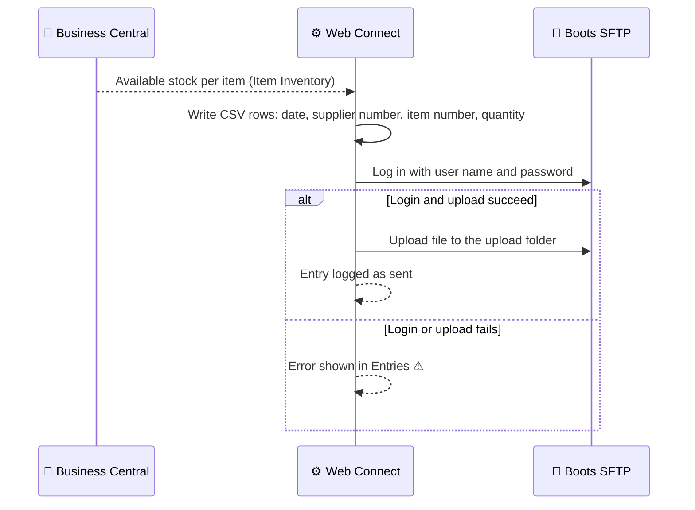

# Business Central to Boots marketplace: stock

Web Connect calculates the available stock per item in Business Central and writes it to a comma separated file with the date, your supplier number at Boots, the item number and the quantity. The file is uploaded to the upload folder on the Boots SFTP server, where Boots reads it and updates the stock on your products.

| | |
|---|---|
| **Direction** | Business Central → Boots |
| **Trigger** | [ATT FYLLA I: a schedule in the job queue or outgoing sync triggers on the calculated stock] |
| **Result** | A new stock file is in the upload folder on the Boots SFTP server |
| **Part of** | [Business Central and Boots marketplace integration](../overview.md) |

## Step by step

1. Web Connect calculates the available stock per item in [Item Inventory](../../../general/item-inventory.md), using the locations and rules in [Destinations](../../../general/destinations.md).
2. When the upload runs, Web Connect writes one row per item with today's date, the supplier number, the item number and the stock. [ATT FYLLA I: all items in the file every time, or only items whose stock changed?]
3. Web Connect logs in to the Boots SFTP server with the user name and the password from Secret Value Storage.
4. The file is uploaded to the upload folder, always with the same file name.
5. The upload is logged in Web Connect Entries.

## Data mapping

The file has no header row. The columns are written in this order, separated by commas.

| Column | Business Central value | Note |
|---|---|---|
| 1. Date | Today's date | Format DD/MM/YYYY |
| 2. Supplier number | Fixed value in the mapping | Your supplier number at Boots. [ATT FYLLA I: confirm that Boots calls this the supplier number] |
| 3. Vendor article number | Item No. | Must match the vendor article number Boots has on the product |
| 4. Quantity | Calculated stock in Item Inventory | Sent as a number |

## Web Connect objects

| Object | Role |
|---|---|
| `BOOTS` | The integration: connection type SFTP server, port 22, comma separated text |
| `BOOTS-SFTP` | Login to the Boots SFTP server with user name and password |
| `BOOTS_STOCKFILE` | Writes the stock rows from Item Inventory and uploads the file |
| `CURRENT-DATE` | Integration variable that gives today's date for the first column |

## Error handling

| Situation | What happens | What to do |
|---|---|---|
| Login to the SFTP server fails | The entry gets an error in Web Connect Entries and no file is uploaded | Check the user name, and the password in [Secret Value Storage](../../../general/secret-value-storage.md). Then [resend the message](../../../../../how-to/web-connect/resend-outgoing-message.md) |
| Boots does not update the stock for a product | The item number in the file does not match a vendor article number with Boots, or the product is not set up with Boots yet | Check the product with Boots. Nothing is reported back to Business Central |
| The quantity is not what you expect | The stock is calculated from the locations and rules in Destinations | Check the item in [Item Inventory](../../../general/item-inventory.md) and the locations in Destinations |
| No file is uploaded at all | The job queue is not running | See [Integration is not running](../../../../../how-to/web-connect/integration-not-running.md) |

## Frequently asked questions

### Which item number does Boots see?

The Business Central item number, sent in the column for the vendor article number. It must match the vendor article number Boots has on the product.

### Does the file have a header row?

No. Each row has four columns in a fixed order: date, supplier number, item number and quantity, separated by commas.

## Related

- [Business Central and Boots marketplace integration](../overview.md)
- [Item Inventory](../../../general/item-inventory.md) · [Destinations](../../../general/destinations.md) · [Outgoing Data](../../../general/outgoing-mapping/outgoing-data-web.md)
- How-to: [Send inventory to external systems](../../../../../how-to/web-connect/outgoing-inventory-to-external-systems.md) · [Resend an outgoing message](../../../../../how-to/web-connect/resend-outgoing-message.md)
