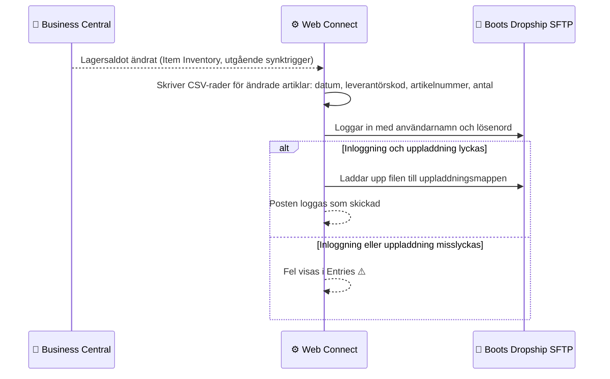

# Från Business Central till Boots marketplace: lagersaldo

När lagersaldot ändras skriver Web Connect det tillgängliga lagersaldot för de ändrade artiklarna i Business Central till en kommaseparerad fil med datum, din leverantörskod hos Boots, artikelnummer och antal. Filen laddas upp till SFTP-brevlådan på plattformen Boots Dropship, där lagersaldot på dina produkter uppdateras.

| | |
|---|---|
| **Riktning** | Business Central → Boots |
| **Startas av** | Utgående synktriggers när det beräknade lagersaldot ändras. Jobbkön skickar filen, och hur ofta den körs kan anpassas efter vad ditt företag behöver |
| **Resultat** | En ny lagerfil ligger i uppladdningsmappen i SFTP-brevlådan i Boots Dropship |
| **Del av** | [Business Central och Boots marketplace: integration](../overview.md) |

## Steg för steg

1. Web Connect beräknar det tillgängliga lagersaldot per artikel i [Item Inventory](../../../general/item-inventory.md), utifrån lagerställena och reglerna i [Destinations](../../../general/destinations.md).
2. När det beräknade lagersaldot för en artikel ändras markerar en utgående synktrigger artikeln för Boots.
3. När jobbkön körs skriver Web Connect en rad per ändrad artikel med dagens datum, leverantörskoden, artikelnumret och lagersaldot.
4. Web Connect loggar in i SFTP-brevlådan med användarnamnet och lösenordet från Secret Value Storage.
5. Filen laddas upp till uppladdningsmappen, alltid med samma filnamn.
6. Uppladdningen loggas i Web Connect Entries.

## Mappning av data

Filen har ingen rubrikrad. Kolumnerna skrivs i den här ordningen, åtskilda med kommatecken.

| Kolumn | Värde i Business Central | Kommentar |
|---|---|---|
| 1. Datum | Dagens datum | Format DD/MM/YYYY |
| 2. Leverantörskod | Fast värde i mappningen | Din leverantörskod på plattformen Boots Dropship |
| 3. Leverantörens artikelnummer (vendor article number) | Item No. | Ditt eget produkt-SKU, inte Boots produktreferens. Måste stämma med det leverantörsartikelnummer som Boots har på produkten |
| 4. Antal | Beräknat lagersaldo i Item Inventory | Skickas som ett tal |

## Objekt i Web Connect

| Objekt | Roll |
|---|---|
| `BOOTS` | Integrationen: anslutningstyp SFTP-server, port 22, kommaseparerad text |
| `BOOTS-SFTP` | Inloggning i SFTP-brevlådan med användarnamn och lösenord |
| `BOOTS_STOCKFILE` | Skriver lagerraderna från Item Inventory och laddar upp filen |
| `CURRENT-DATE` | Integrationsvariabel som ger dagens datum till första kolumnen |

## Felhantering

| Situation | Vad som händer | Vad du gör |
|---|---|---|
| Inloggningen på SFTP-servern misslyckas | Posten får ett fel i Web Connect Entries och ingen fil laddas upp | Kontrollera användarnamnet och lösenordet i [Secret Value Storage](../../../general/secret-value-storage.md). Sedan [skickar du om meddelandet](../../../../../how-to/web-connect/resend-outgoing-message.md) |
| Boots uppdaterar inte lagersaldot för en produkt | Artikelnumret i filen stämmer inte med något leverantörsartikelnummer hos Boots, eller så är produkten inte uppsatt hos Boots än | Kontrollera produkten på plattformen Boots Dropship. Ingenting rapporteras tillbaka till Business Central |
| Antalet är inte det du väntar dig | Lagersaldot beräknas utifrån lagerställena och reglerna i Destinations | Kontrollera artikeln i [Item Inventory](../../../general/item-inventory.md) och lagerställena i Destinations |
| Ingen fil laddas upp alls | Inget lagersaldo har ändrats, eller så körs inte jobbkön | Se [Integrationen körs inte](../../../../../how-to/web-connect/integration-not-running.md) |

## Vanliga frågor

### Vilket artikelnummer ser Boots?

Artikelnumret i Business Central, som skickas i kolumnen för leverantörens artikelnummer (vendor article number). Det är ditt eget produkt-SKU, inte Boots produktreferens, och det måste stämma med det leverantörsartikelnummer som Boots har på produkten.

### Innehåller varje fil alla artiklar?

Nej. En fil skapas när lagersaldot ändras, och den innehåller bara de artiklar vars lagersaldo har ändrats sedan förra uppladdningen.

### Har filen en rubrikrad?

Nej. Varje rad har fyra kolumner i fast ordning: datum, leverantörskod, artikelnummer och antal, åtskilda med kommatecken.

## Relaterat

- [Business Central och Boots marketplace: integration](../overview.md)
- [Item Inventory](../../../general/item-inventory.md) · [Destinations](../../../general/destinations.md) · [Outgoing Data](../../../general/outgoing-mapping/outgoing-data-web.md)
- Instruktioner: [Skicka lagersaldo till externa system](../../../../../how-to/web-connect/outgoing-inventory-to-external-systems.md) · [Skicka om ett utgående meddelande](../../../../../how-to/web-connect/resend-outgoing-message.md)
