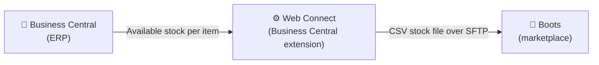
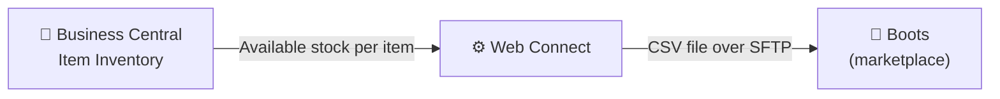

# Business Central and Boots marketplace integration

Web Connect by CombineIT connects Microsoft Dynamics 365 Business Central with the Boots marketplace. A stock file with the available quantity per item is created in Business Central and uploaded as a CSV file to the SFTP server Boots gives its suppliers. All mappings and rules live in your own Business Central, where you can see and change them yourself.

## At a glance

| | |
|---|---|
| **System** | Boots marketplace (marketplace) |
| **Integration product** | Web Connect for Microsoft Dynamics 365 Business Central |
| **Runs in** | Your own Business Central environment, as an extension. Web Connect creates the stock file in Business Central and uploads it to the Boots SFTP server. Nothing is received from Boots, so no webhooks and no external integration platform are involved. All processing and configuration stays in Business Central. |
| **Configured by** | You, in Business Central: mappings, conditions, triggers and flows. You can do all of it yourself. If you want, CombineIT takes part in any step, as a sounding board or by doing the work. |
| **Connection** | SFTP (port 22), with user name and password |
| **Boots documentation** | [ATT FYLLA I: name of and link to the Boots supplier documentation for the stock file, if there is a public one] |
| **Data flows** | 1: stock |
| **Business Central editions** | All editions, Essentials and Premium, including the latest version |
| **Available from** | [Web Connect on Microsoft AppSource](https://marketplace.microsoft.com/sv-se/product/PUBID.martitab1633951001710%7CAID.webconnect%7CPAPPID.9f3a7223-19db-4ac7-832f-cf8e4699186f?tab=Overview). [ATT FYLLA I: is Boots part of the Web Connect Ready Integrations app, or set up as part of the implementation?] |

## What can be synchronized

Web Connect has one data flow between Business Central and the Boots marketplace.

| Data | Direction | What happens |
|---|---|---|
| [Stock](flows/stock-update.md) | Business Central → Boots | A CSV file with the date, your supplier number, the item number and the available quantity per item is uploaded to the Boots SFTP server |

The stock file is the whole integration today. Orders, order confirmations and invoices are not part of it, see [Limitations](#limitations).

## How it works

Web Connect calculates the available stock per item in [Item Inventory](../../general/item-inventory.md), using the locations and rules in [Destinations](../../general/destinations.md). It writes one row per item to a comma separated text file and uploads the file to the upload folder on the Boots SFTP server. [ATT FYLLA I: what starts the upload, a schedule in the job queue or outgoing sync triggers, and whether every upload holds all items or only items whose stock changed.] How often the job queue sends data can be adjusted to what your business needs. Every upload is logged in Web Connect [Entries](../../general/entries.md), where it can be checked and resent.

## Choose your setup

Each flow has to fit how your business works: which system owns the data, where people do their work, and what the accounting needs. That is why the flows are decided together when a new integration is set up. The options below are the ones Web Connect customers use today. **Common setup** marks the option most Web Connect customers with Boots use. **Recommended** marks CombineIT's best practice, where there is one.

The Boots integration is set up with one Web Connect customer today. That is too few to say what is common, so no option below is marked as common setup.

### Stock

| Option | How it works | When it fits |
|---|---|---|
| **Stock file calculated in Business Central** | Web Connect Item Inventory calculates the available stock for the locations that supply Boots, and the quantity is written to the stock file that is uploaded to the Boots SFTP server | Business Central has the correct stock for the goods sold through Boots |

#### Stock calculated in Business Central and sent as a file

Product listings, product codes and prices are always maintained with Boots.

## What you need

- Microsoft Dynamics 365 Business Central, any edition (Essentials or Premium), including the latest version
- Web Connect installed from Microsoft AppSource, with an activated Web Connect license
- Your approval for Web Connect to be installed and to act in your Business Central environment
- A supplier account with Boots, with access to the Boots SFTP server. The user name and password are created by Boots
- Your supplier number at Boots, which is written on every row of the stock file
- Your products set up with Boots, with your item numbers as vendor article numbers. Boots can only read stock for products it already knows

## Setting it up

1. Decide which locations supply Boots and which items are included, see [Choose your setup](#choose-your-setup).
2. Install Web Connect in Business Central, activate the license and give your approval.
3. Store the SFTP password in Web Connect [Secret Value Storage](../../general/secret-value-storage.md) and set up the connection to the Boots SFTP server with the user name from Boots.
4. Set your supplier number and the locations in [Destinations](../../general/destinations.md), and check the calculated stock in [Item Inventory](../../general/item-inventory.md).
5. Upload a first file and let Boots confirm that it can be read before going live. Products must be set up with Boots for the test to cover the whole flow.

## Configure it yourself in Business Central

All configuration and logic in the integration is visible and editable in Business Central. There is no external integration platform where the logic is hidden.

| What you can change | Where in Web Connect | Example |
|---|---|---|
| Columns in the stock file | [Outgoing Data](../../general/outgoing-mapping/outgoing-data-web.md) | Change the order of the columns, the date format or the fixed supplier number |
| Which stock is sent | [Item Inventory](../../general/item-inventory.md) and [Destinations](../../general/destinations.md) | Calculate stock only for the locations that supply Boots |
| Conditions | [Condition List](../../general/condition-list.md) | Send 0 for items you do not want Boots to sell for the moment |
| What triggers an upload | [Outgoing Sync Triggers](../../general/outgoing-mapping/outgoing-sync-triggers.md) | Send the file when stock changes, or on a schedule |
| Monitoring and resending | [Entries](../../general/entries.md) | See every file uploaded and [resend a message](../../../../how-to/web-connect/resend-outgoing-message.md) |

## Configuration choices

- **Locations:** which Business Central locations make up the stock that Boots sees.
- **Supplier number:** the number Boots has given you. It is set as a fixed value in the mapping and written on every row.
- **Item number:** the Business Central item number is sent as the vendor article number. It must match the vendor article number Boots has on the product.
- **File:** the separator (comma), the date format (DD/MM/YYYY), the file name and the folder on the SFTP server.
- **Timing:** how often the file is uploaded. It can be adjusted to what your business needs.

## Limitations

- **Stock only.** The integration sends stock from Business Central to Boots. Orders, order confirmations, shipments and invoices are not part of it. [ATT FYLLA I: is an order flow from Boots planned, and should it be mentioned here?]
- **Nothing comes back from Boots.** Web Connect uploads the file but does not read a response or error file from Boots. If Boots cannot match a row to a product, it is seen with Boots, not in Business Central.
- **Products must exist with Boots first.** Stock for an item number that Boots does not know as a vendor article number has no effect.
- **No headers in the file.** The file has four columns in a fixed order without a header row, as set in the mapping.

## Frequently asked questions

### Can Business Central be integrated with the Boots marketplace?

Yes. Web Connect creates a stock file in Business Central with the available quantity per item and uploads it as a CSV file to the SFTP server that Boots gives its suppliers.

### What is in the stock file?

One row per item with four columns: the date in the format DD/MM/YYYY, your supplier number at Boots, the item number as the vendor article number, and the available quantity calculated in Business Central.

### Are Boots orders imported into Business Central?

Not in the current integration. It sends stock from Business Central to Boots. Orders, order confirmations and invoices are not part of it.

### Where is the SFTP password kept?

In Web Connect Secret Value Storage in your own Business Central. The connection to the Boots SFTP server uses the user name and password Boots gives you.

## Related

- Flows: [Stock](flows/stock-update.md)
- How-to: [Send inventory to external systems](../../../../how-to/web-connect/outgoing-inventory-to-external-systems.md) · [Resend an outgoing message](../../../../how-to/web-connect/resend-outgoing-message.md) · [Integration is not running](../../../../how-to/web-connect/integration-not-running.md)
- [Web Connect general documentation](../../general/README.md)

## About Web Connect

Web Connect is an integration platform for Microsoft Dynamics 365 Business Central, developed by CombineIT. It is installed in your own Business Central and connects it with e-commerce platforms, warehouse systems, POS, returns, marketplaces and EDI. Every flow, mapping and rule is configured in Business Central, where you can see and change it yourself, without custom code for each integration. [Web Connect on Microsoft AppSource](https://marketplace.microsoft.com/sv-se/product/PUBID.martitab1633951001710%7CAID.webconnect%7CPAPPID.9f3a7223-19db-4ac7-832f-cf8e4699186f?tab=Overview) · [Contact CombineIT](https://www.combineit.se/contact/)
