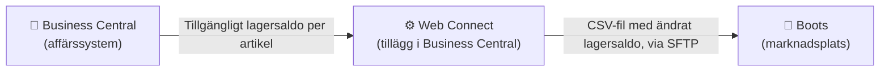
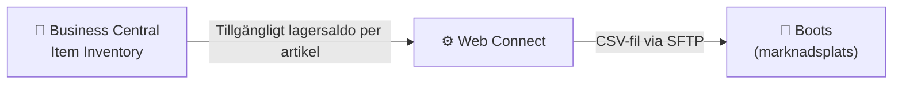

# Business Central och Boots marketplace: integration

Web Connect från CombineIT kopplar Microsoft Dynamics 365 Business Central till Boots marketplace. En lagerfil med tillgängligt antal per artikel skapas i Business Central och laddas upp som en CSV-fil till den SFTP-brevlåda som Boots leverantörer får på plattformen Boots Dropship. Alla mappningar och regler finns i ditt eget Business Central, där du kan se och ändra dem själv.

## I korthet

| | |
|---|---|
| **System** | Boots marketplace (marknadsplats) |
| **Integrationsprodukt** | Web Connect för Microsoft Dynamics 365 Business Central |
| **Körs i** | Din egen Business Central-miljö, som ett tillägg. Web Connect skapar lagerfilen i Business Central när lagersaldot ändras och laddar upp den till SFTP-brevlådan. Ingenting tas emot från Boots, så inga webhooks och ingen extern integrationsplattform används. All bearbetning och konfiguration stannar i Business Central. |
| **Konfigureras av** | Dig, i Business Central: mappningar, villkor, triggers och flöden. Du kan göra allt själv. Om du vill är CombineIT med i vilket steg som helst, som bollplank eller genom att göra jobbet. |
| **Koppling** | SFTP (port 22), med användarnamn och lösenord |
| **Boots plattform** | Boots Dropship körs på e2open (tidigare BluJay). Boots har inget eget API för leverantörer. Lagersaldot delas som en CSV-fil i en SFTP-brevlåda, enligt den mall som e2open ger varje leverantör vid anslutningen |
| **Dataflöden** | 1: lagersaldo |
| **Business Central-utgåvor** | Alla utgåvor, Essentials och Premium, även den senaste versionen |
| **Finns på** | [Web Connect på Microsoft AppSource](https://marketplace.microsoft.com/sv-se/product/PUBID.martitab1633951001710%7CAID.webconnect%7CPAPPID.9f3a7223-19db-4ac7-832f-cf8e4699186f?tab=Overview). Integrationen med Boots ingår inte i appen Web Connect Ready Integrations. Den sätts upp i Web Connect som en del av implementationen |

## Det här kan synkas

Web Connect har ett dataflöde mellan Business Central och Boots marketplace.

| Data | Riktning | Vad som händer |
|---|---|---|
| [Lagersaldo](flows/stock-update.md) | Business Central → Boots | När lagersaldot ändras laddas en CSV-fil med datum, din leverantörskod, artikelnummer och tillgängligt antal för de ändrade artiklarna upp till SFTP-brevlådan i Boots Dropship |

Lagerfilen är hela integrationen i dag. Order, orderbekräftelser och fakturor ingår inte, se [Begränsningar](#limitations).

## Så fungerar det

Web Connect beräknar det tillgängliga lagersaldot per artikel i [Item Inventory](../../general/item-inventory.md), utifrån lagerställena och reglerna i [Destinations](../../general/destinations.md). Den skriver en rad per ändrad artikel till en kommaseparerad textfil och laddar upp filen till uppladdningsmappen i SFTP-brevlådan i Boots Dropship. Uppladdningen startas av utgående synktriggers när det beräknade lagersaldot ändras, och filen innehåller bara de artiklar vars lagersaldo har ändrats. Jobbkön skickar sedan filen, och hur ofta den körs kan anpassas efter vad ditt företag behöver. Varje uppladdning loggas i Web Connect [Entries](../../general/entries.md), där den kan kontrolleras och skickas om.

## Välj upplägg

Varje flöde måste passa hur ditt företag arbetar: vilket system som äger datan, var personalen gör sitt arbete och vad bokföringen behöver. Därför bestäms flödena tillsammans när en ny integration sätts upp. Alternativen nedan är de som kunder med Web Connect använder i dag. **Vanligt upplägg** markerar det alternativ som flest kunder med Web Connect och Boots använder. **Rekommenderas** markerar CombineIT:s bästa praxis, där det finns en.

Integrationen med Boots är i dag uppsatt hos en kund med Web Connect. Det är för få för att säga vad som är vanligt, så inget alternativ nedan är markerat som vanligt upplägg.

### Lagersaldo

| Alternativ | Så fungerar det | När det passar |
|---|---|---|
| **Lagerfil beräknad i Business Central** | Web Connect Item Inventory beräknar det tillgängliga lagersaldot för de lagerställen som levererar till Boots, och antalet skrivs till lagerfilen som laddas upp till SFTP-brevlådan i Boots Dropship | Business Central har rätt lagersaldo för varorna som säljs via Boots |

#### Lagersaldo beräknat i Business Central och skickat som fil

Produktannonser, produktkoder och priser hanteras alltid hos Boots.

## Det här behöver du

- Microsoft Dynamics 365 Business Central, valfri utgåva (Essentials eller Premium), även den senaste versionen
- Web Connect installerat från Microsoft AppSource, med en aktiverad licens för Web Connect
- Ditt godkännande av att Web Connect installeras och agerar i din Business Central-miljö
- Ett leverantörskonto på plattformen Boots Dropship, med åtkomst till dess SFTP-brevlåda. Användarnamnet och lösenordet skapas av e2open när du ansluts som leverantör till Boots
- Din leverantörskod hos Boots, som skrivs på varje rad i lagerfilen
- Dina produkter uppsatta hos Boots, med ditt eget produkt-SKU (ditt artikelnummer) som leverantörens artikelnummer (vendor article number), inte Boots produktreferens. Boots kan bara läsa lagersaldo för produkter som redan finns hos Boots

## Så kommer du igång

1. Bestäm vilka lagerställen som levererar till Boots och vilka artiklar som ska vara med, se [Välj upplägg](#choose-your-setup).
2. Installera Web Connect i Business Central, aktivera licensen och ge ditt godkännande.
3. Spara lösenordet till SFTP i Web Connect [Secret Value Storage](../../general/secret-value-storage.md) och sätt upp kopplingen till SFTP-brevlådan med användarnamnet från e2open.
4. Ange din leverantörskod i mappningen och lagerställena i [Destinations](../../general/destinations.md), och kontrollera det beräknade lagersaldot i [Item Inventory](../../general/item-inventory.md).
5. Ladda upp en första fil och låt e2open bekräfta att den går att läsa innan ni går live. Produkterna måste vara uppsatta hos Boots för att testet ska täcka hela flödet.

## Konfigurera själv i Business Central

All konfiguration och logik i integrationen går att se och ändra i Business Central. Det finns ingen extern integrationsplattform där logiken är dold.

| Det här kan du ändra | Var i Web Connect | Exempel |
|---|---|---|
| Kolumnerna i lagerfilen | [Outgoing Data](../../general/outgoing-mapping/outgoing-data-web.md) | Ändra ordningen på kolumnerna, datumformatet eller den fasta leverantörskoden |
| Vilket lagersaldo som skickas | [Item Inventory](../../general/item-inventory.md) och [Destinations](../../general/destinations.md) | Beräkna lagersaldo bara för de lagerställen som levererar till Boots |
| Villkor | [Condition List](../../general/condition-list.md) | Skicka 0 för artiklar som du inte vill att Boots ska sälja just nu |
| Vad som startar en uppladdning | [Outgoing Sync Triggers](../../general/outgoing-mapping/outgoing-sync-triggers.md) | Välj vilka ändringar i Business Central som startar en uppladdning |
| Övervakning och omsändning | [Entries](../../general/entries.md) | Se varje uppladdad fil och [skicka om ett meddelande](../../../../how-to/web-connect/resend-outgoing-message.md) |

## Val i konfigurationen

- **Lagerställen:** vilka lagerställen i Business Central som utgör det lagersaldo som Boots ser.
- **Leverantörskod:** koden som e2open ger dig när du sätts upp på plattformen Boots Dropship. Den anges som ett fast värde i mappningen och skrivs på varje rad.
- **Artikelnummer:** artikelnumret i Business Central skickas som leverantörens artikelnummer (vendor article number). Det är ditt eget produkt-SKU, inte Boots produktreferens, och det måste stämma med det leverantörsartikelnummer som Boots har på produkten.
- **Fil:** avgränsaren (komma), datumformatet (DD/MM/YYYY), filnamnet och mappen på SFTP-servern.
- **Tidpunkt:** en fil skapas när lagersaldot ändras och innehåller bara de ändrade artiklarna. Hur ofta jobbkön skickar den kan anpassas efter vad ditt företag behöver.

## Begränsningar

- **Bara lagersaldo.** Integrationen skickar lagersaldo från Business Central till Boots. Order, orderbekräftelser och leveranser ingår inte i dag. Ett orderflöde är planerat men inte i drift, eftersom ingen kund behöver det än. Till dess hanteras order i systemet Boots Dropship.
- **Fakturor går via EDI.** Boots tar emot leverantörsfakturor via EDI, som sätts upp separat från den här integrationen.
- **Ingenting kommer tillbaka från Boots.** Web Connect laddar upp filen men läser inget svar eller någon felfil från Boots. Om Boots inte kan matcha en rad mot en produkt syns det på plattformen Boots Dropship, inte i Business Central.
- **Produkterna måste först finnas hos Boots.** Lagersaldo för ett artikelnummer som Boots inte känner till som leverantörsartikelnummer har ingen effekt.
- **Bara ändrade artiklar.** Varje fil innehåller de artiklar vars lagersaldo har ändrats. En fullständig lagerfil med alla artiklar skickas inte enligt schema i standardupplägget.
- **Inga rubriker i filen.** Filen har fyra kolumner i fast ordning utan rubrikrad, enligt inställningen i mappningen.

## Vanliga frågor

### Går det att integrera Business Central med Boots marketplace?

Ja. Web Connect skapar en lagerfil i Business Central med tillgängligt antal per artikel och laddar upp den som en CSV-fil till den SFTP-brevlåda som Boots leverantörer får på plattformen Boots Dropship.

### Vad står i lagerfilen?

En rad per ändrad artikel med fyra kolumner: datumet i formatet DD/MM/YYYY, din leverantörskod hos Boots, artikelnumret som leverantörens artikelnummer (vendor article number) och det tillgängliga antalet som beräknats i Business Central.

### Importeras order från Boots till Business Central?

Inte i dag. Integrationen skickar lagersaldo från Business Central till Boots. Ett orderflöde är planerat men inte i drift än, och order hanteras i systemet Boots Dropship. Fakturor går till Boots via EDI.

### Var sparas lösenordet till SFTP?

I Web Connect Secret Value Storage i ditt eget Business Central. Kopplingen till SFTP-brevlådan i Boots Dropship använder det användarnamn och lösenord som e2open ger dig när du ansluts som leverantör.

## Relaterat

- Flöden: [Lagersaldo](flows/stock-update.md)
- Instruktioner: [Skicka lagersaldo till externa system](../../../../how-to/web-connect/outgoing-inventory-to-external-systems.md) · [Skicka om ett utgående meddelande](../../../../how-to/web-connect/resend-outgoing-message.md) · [Integrationen körs inte](../../../../how-to/web-connect/integration-not-running.md)
- [Allmän dokumentation om Web Connect](../../general/README.md)

## Om Web Connect

Web Connect är en integrationsplattform för Microsoft Dynamics 365 Business Central, utvecklad av CombineIT. Den installeras i ditt eget Business Central och kopplar det till e-handelsplattformar, lagersystem, kassasystem, returer, marknadsplatser och EDI. Varje flöde, mappning och regel konfigureras i Business Central, där du kan se och ändra dem själv, utan specialkod för varje integration. [Web Connect på Microsoft AppSource](https://marketplace.microsoft.com/sv-se/product/PUBID.martitab1633951001710%7CAID.webconnect%7CPAPPID.9f3a7223-19db-4ac7-832f-cf8e4699186f?tab=Overview) · [Kontakta CombineIT](https://www.combineit.se/contact/)
