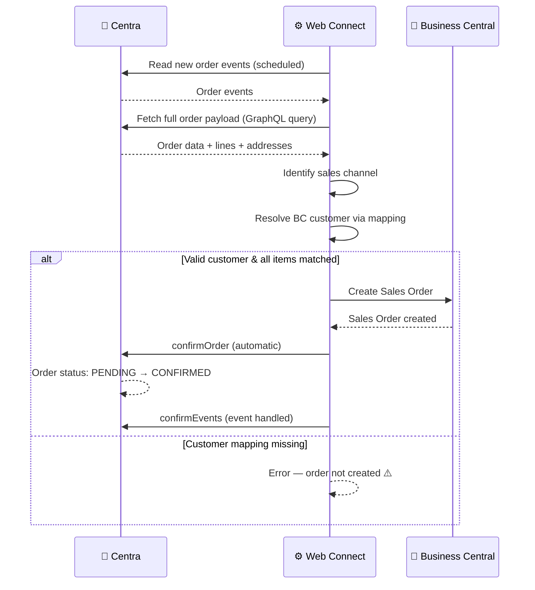

# Order — Inbound Flow

**Direction:** Centra → BC
**Purpose:** Receive orders from Centra and create Sales Orders in Business Central.

---

## Overview

Web Connect asks Centra for new and updated orders on a schedule in the Business Central job queue, using a GraphQL query against Centra's event list. For each order, Web Connect fetches the full order details, determines the correct BC customer based on the sales channel and market, and creates a Sales Order in BC. The order is then automatically confirmed in Centra to indicate that it has been received and is ready for processing.

---

## How It Works

**Trigger:** Scheduled fetch from the Business Central job queue (GraphQL query `ReadNewOrders` against Centra's events)
**Acknowledgment:** Automatic confirmation sent back to Centra

**Objects used:**

| Object | Role |
|---|---|
| `CA_NEW_ORDER_EVENT` | Reads new and updated order events from Centra |
| `CA_ORDER` | Fetches full order payload (header and lines) |
| `CA_BILLINGADDRESS` | Billing address details |
| `CA_SHIPPINGADDRESS` | Delivery address details |
| `CA_LINES` | Order line items (product, quantity, price) |

**Process steps:**

1. Customer places order in Centra
2. Web Connect reads new order events from Centra on its next scheduled run (`CA_NEW_ORDER_EVENT`)
3. Web Connect fetches the full order payload. Orders waiting for payment or on hold are not imported
4. Sales channel identified via conditions (e.g. DTC Retail, Wholesale, Consignment)
5. BC customer resolved using market/channel mappings
6. Sales Order created in BC with order lines
7. Order confirmation sent automatically → Centra status: PENDING → CONFIRMED, and the event is marked as handled in Centra (`confirmEvents`)
8. Order is now ready for warehouse to pick, pack, and ship

**Sequence diagram:**

---

## Order Confirmation

Order confirmation is **automatic** — it happens immediately after the Sales Order is created in BC:

- No manual confirmation step required
- Centra receives the confirmation and updates the order status to `CONFIRMED`
- This signals that BC is ready to process the order

---

## Order Lifecycle

Once the order is confirmed in BC:

1. **CONFIRMED** → Warehouse picks and packs the order
2. **PROCESSING** → First shipment is created and sent to Centra
3. **COMPLETED** → All order lines have been shipped

If an order needs to be cancelled:

- Cancellation can happen at any stage
- Status moves to `CANCELLED`
- See [Cancellation](cancellation.md) flow for details

---

## Variants

### Variant A — DTC / B2C Orders

Retail/B2C orders from Centra's store. Customer is resolved via a market-to-BC-customer mapping.

Example: Centra market "Sweden Web" → maps to BC customer "WEBSE"

### Variant B — Wholesale / B2B Orders

Wholesale orders placed by B2B accounts. Customer details may be fetched from account data in the order payload.

### Variant C — Consignment / Marketplace Orders

Orders from department stores or third-party marketplaces sold through Centra. Each marketplace may require its own channel condition and customer mapping.

---

## Configuration Notes

- **Channel identification:** Set up conditions to distinguish between different sales channels (retail, wholesale, marketplace)
- **Customer mapping:** Create a mapping from Centra market IDs to BC customer numbers
- **Item matching:** Configure how items in Centra orders are matched to BC items (typically via EAN or product ID)
- **Shipping fee mapping:** Inbound orders include a shipping cost from Centra. Configure how this is posted in BC via the Web Connect Codeunit Setup Card (Shipping Fee Type + Shipping Fee No.). Options include posting to a G/L account, creating a shipping item line, or using BC Item Charges.
- **Fetch schedule:** how often the job queue entry fetches new orders from Centra
- **Discounts and vouchers:** see [Discounts Applied](#discounts-applied) below

### Discounts Applied

Centra sends order-level discounts, vouchers and gift card redemptions as `discountsApplied` on the order (object `CA_DISCOUNTSAPPLIED` with `CA_VALUE1`). Without a mapping, these amounts do not reach the Sales Order and the order total in BC will not match Centra.

Map `CA_VALUE1` to a Sales Line (table 37). Two common setups:

| Setup | Line Type | No. | Use when |
|---|---|---|---|
| G/L account | G/L Account | The discount account, for example a revenue deduction account | Discount codes and vouchers that are a pure price reduction |
| Item | Item | A dedicated item, for example a gift card item | Gift cards, or when the customer wants to follow up redemptions per item |

Set the **VAT Prod. Posting Group** on the line explicitly.

Things to know:

- **VAT on gift cards.** Centra sends the purchase of a gift card without VAT, but the redemption as an amount plus VAT and expects a VAT amount on the discount. If all products carry the same VAT rate, a fixed VAT setup on the discount line is enough.
- **Discounts without a value.** A line discount in Centra also produces a `discountsApplied` entry, but without a value. Ignore entries without a value, otherwise they create empty lines.
- **Different discount types.** If Centra sends several kinds of values (gift card, voucher, discount code) that should be posted differently, extend the GraphQL query to include the type and add a condition per type.

---

## Error Handling

| Step | What can go wrong | What happens |
|---|---|---|
| Reading order events | Job queue stopped or Centra API error | Orders are fetched on the next successful run; order may be delayed |
| Fetching order data | Centra API error | Web Connect retries; order processing delayed |
| Channel identification | Unknown store/market condition | Order not created; logged with error |
| Customer lookup | Market ID not in mapping | Sales Order creation fails; error logged |
| Creating Sales Order | BC validation error (missing dimension, invalid item) | Order remains in PENDING; manual intervention needed |
| Sending confirmation | Centra API unavailable | Confirmation may fail; order stays PENDING in Centra |

---

**Related:**
[Overview](../overview.md) · [Shipment](shipment.md) · [Cancellation](cancellation.md) · [How-to](../../../../../how-to/web-connect/README.md)
