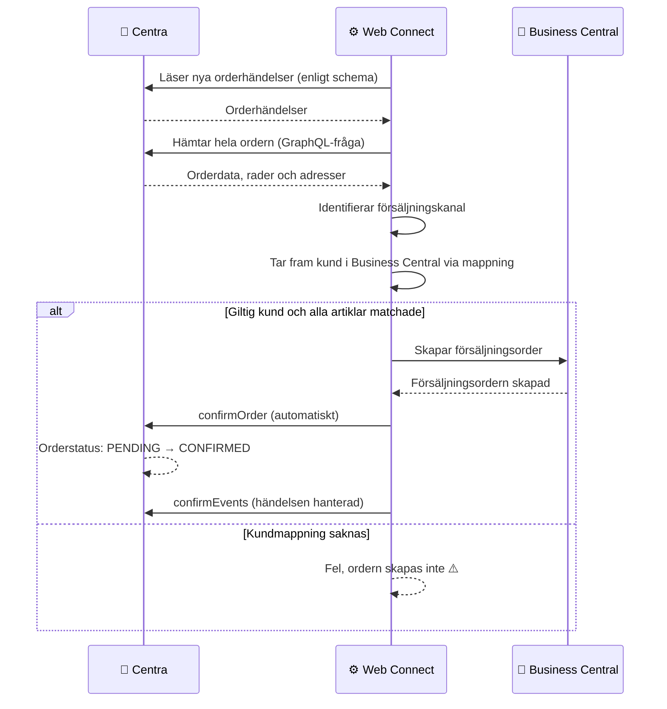

# Från Centra till Business Central: order

**Riktning:** Centra → Business Central
**Syfte:** Ta emot order från Centra och skapa försäljningsorder i Business Central.

---

## Översikt

Web Connect frågar Centra efter nya och uppdaterade order enligt schema i jobbkön i Business Central, med en GraphQL-fråga mot Centras händelselista. För varje order hämtar Web Connect hela ordern, avgör vilken kund i Business Central den ska ha utifrån försäljningskanal och market, och skapar en försäljningsorder i Business Central. Sedan bekräftas ordern automatiskt i Centra, som ett besked om att den har tagits emot och är redo att hanteras.

---

## Så fungerar det

**Startas av:** Schemalagd hämtning från jobbkön i Business Central (GraphQL-frågan `ReadNewOrders` mot Centras händelser)
**Kvittens:** Automatisk bekräftelse tillbaka till Centra

**Objekt som används:**

| Objekt | Roll |
|---|---|
| `CA_NEW_ORDER_EVENT` | Läser nya och uppdaterade orderhändelser från Centra |
| `CA_ORDER` | Hämtar hela ordern (huvud och rader) |
| `CA_BILLINGADDRESS` | Faktureringsadress |
| `CA_SHIPPINGADDRESS` | Leveransadress |
| `CA_LINES` | Orderrader (produkt, antal, pris) |

**Steg i processen:**

1. Kunden lägger en order i Centra
2. Web Connect läser nya orderhändelser från Centra vid nästa schemalagda körning (`CA_NEW_ORDER_EVENT`)
3. Web Connect hämtar hela ordern. Order som väntar på betalning eller är pausade importeras inte
4. Försäljningskanalen identifieras med villkor (till exempel DTC Retail, Wholesale, Consignment)
5. Kunden i Business Central tas fram med mappningar per market och kanal
6. Försäljningsordern skapas i Business Central med orderrader
7. Orderbekräftelsen skickas automatiskt → status i Centra: PENDING → CONFIRMED, och händelsen markeras som hanterad i Centra (`confirmEvents`)
8. Ordern är nu redo för lagret att plocka, packa och skicka

**Sekvensdiagram:**

---

## Orderbekräftelse

Orderbekräftelsen är **automatisk**. Den sker direkt när försäljningsordern har skapats i Business Central:

- Ingen manuell bekräftelse behövs
- Centra tar emot bekräftelsen och ändrar orderstatus till `CONFIRMED`
- Det visar att Business Central är redo att hantera ordern

---

## Orderns livscykel

När ordern har bekräftats i Business Central:

1. **CONFIRMED** → Lagret plockar och packar ordern
2. **PROCESSING** → Första leveransen skapas och skickas till Centra
3. **COMPLETED** → Alla orderrader har levererats

Om en order behöver makuleras:

- Makulering kan ske i vilket skede som helst
- Statusen ändras till `CANCELLED`
- Se flödet för [makulering](cancellation.md) för detaljer

---

## Varianter

### Variant A: DTC- och B2C-order

Order från konsumenter i Centras store. Kunden tas fram med en mappning från market till kund i Business Central.

Exempel: market "Sweden Web" i Centra → mappas till kunden "WEBSE" i Business Central

### Variant B: wholesale- och B2B-order

Grossistorder som läggs av B2B-konton. Kunduppgifterna kan hämtas från kontodatan i ordern.

### Variant C: consignment- och marknadsplatsorder

Order från varuhus eller externa marknadsplatser som säljs via Centra. Varje marknadsplats kan behöva ett eget kanalvillkor och en egen kundmappning.

---

## Att tänka på i konfigurationen

- **Identifiering av kanal:** Sätt upp villkor som skiljer de olika försäljningskanalerna åt (butik, grossist, marknadsplats)
- **Kundmappning:** Skapa en mappning från market-id i Centra till kundnummer i Business Central
- **Matchning av artiklar:** Ställ in hur artiklarna i ordern från Centra matchas mot artiklar i Business Central (oftast på EAN eller produkt-id)
- **Mappning av fraktavgift:** Inkommande order har en fraktkostnad från Centra. Ställ in hur den bokförs i Business Central på Web Connect Codeunit Setup Card (Shipping Fee Type och Shipping Fee No.). Den kan bokföras på ett redovisningskonto, som en fraktartikelrad eller med Item Charges i Business Central.
- **Schema för hämtning:** hur ofta posten i jobbkön hämtar nya order från Centra
- **Rabatter och värdekoder:** se [Rabatter på ordern](#discounts-applied) nedan

### Rabatter på ordern

Centra skickar rabatter på ordernivå, värdekoder och inlösta presentkort som `discountsApplied` på ordern (objektet `CA_DISCOUNTSAPPLIED` med `CA_VALUE1`). Utan en mappning når de här beloppen aldrig försäljningsordern, och ordersumman i Business Central stämmer då inte med Centra.

Mappa `CA_VALUE1` till en försäljningsrad (tabell 37). Två vanliga upplägg:

| Upplägg | Line Type | No. | Använd när |
|---|---|---|---|
| Redovisningskonto | G/L Account | Rabattkontot, till exempel ett konto för intäktsminskning | Rabattkoder och värdekoder som är en ren prissänkning |
| Artikel | Item | En egen artikel, till exempel en presentkortsartikel | Presentkort, eller när kunden vill följa upp inlösen per artikel |

Ange **VAT Prod. Posting Group** på raden uttryckligen.

Bra att veta:

- **Moms på presentkort.** Centra skickar köpet av ett presentkort utan moms, men inlösen som ett belopp plus moms, och förväntar sig ett momsbelopp på rabatten. Har alla produkter samma momssats räcker det med en fast momsinställning på rabattraden.
- **Rabatter utan värde.** En radrabatt i Centra ger också en post i `discountsApplied`, men utan värde. Hoppa över poster utan värde, annars blir det tomma rader.
- **Olika sorters rabatter.** Skickar Centra flera sorters värden (presentkort, värdekod, rabattkod) som ska bokföras olika: bygg ut GraphQL-frågan så att typen kommer med och lägg till ett villkor per typ.

---

## Felhantering

| Steg | Vad som kan gå fel | Vad som händer |
|---|---|---|
| Läsa orderhändelser | Jobbkön har stannat eller fel i Centras API | Ordern hämtas vid nästa lyckade körning och kan bli försenad |
| Hämta orderdata | Fel i Centras API | Web Connect försöker igen och ordern blir försenad |
| Identifiera kanal | Okänt villkor för store eller market | Ordern skapas inte och felet loggas |
| Ta fram kund | Market-id finns inte i mappningen | Försäljningsordern kan inte skapas och felet loggas |
| Skapa försäljningsorder | Valideringsfel i Business Central (dimension saknas, ogiltig artikel) | Ordern ligger kvar som PENDING och måste hanteras manuellt |
| Skicka bekräftelse | Centras API är inte tillgängligt | Bekräftelsen kan misslyckas och ordern ligger kvar som PENDING i Centra |

---

**Relaterat:**
[Översikt](../overview.md) · [Leverans](shipment.md) · [Makulering](cancellation.md) · [Instruktioner](../../../../../how-to/web-connect/README.md)
