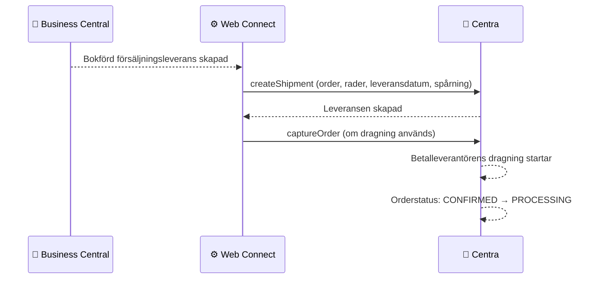

# Från Business Central till Centra: leveranser

**Riktning:** Business Central → Centra
**Syfte:** Meddela Centra när order har skickats och starta dragningen av betalningen.

---

## Översikt

När en order skickas i Business Central skickar Web Connect automatiskt leveransuppgifterna till Centra. Det uppdaterar orderstatusen och kan starta betalleverantörens dragning av betalningen.

Flödet har tre steg:
1. **Skapa leveransen:** registrera vilka artiklar som skickas
2. **Slutför leveransen:** markera leveransen som klar
3. **Dra betalningen:** starta auktorisering eller dragning av betalningen (om det är inställt)

---

## Så fungerar det

**Startas av:** En bokförd försäljningsleverans (Posted Sales Shipment) skapas i Business Central
**API-anrop:** `createShipment` (med leveransdatum, spårning och en valfri flagga för dragning), och `captureOrder` när dragningen görs som ett eget steg

**Objekt som används:**

| Objekt | Roll |
|---|---|
| `CA_SHIPMENT` | Skapar leveransen i Centra (`createShipment`) |
| `CA_SHIPMENTINPUT` | Order, levererade rader, leveransdatum och flaggorna `isGoodToGo`, `isPaid` och `capture` |
| `CA_SHIPMENTINFO` | Transportör, tjänst, spårningsnummer och spårningsnummer för retur |
| `CA_CONFIRM_SHIPPEDORDER` | Bekräftar ordern i Centra (`confirmOrder`) som en del av leveransflödet |
| `CA_CAPTURESHIPMENT` | Begär dragning av betalningen för ordern (`captureOrder`) |

**Steg i processen:**

1. Lagret bokför en försäljningsleverans i Business Central
2. Web Connect upptäcker att leveransen har skapats
3. Web Connect skickar `createShipment` till Centra med levererade rader, leveransdatum, transportör och spårningsnummer
4. Centra registrerar leveransen → orderstatus: CONFIRMED → PROCESSING
5. Om dragning används begärs den med flaggan för dragning på leveransen eller med `captureOrder`
6. Centras betalleverantör drar betalningen
7. Ordern går mot statusen `COMPLETED` när alla rader har levererats

**Sekvensdiagram:**

---

## Varianter

### Variant A: hel leverans med dragning (standard)

Alla beställda artiklar skickas och betalningen dras i en och samma transaktion.

### Variant B: delleveranser

Bara en del av artiklarna skickas. De återstående artiklarna ligger kvar allokerade tills nästa leverans eller en makulering.

### Variant C: leverans utan dragning

En del kunder hanterar betalningen separat och vill inte att dragningen startar automatiskt.

---

## Att tänka på i konfigurationen

- **Trigger för leverans:** Posted Sales Shipment (tabell 110) visar när varorna har skickats
- **Transportör och spårning:** Koder för speditör och tjänst kan skickas med om det är inställt
- **Flera leveranser:** En order kan ha flera leveranser, och var och en skickas till Centra för sig

---

## Felhantering

| Steg | Vad som kan gå fel | Vad som händer |
|---|---|---|
| Upptäcka leveransen | Web Connect bevakar inte försäljningsleveranser | Leveransen skickas aldrig till Centra |
| Skapa leveransen | Ordern är inte CONFIRMED i Centra | API:t svarar med fel och leveransen skapas inte |
| Slutföra leveransen | Centras API är inte tillgängligt | Posten i jobbkön misslyckas och körs igen nästa gång |
| Dra betalningen | Betalleverantören är inte tillgänglig eller auktoriseringen har gått ut | Dragningen misslyckas. En varning kommer tillbaka, men leveransen är registrerad |

---

**Relaterat:**
[Översikt](../overview.md) · [Order in](order-inbound.md) · [Makulering](cancellation.md) · [Instruktioner](../../../../../how-to/web-connect/README.md)
