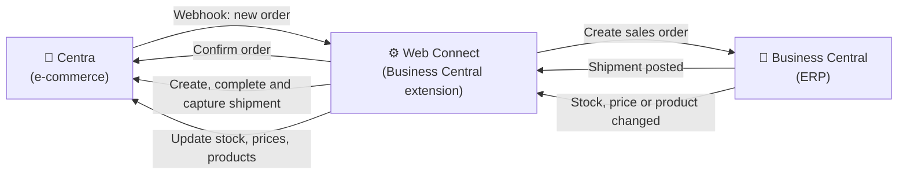
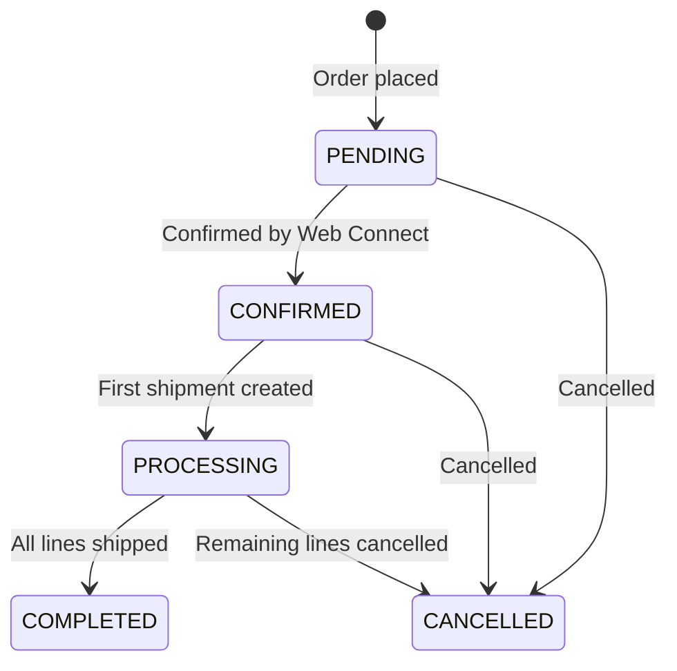

# Business Central and Centra integration

Web Connect by CombineIT connects Microsoft Dynamics 365 Business Central with Centra, the e-commerce platform. Orders are imported from Centra into Business Central, and stock, shipments with payment capture, prices, products and cancellations are sent back to Centra. All mappings and rules live in your own Business Central, where you can see and change them yourself.

## At a glance

| | |
|---|---|
| **System** | Centra (e-commerce for DTC, wholesale and marketplaces) |
| **Integration product** | Web Connect for Microsoft Dynamics 365 Business Central |
| **Runs in** | Your own Business Central environment, as an extension. New orders from Centra arrive as webhooks, which are received by an Azure endpoint that passes them on to Web Connect. All processing and configuration stays in Business Central. |
| **Configured by** | You, in Business Central: mappings, conditions, triggers and flows. CombineIT can help, but nothing is hidden. |
| **Connection** | Centra GraphQL Integration API and webhooks |
| **Centra API** | [Centra Integration API](https://docs.centraapis.com/) |
| **Number of flows** | 6 |
| **Business Central editions** | [ATT FYLLA I: Essentials och Premium enligt Marketplace, verifiera] |
| **Available from** | [Web Connect on Microsoft AppSource](https://marketplace.microsoft.com/sv-se/product/PUBID.martitab1633951001710%7CAID.webconnect%7CPAPPID.9f3a7223-19db-4ac7-832f-cf8e4699186f?tab=Overview) [ATT FYLLA I: ingår Centra i Web Connect Ready Integrations, och ska den länkas här?] |

## What is synchronized

| Flow | Direction | Trigger | What happens |
|---|---|---|---|
| [Order inbound](flows/order-inbound.md) | Centra → Business Central | Webhook when an order is placed | A sales order is created in Business Central and the order is confirmed in Centra |
| [Shipment](flows/shipment.md) | Business Central → Centra | Posted sales shipment | The shipment is created and completed in Centra, and payment capture is requested |
| [Stock update](flows/stock-update.md) | Business Central → Centra | Changes on item ledger entries, sales, purchase and transfer lines | Available stock is sent to Centra |
| [Product data](flows/product-data.md) | Business Central → Centra | Changes on items and variants (optional) | Products, variants and sizes are created or updated in Centra |
| Price sync | Business Central → Centra | Price changes in Business Central (optional) | Prices are set on the matching Centra price lists |
| [Cancellation](flows/cancellation.md) | Business Central → Centra | Order or line cancelled in Business Central (optional) | The order or the unshipped lines are cancelled in Centra |

Order inbound and stock update are the standard setup. Shipment is used by almost every implementation. Product data, price sync and cancellation are activated when Business Central is the master for that data.

## How it works

Centra sends a webhook when an order is placed. Web Connect fetches the full order from the Centra API, identifies the sales channel, creates the sales order in Business Central and confirms the order in Centra. When something changes in Business Central (a shipment is posted, stock moves, a price changes), an outgoing sync trigger in Web Connect sends the change to Centra. Every message in both directions is logged in Web Connect Entries, where it can be inspected and resent.

### Order status in Centra

## Master data ownership

| Data | Master system | Direction |
|---|---|---|
| Orders | Centra | Centra → Business Central |
| Stock | Business Central | Business Central → Centra |
| Products, variants and sizes (optional) | Business Central | Business Central → Centra |
| Prices (optional) | Business Central | Business Central → Centra |
| Product enrichment: images, texts, categories, SEO | Centra | Stays in Centra |
| Customers and B2B accounts | Centra | Read from the order into Business Central |
| Stores, markets and price lists | Centra | Configuration only |
| Payments | Centra | Captured through Centra's payment provider |

## What you need

- Microsoft Dynamics 365 Business Central [ATT FYLLA I: utgåva och lägsta version]
- Web Connect installed from Microsoft AppSource
- An Integration API token from Centra (created under System, API Tokens in Centra), with permissions for orders, shipments, products, stock, payments and accounts
- A webhook in Centra for new orders, pointing to your Web Connect endpoint

## Setting it up

1. Install Web Connect in Business Central and activate the Centra integration. [ATT FYLLA I: via Ready Integrations eller import av konfiguration?]
2. Create an Integration API token in Centra and store it in Web Connect [Secret Value Storage](../../general/secret-value-storage.md).
3. Register the order webhook in Centra.
4. Choose which flows to activate and set up the configuration choices below.
5. Test the whole order flow in a Business Central sandbox against Centra QA before going live.

## Configure it yourself in Business Central

All configuration and logic in the integration is visible and editable in Business Central. There is no external integration platform where the logic is hidden. The Azure endpoint that receives webhooks only passes the call on to Web Connect.

| What you can change | Where in Web Connect | Example |
|---|---|---|
| Sales channel routing | [Condition List](../../general/condition-list.md) | Treat orders from the wholesale store differently from retail orders |
| Customer per market | [Text Mapping](../../general/text-mapping.md) | Map each Centra market to a Business Central customer |
| Field mapping on orders | [Incoming Data mapping](../../general/incoming-data/mapping.md) | Map a Centra order field to a field on the sales order |
| What triggers stock updates | [Outgoing Sync Triggers](../../general/outgoing-mapping/outgoing-sync-triggers.md) | Send stock when sales, purchase or transfer lines change |
| Which stock is sent | [Item Inventory](../../general/item-inventory.md) and [Destinations](../../general/destinations.md) | Calculate available stock for selected locations only |
| Monitoring and resending | [Entries](../../general/entries.md) | See every order and update, and [resend a message](../../../../how-to/web-connect/resend-outgoing-message.md) |

## Configuration choices

- **Sales channels:** which Centra stores and markets exist (retail, wholesale, marketplaces) and how each is identified with a condition.
- **Customer mapping:** which Business Central customer each Centra market maps to. Wholesale orders can use the B2B account on the order instead.
- **Item matching:** how Centra products are matched to Business Central items and variants, typically by EAN or SKU.
- **Shipping fees:** whether the shipping cost on Centra orders is posted to a G/L account, as an item line or as an item charge.
- **Financial mappings:** VAT business posting groups per country, payment methods and shipping agents.
- **Stock calculation:** which locations are included and whether reserved quantities are deducted. Negative stock is sent as 0.
- **Payment capture:** whether payment is captured automatically when a shipment is created.
- **Master data:** whether products and prices are maintained in Business Central and synced, or maintained in Centra.

## Limitations

- **Size charts in Centra cannot be changed** once assigned to a product. The product has to be deleted and recreated in Centra. Plan the size structure before products are synced.
- **Centra API tokens expire** and Centra does not warn before they do. Renewal is manual.
- **Completed orders cannot be cancelled** in Centra, and orders being processed can only have their unshipped lines cancelled.
- **Shipments require a confirmed order.** An order that was never confirmed in Centra cannot receive shipments.
- **Product enrichment stays in Centra.** Images, texts, categories and SEO are not sent from Business Central.

## Frequently asked questions

### Can Business Central be integrated with Centra?

Yes. Web Connect connects Business Central with Centra through the Centra GraphQL Integration API. Orders are imported into Business Central, and stock, shipments, payment capture, prices, products and cancellations are sent to Centra.

### Does the integration support both DTC and wholesale in Centra?

Yes. Web Connect identifies the Centra store and market on each order with conditions, so retail (DTC), wholesale (B2B) and marketplace orders can be routed to different customers and settings in Business Central.

### Can we change what is sent between Business Central and Centra ourselves?

Yes. Field mappings, conditions, triggers and which flows are active are configured in Web Connect inside your own Business Central. You can see and change them without asking a supplier to change an external platform.

### What happens when the Centra API token expires?

All calls to Centra fail with 401 Unauthorized. Create a new Integration API token in Centra and update the stored secret in Web Connect. Centra does not notify you before a token expires, so set a reminder.

### Why is a shipment not showing up in Centra?

Centra only accepts shipments on orders that are confirmed. Check that the order was confirmed in Centra after it was created in Business Central, then check the error in Web Connect Entries.

### Is the payment captured automatically when we ship?

It can be. After the shipment is created and completed in Centra, Web Connect can request payment capture, and Centra's payment provider performs it. Capture can also be turned off if payments are handled separately.

## Related

- Flows: [Order inbound](flows/order-inbound.md) · [Shipment](flows/shipment.md) · [Stock update](flows/stock-update.md) · [Product data](flows/product-data.md) · [Cancellation](flows/cancellation.md)
- How-to: [Resend an outgoing message](../../../../how-to/web-connect/resend-outgoing-message.md) · [Integrations not running](../../../../how-to/web-connect/integration-not-running.md) · [401 after job queue stopped](../../../../how-to/web-connect/unauthorized-after-job-queue-stopped.md)
- [Web Connect general documentation](../../general/README.md)
- [Centra Integration API documentation](https://docs.centraapis.com/)

## About Web Connect

Web Connect is an integration platform for Microsoft Dynamics 365 Business Central, developed by CombineIT. It is installed in your own Business Central and connects it with e-commerce platforms, warehouse systems, POS, returns, marketplaces and EDI. Every flow, mapping and rule is configured in Business Central, where you can see and change it yourself, without custom code for each integration. [ATT FYLLA I: formulering om MartIT och CombineIT, bestäms i docs-internal#59.] [Web Connect on Microsoft AppSource](https://marketplace.microsoft.com/sv-se/product/PUBID.martitab1633951001710%7CAID.webconnect%7CPAPPID.9f3a7223-19db-4ac7-832f-cf8e4699186f?tab=Overview) · [Contact CombineIT](https://www.combineit.se/contact/)
