# Business Central and Centra integration

Web Connect by CombineIT connects Microsoft Dynamics 365 Business Central with Centra, the e-commerce platform. Orders are fetched from Centra into Business Central, and shipments, stock, products, prices and cancellations can be sent back to Centra. You choose which flows to use. All mappings and rules live in your own Business Central, where you can see and change them yourself.

## At a glance

| | |
|---|---|
| **System** | Centra (e-commerce for DTC, wholesale and marketplaces) |
| **Integration product** | Web Connect for Microsoft Dynamics 365 Business Central |
| **Runs in** | Your own Business Central environment, as an extension. Web Connect fetches new orders from Centra on a schedule in the Business Central job queue and sends changes to Centra when they happen. No external integration platform is involved. |
| **Configured by** | You, in Business Central: mappings, conditions, triggers and flows. You can do all of it yourself. If you want, CombineIT takes part in any step, as a sounding board or by doing the work. |
| **Connection** | Centra GraphQL Integration API |
| **Centra API** | [Centra Integration API](https://docs.centraapis.com/) |
| **Data flows** | 7: orders, shipments, payment capture, stock, products, prices and cancellations |
| **Business Central editions** | [ATT FYLLA I: Essentials och Premium enligt Marketplace, verifiera] |
| **Available from** | [Web Connect on Microsoft AppSource](https://marketplace.microsoft.com/sv-se/product/PUBID.martitab1633951001710%7CAID.webconnect%7CPAPPID.9f3a7223-19db-4ac7-832f-cf8e4699186f?tab=Overview) [ATT FYLLA I: ingår Centra i Web Connect Ready Integrations, och ska den länkas här?] |

## What can be synchronized

Web Connect has seven data flows between Business Central and Centra.

| Data | Direction | What happens |
|---|---|---|
| [Orders](flows/order-inbound.md) | Centra → Business Central | New orders are fetched, a sales order is created and the order is confirmed in Centra |
| [Shipments](flows/shipment.md) | Business Central → Centra | A posted sales shipment is created and completed in Centra |
| Payment capture | Business Central → Centra | Centra is asked to capture the payment when the order ships |
| [Stock](flows/stock-update.md) | Business Central → Centra | Available stock is sent to Centra |
| [Products](flows/product-data.md) | Business Central → Centra | Products, variants and sizes are created or updated in Centra |
| Prices | Business Central → Centra | Prices are set on the matching Centra price lists |
| [Cancellations](flows/cancellation.md) | Business Central → Centra | The order or its unshipped lines are cancelled in Centra |

Orders are part of every Centra integration. The other flows are chosen when the integration is set up, depending on where each kind of data is maintained in your business. See [Choose your setup](#choose-your-setup).

## How it works

Web Connect asks Centra for new and updated orders on a schedule, using a GraphQL query against Centra's event list. For each order it fetches the full order, identifies the sales channel, creates the sales order in Business Central, confirms the order in Centra and marks the event as handled. When something changes in Business Central (a shipment is posted, stock moves, a price changes), an outgoing sync trigger in Web Connect sends the change to Centra. Every message in both directions is logged in Web Connect Entries, where it can be inspected and resent.

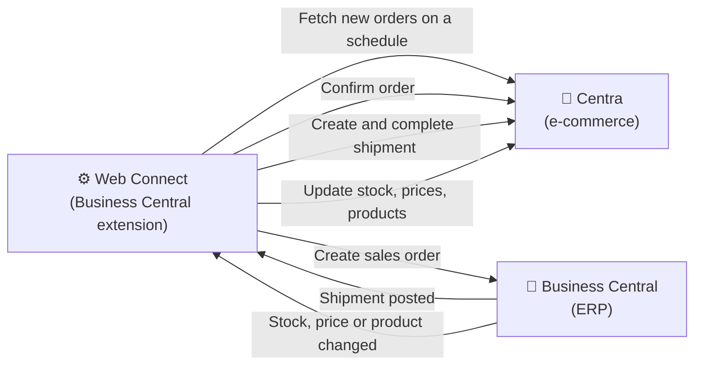

### Order status in Centra

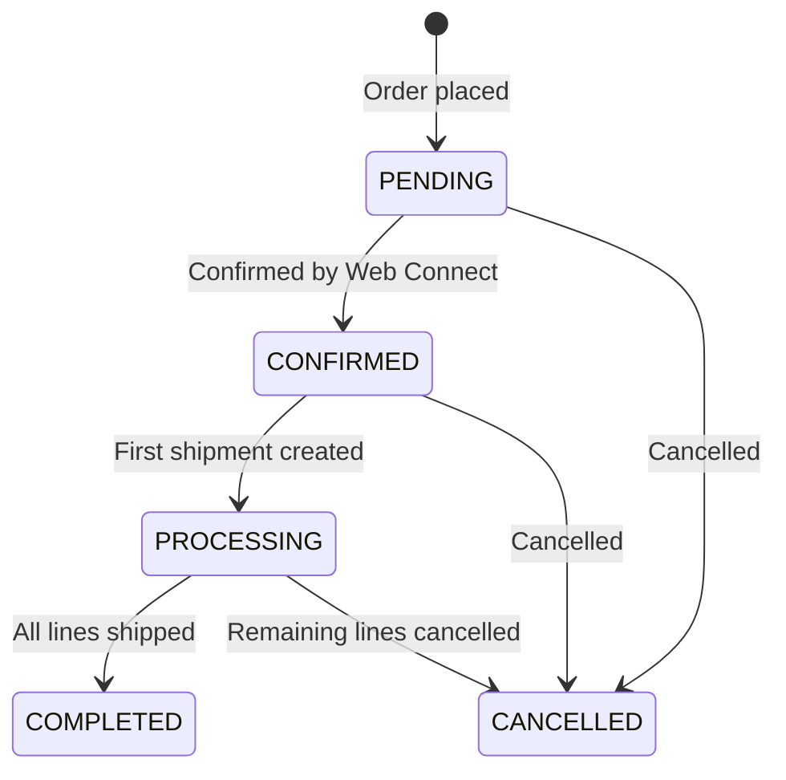

## Choose your setup

Each flow has to fit how your business works: which system owns the data, where people do their work, and what the accounting needs. That is why the flows are decided together when a new integration is set up. The options below are the ones Web Connect customers use today. **Common setup** marks the option most Web Connect customers with Centra use. **Recommended** marks CombineIT's best practice, where there is one. [ATT FYLLA I: andel av kunderna per vanligt upplägg, när konfigexporten (docs-internal#61) finns.]

### Orders

| Option | How it works | When it fits |
|---|---|---|
| **Centra → Business Central** (common setup) | Orders are fetched from Centra and created as sales orders in Business Central | Always. This is the core of the integration |

### Shipments

| Option | How it works | When it fits |
|---|---|---|
| **Business Central → Centra** (common setup) | When a sales shipment is posted, the shipment is created and completed in Centra | When the warehouse work is registered in Business Central, directly or through a warehouse integration |

### Stock

| Option | How it works | When it fits |
|---|---|---|
| **Calculated in Business Central** | Business Central calculates available stock for the chosen locations and sends it to Centra | Business Central has the correct stock |
| **From the warehouse system, through Business Central** | Web Connect reads stock from the warehouse system (WMS), applies the rules you want, for example buffers or selected locations, and sends the result to Centra | Stock is managed in a WMS or 3PL, and you want control over what is shown in the web shop |
| **Directly between the warehouse system and Centra** | Stock goes from the WMS to Centra without Web Connect | The WMS already has a direct connection to Centra |

#### Stock calculated in Business Central

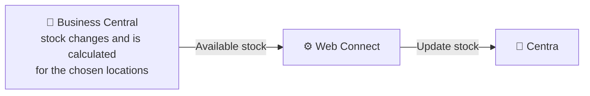

#### Stock from the warehouse system, through Business Central

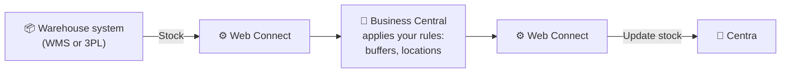

#### Stock directly between the warehouse system and Centra

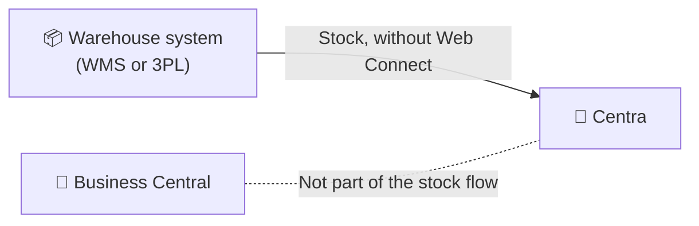

[ATT FYLLA I: vilket alternativ som är vanligt upplägg.]

### Products

| Option | How it works | When it fits |
|---|---|---|
| **Created in Business Central** | Products, variants and sizes are created in Business Central and sent to Centra. Images, texts and categories are added in Centra | Business Central is where new products start |
| **From a PIM or PLM** | A PIM or PLM system is the master for products. How products reach Business Central and Centra is decided in the project | You already maintain products in a PIM or PLM |
| **Created in Centra** | Products are created in Centra. The items in Business Central are created separately and matched by EAN or SKU | The web team owns the assortment |

#### Products created in Business Central

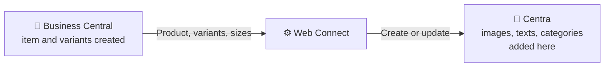

#### Products from a PIM or PLM

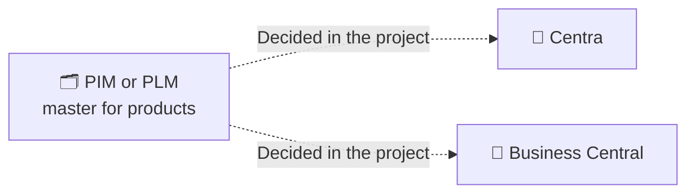

#### Products created in Centra

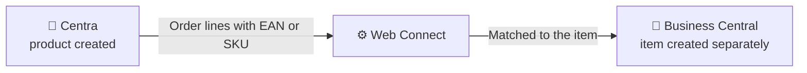

[ATT FYLLA I: vilket alternativ som är vanligt upplägg.]

### Prices

| Option | How it works | When it fits |
|---|---|---|
| **Business Central → Centra** | Prices are maintained in Business Central and set on the matching Centra price lists | Prices are decided in Business Central |
| **Maintained in Centra** | Prices are set in Centra and come into Business Central on each order | Prices and campaigns are run in Centra |

#### Prices from Business Central to Centra

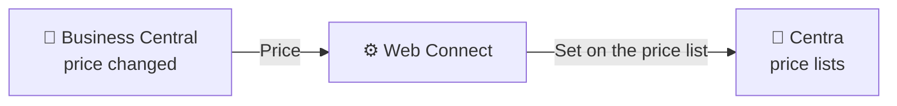

#### Prices maintained in Centra

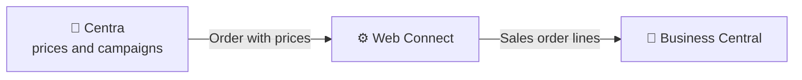

[ATT FYLLA I: vilket alternativ som är vanligt upplägg.]

### Payment capture

| Option | How it works | When it fits |
|---|---|---|
| **Through Centra** | When the shipment is created, Web Connect asks Centra to capture the payment, and Centra's payment provider performs it | Payments are handled by Centra's payment provider |
| **In Business Central with PSP Connect** | The payment is captured in Business Central, close to the accounting | You use PSP Connect. This is the usual choice then |
| **Outside the integration** | Capture is handled manually or by another system | Payments are handled separately |

#### Payment capture through Centra

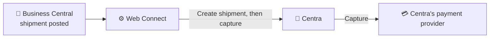

#### Payment capture in Business Central with PSP Connect

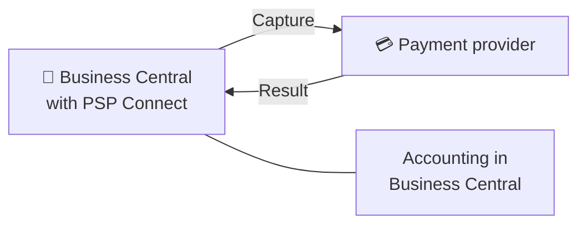

#### Payment capture outside the integration

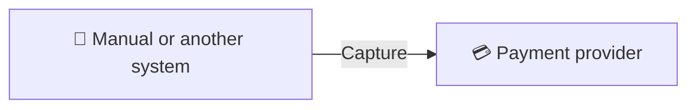

### Cancellations

Cancel orders in Business Central, not in Centra. Business Central is where the order is handled further, and with a warehouse integration it is the only place that knows whether the warehouse can still stop the order.

| Option | How it works | When it fits |
|---|---|---|
| **In Business Central, checked with the warehouse system** (recommended) | Customer service cancels in Business Central. A cancellation request is sent to the warehouse system first. If the warehouse accepts, the order or its unshipped lines are cancelled in Centra. If the order has come too far, for example it is being picked, the warehouse system rejects the request and the order is not cancelled | You have a warehouse integration through Web Connect |
| **In Business Central** | Customer service cancels in Business Central, and the order or its unshipped lines are cancelled in Centra | The warehouse work is done in Business Central |

#### Cancellation in Business Central, checked with the warehouse system

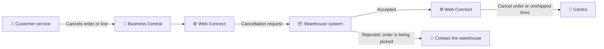

#### Cancellation in Business Central

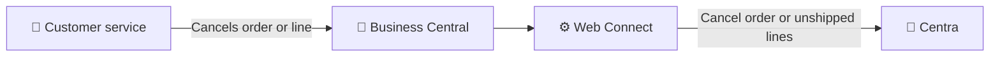

When Centra cancels an order, it can also cancel the payment authorization and email the customer.

Product enrichment (images, texts, categories and SEO), customers and B2B accounts, stores, markets and price lists are always maintained in Centra.

## What you need

- Microsoft Dynamics 365 Business Central [ATT FYLLA I: utgåva och lägsta version]
- Web Connect installed from Microsoft AppSource, with an activated Web Connect license
- Your approval for Web Connect to be installed and to act in your Business Central environment
- An Integration API token from Centra (created under System, API Tokens in Centra), with permissions for orders, shipments, products, stock, payments and accounts

## Setting it up

1. Decide which flows to use and which option to choose for each, see [Choose your setup](#choose-your-setup).
2. Install Web Connect in Business Central, activate the license and give your approval. [ATT FYLLA I: aktiveras Centra via Ready Integrations eller import av konfiguration?]
3. Create an Integration API token in Centra and store it in Web Connect [Secret Value Storage](../../general/secret-value-storage.md).
4. Set up the configuration choices below.
5. Test the whole order flow in a Business Central sandbox against Centra QA before going live.

## Configure it yourself in Business Central

All configuration and logic in the integration is visible and editable in Business Central. There is no external integration platform where the logic is hidden.

| What you can change | Where in Web Connect | Example |
|---|---|---|
| Sales channel routing | [Condition List](../../general/condition-list.md) | Treat orders from the wholesale store differently from retail orders |
| Customer per market | [Text Mapping](../../general/text-mapping.md) | Map each Centra market to a Business Central customer |
| Field mapping on orders | [Incoming Data mapping](../../general/incoming-data/mapping.md) | Map a Centra order field to a field on the sales order |
| What triggers stock updates | [Outgoing Sync Triggers](../../general/outgoing-mapping/outgoing-sync-triggers.md) | Send stock when sales, purchase or transfer lines change |
| Which stock is sent | [Item Inventory](../../general/item-inventory.md) and [Destinations](../../general/destinations.md) | Calculate available stock for selected locations only |
| Monitoring and resending | [Entries](../../general/entries.md) | See every order and update, and [resend a message](../../../../how-to/web-connect/resend-outgoing-message.md) |

## Configuration choices

- **Sales channels:** which Centra stores and markets exist (retail, wholesale, marketplaces) and how each is identified with a condition.
- **Customer mapping:** which Business Central customer each Centra market maps to. Wholesale orders can use the B2B account on the order instead.
- **Item matching:** how Centra products are matched to Business Central items and variants, typically by EAN or SKU.
- **Shipping fees:** whether the shipping cost on Centra orders is posted to a G/L account, as an item line or as an item charge.
- **Financial mappings:** VAT business posting groups per country, payment methods and shipping agents.
- **Stock calculation:** which locations are included and whether reserved quantities are deducted. Negative stock is sent as 0.
- **Orders to import:** orders that are waiting for payment or on hold in Centra are not imported.

## Limitations

- **Size charts in Centra cannot be changed** once assigned to a product. The product has to be deleted and recreated in Centra. Plan the size structure before products are synced.
- **Centra API tokens expire** and Centra does not warn before they do. Renewal is manual.
- **Completed orders cannot be cancelled** in Centra, and orders being processed can only have their unshipped lines cancelled.
- **Orders the warehouse has started on cannot be cancelled** when a warehouse integration is used. The warehouse system rejects the request, and the warehouse has to be contacted.
- **Shipments require a confirmed order.** An order that was never confirmed in Centra cannot receive shipments.
- **Product enrichment stays in Centra.** Images, texts, categories and SEO are not sent from Business Central.

## Frequently asked questions

### Can Business Central be integrated with Centra?

Yes. Web Connect connects Business Central with Centra through the Centra GraphQL Integration API. Orders are fetched into Business Central, and shipments, stock, products, prices, payment capture and cancellations can be sent to Centra.

### Does the integration support both DTC and wholesale in Centra?

Yes. Web Connect identifies the Centra store and market on each order with conditions, so retail (DTC), wholesale (B2B) and marketplace orders can be routed to different customers and settings in Business Central.

### Can we change what is sent between Business Central and Centra ourselves?

Yes. Field mappings, conditions, triggers and which flows are active are configured in Web Connect inside your own Business Central. You can see and change them without asking a supplier to change an external platform.

### What happens when the Centra API token expires?

All calls to Centra fail with 401 Unauthorized. Create a new Integration API token in Centra and update the stored secret in Web Connect. Centra does not notify you before a token expires, so set a reminder.

### Why is a shipment not showing up in Centra?

Centra only accepts shipments on orders that are confirmed. Check that the order was confirmed in Centra after it was created in Business Central, then check the error in Web Connect Entries.

### Can we cancel a Centra order that the warehouse has started picking?

Not from Business Central. With a warehouse integration, Web Connect sends a cancellation request to the warehouse system before anything is cancelled in Centra. If the order has come too far, for example it is being picked, the warehouse system rejects the request. Contact the warehouse to stop the order.

### Is the payment captured automatically when we ship?

It can be. Web Connect can ask Centra to capture the payment when the shipment is created, and Centra's payment provider performs it. If you use PSP Connect, capture is usually done in Business Central instead, close to the accounting.

## Related

- Flows: [Order inbound](flows/order-inbound.md) · [Shipment](flows/shipment.md) · [Stock update](flows/stock-update.md) · [Product data](flows/product-data.md) · [Cancellation](flows/cancellation.md)
- How-to: [Resend an outgoing message](../../../../how-to/web-connect/resend-outgoing-message.md) · [Integrations not running](../../../../how-to/web-connect/integration-not-running.md) · [401 after job queue stopped](../../../../how-to/web-connect/unauthorized-after-job-queue-stopped.md)
- [Web Connect general documentation](../../general/README.md)
- [Centra Integration API documentation](https://docs.centraapis.com/)

## About Web Connect

Web Connect is an integration platform for Microsoft Dynamics 365 Business Central, developed by CombineIT. It is installed in your own Business Central and connects it with e-commerce platforms, warehouse systems, POS, returns, marketplaces and EDI. Every flow, mapping and rule is configured in Business Central, where you can see and change it yourself, without custom code for each integration. [ATT FYLLA I: formulering om MartIT och CombineIT, bestäms i docs-internal#59.] [Web Connect on Microsoft AppSource](https://marketplace.microsoft.com/sv-se/product/PUBID.martitab1633951001710%7CAID.webconnect%7CPAPPID.9f3a7223-19db-4ac7-832f-cf8e4699186f?tab=Overview) · [Contact CombineIT](https://www.combineit.se/contact/)
