# Business Central och Centra: integration

Web Connect från CombineIT kopplar Microsoft Dynamics 365 Business Central till e-handelsplattformen Centra. Order hämtas från Centra till Business Central, och leveranser, lagersaldo, produkter, priser och makuleringar kan skickas tillbaka till Centra. Du väljer vilka flöden du vill använda. Alla mappningar och regler finns i ditt eget Business Central, där du kan se och ändra dem själv.

## I korthet

| | |
|---|---|
| **System** | Centra (e-handel för DTC, wholesale och marknadsplatser) |
| **Integrationsprodukt** | Web Connect för Microsoft Dynamics 365 Business Central |
| **Körs i** | Din egen Business Central-miljö, som ett tillägg. Web Connect hämtar nya order från Centra enligt schema i jobbkön i Business Central och skickar ändringar till Centra när de sker. Ingen extern integrationsplattform är inblandad. |
| **Konfigureras av** | Dig, i Business Central: mappningar, villkor, triggers och flöden. Du kan göra allt själv. Om du vill är CombineIT med i vilket steg som helst, som bollplank eller genom att göra jobbet. |
| **Koppling** | Centra GraphQL Integration API |
| **Centras API** | [Centra Integration API](https://docs.centraapis.com/) |
| **Dataflöden** | 8: order, leveranser, dragning av betalningen, lagersaldo, produkter, priser, kostpriser och makuleringar |
| **Business Central-utgåvor** | Essentials och Premium |
| **Finns på** | [Web Connect på Microsoft AppSource](https://marketplace.microsoft.com/sv-se/product/PUBID.martitab1633951001710%7CAID.webconnect%7CPAPPID.9f3a7223-19db-4ac7-832f-cf8e4699186f?tab=Overview). Centra-integrationen ingår i appen Web Connect Ready Integrations |

## Det här kan synkas

Web Connect har åtta dataflöden mellan Business Central och Centra.

| Data | Riktning | Vad som händer |
|---|---|---|
| [Order](flows/order-inbound.md) | Centra → Business Central | Nya order hämtas, en försäljningsorder skapas och ordern bekräftas i Centra |
| [Leveranser](flows/shipment.md) | Business Central → Centra | En bokförd försäljningsleverans skapas i Centra med transportör och spårningsnummer |
| Dragning av betalningen | Business Central → Centra | Centra ombeds dra betalningen när ordern skickas |
| [Lagersaldo](flows/stock-update.md) | Business Central → Centra | Tillgängligt lagersaldo skickas till Centra |
| [Produkter](flows/product-data.md) | Business Central → Centra | Produkter, varianter och storlekar skapas eller uppdateras i Centra |
| Priser | Business Central → Centra | Priserna sätts på motsvarande prislistor i Centra |
| Kostpriser | Business Central → Centra | Styckkostnaden för varje variant uppdateras i Centra när den ändras i Business Central |
| [Makuleringar](flows/cancellation.md) | Business Central → Centra | Ordern eller dess ej levererade rader makuleras i Centra |

Order ingår i alla Centra-integrationer. De andra flödena väljs när integrationen sätts upp, beroende på var varje sorts data underhålls i ert företag. Se [Välj upplägg](#choose-your-setup).

## Så fungerar det

Web Connect frågar Centra efter nya och uppdaterade order enligt schema, med en GraphQL-fråga. Den läser antingen Centras händelselista eller de order som uppdaterats sedan förra hämtningen. För varje order hämtas hela ordern, försäljningskanalen identifieras, försäljningsordern skapas i Business Central, ordern bekräftas i Centra och händelsen markeras som hanterad. När något ändras i Business Central (en leverans bokförs, lagersaldot rör sig, ett pris ändras) skickar en utgående synktrigger i Web Connect ändringen till Centra. Varje meddelande åt båda hållen loggas i Web Connect Entries, där det kan granskas och skickas igen.

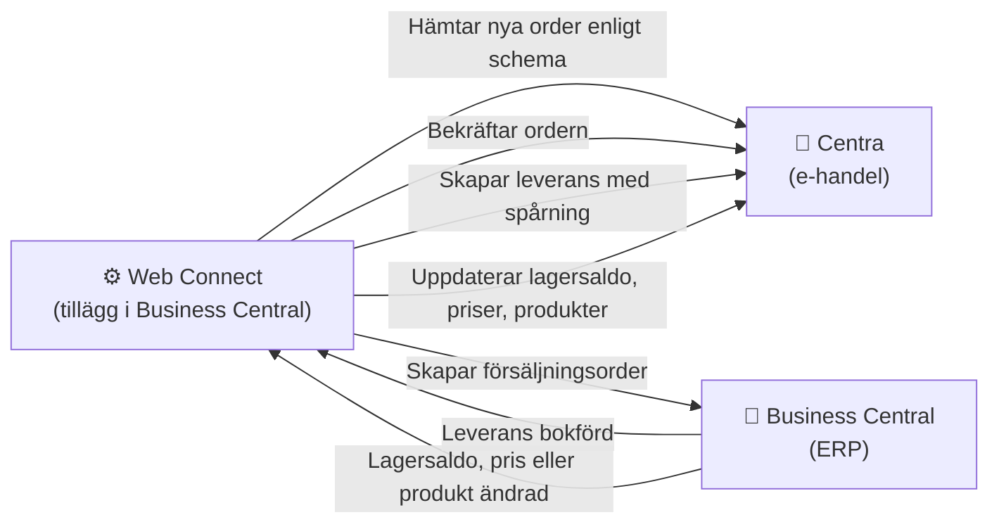

### Orderstatus i Centra

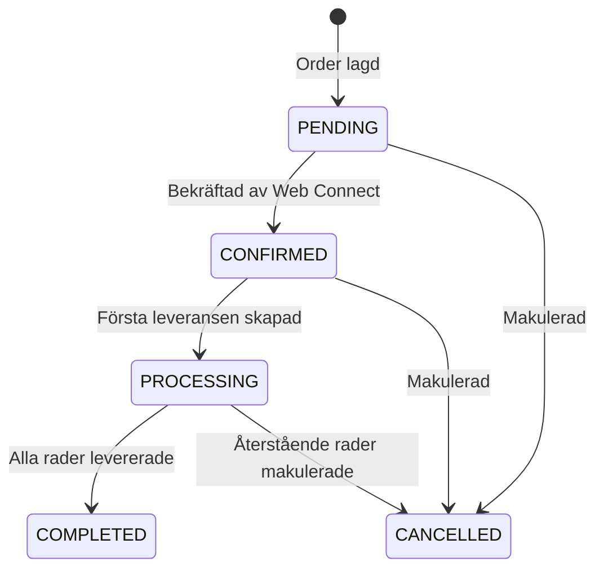

## Välj upplägg

Varje flöde måste passa hur ert företag arbetar: vilket system som äger datan, var medarbetarna gör sitt jobb och vad bokföringen behöver. Därför bestäms flödena tillsammans när en ny integration sätts upp. Alternativen nedan är de som kunder med Web Connect använder i dag. **Vanligast** visar det alternativ som flest kunder med Web Connect och Centra använder. **Rekommenderas** visar CombineIT:s bästa praxis, där det finns en.

### Order

| Alternativ | Så fungerar det | När det passar |
|---|---|---|
| **Centra → Business Central** (vanligast) | Order hämtas från Centra och skapas som försäljningsorder i Business Central | Alltid. Det här är kärnan i integrationen |

### Leveranser

| Alternativ | Så fungerar det | När det passar |
|---|---|---|
| **Business Central → Centra** (vanligast) | När en försäljningsleverans bokförs skapas leveransen i Centra med transportör och spårningsnummer | När lagerarbetet registreras i Business Central, direkt eller via en lagerintegration |

### Lagersaldo

| Alternativ | Så fungerar det | När det passar |
|---|---|---|
| **Beräknas i Business Central** (vanligast) | Business Central räknar ut tillgängligt lagersaldo för de valda lagerställena och skickar det till Centra | Business Central har rätt lagersaldo |
| **Från lagersystemet, via Business Central** | Web Connect läser lagersaldot från lagersystemet (WMS), tillämpar de regler du vill, till exempel buffertar eller utvalda lagerställen, och skickar resultatet till Centra | Lagret sköts i ett WMS eller av en 3PL, och du vill styra vad som visas i webbshopen |
| **Direkt mellan lagersystemet och Centra** | Lagersaldot går mellan WMS:et eller 3PL:en och Centra utan Web Connect. Business Central är inte med i lagerflödet | Lagersystemet eller 3PL:en har redan en direkt koppling till Centra |

#### Lagersaldo som beräknas i Business Central

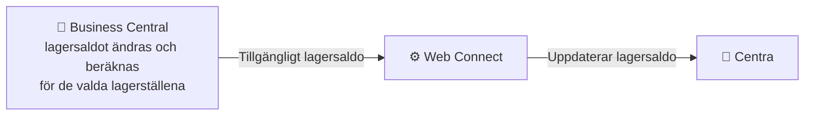

#### Lagersaldo från lagersystemet, via Business Central

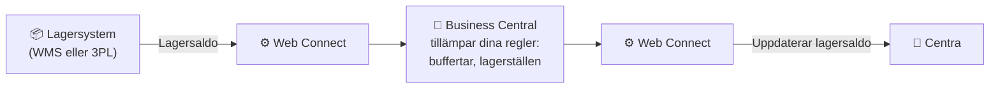

#### Lagersaldo direkt mellan lagersystemet och Centra

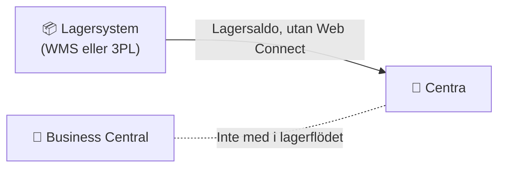

### Produkter

| Alternativ | Så fungerar det | När det passar |
|---|---|---|
| **Skapas i Business Central** (vanligast) | Produkter, varianter och storlekar skapas i Business Central och skickas till Centra. Bilder, texter och kategorier läggs till i Centra | Nya produkter börjar sitt liv i Business Central |
| **Från ett PIM eller PLM** | Ett PIM eller PLM är master för produkterna. Hur produkterna når Business Central och Centra bestäms i projektet | Ni underhåller redan produkterna i ett PIM eller PLM |
| **Skapas i Centra** | Produkterna skapas i Centra. Web Connect hämtar nya och uppdaterade produkter från Centra och skapar eller uppdaterar artiklarna i Business Central | Webbteamet äger sortimentet |

#### Produkter som skapas i Business Central

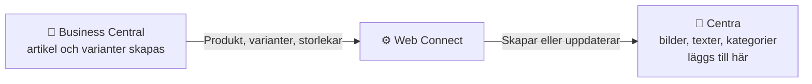

#### Produkter från ett PIM eller PLM

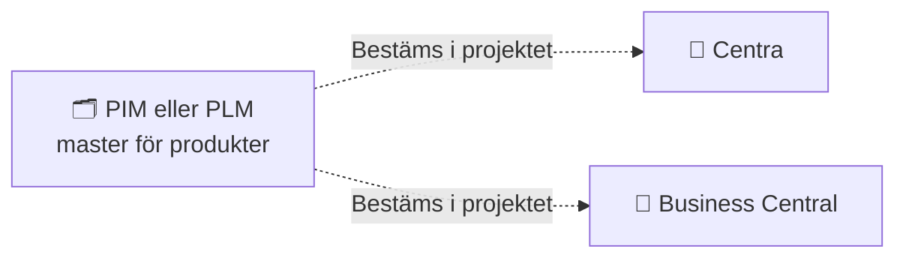

#### Produkter som skapas i Centra

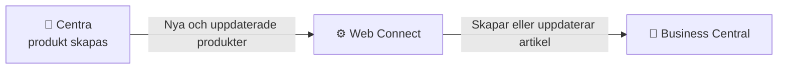

### Priser

| Alternativ | Så fungerar det | När det passar |
|---|---|---|
| **Business Central → Centra** (vanligast) | Priserna underhålls i Business Central och sätts på motsvarande prislistor i Centra | Priserna bestäms i Business Central |
| **Underhålls i Centra** | Priserna sätts i Centra och kommer in i Business Central med varje order | Priser och kampanjer sköts i Centra |

#### Priser från Business Central till Centra

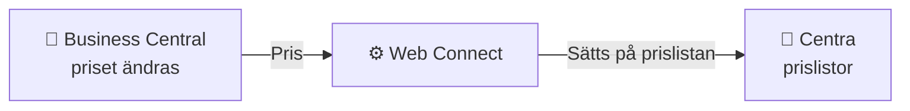

#### Priser som underhålls i Centra

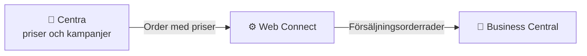

### Dragning av betalningen

| Alternativ | Så fungerar det | När det passar |
|---|---|---|
| **Via Centra** | När leveransen skapas ber Web Connect Centra att dra betalningen, och Centras betalleverantör gör dragningen | Betalningarna sköts av Centras betalleverantör |
| **I Business Central med PSP Connect** | Betalningen dras i Business Central med [PSP Connect](https://appsource.microsoft.com/en-us/product/dynamics-365-business-central/PUBID.n3visionab1614113437854%7CAID.pspconnect%7CPAPPID.3502b030-589b-4d25-a741-5a58b76ea13c) från N3 Vision, nära bokföringen. PSP Connect stämmer också av betalleverantörens utbetalningar mot Business Central | Ni använder PSP Connect. Då är det här det vanliga valet |
| **Utanför integrationen** | Dragningen görs manuellt eller av ett annat system | Betalningarna hanteras separat |

#### Dragning av betalningen via Centra

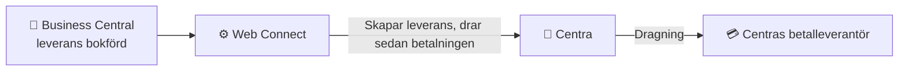

#### Dragning av betalningen i Business Central med PSP Connect

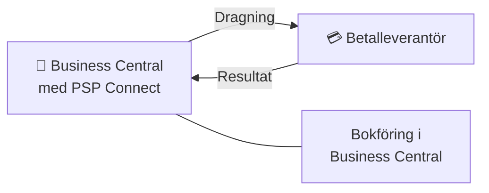

#### Dragning av betalningen utanför integrationen

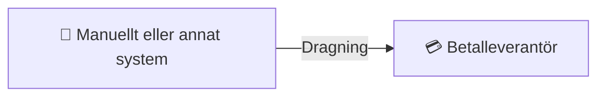

### Makuleringar

Makulera order i Business Central, inte i Centra. Det är i Business Central som ordern hanteras vidare, och med en lagerintegration är det det enda stället som vet om lagret fortfarande kan stoppa ordern.

| Alternativ | Så fungerar det | När det passar |
|---|---|---|
| **I Business Central, avstämt med lagersystemet** (rekommenderas) | Kundtjänst makulerar i Business Central. En begäran om makulering skickas först till lagersystemet. Med Ongoing WMS är det en statusuppdatering på ordern i Ongoing. Godkänner lagret makuleras ordern eller dess ej levererade rader i Centra. Har ordern kommit för långt, till exempel om den plockas, nekar lagersystemet begäran och ordern makuleras inte | Ni har en lagerintegration via Web Connect |
| **I Business Central** (vanligast) | Kundtjänst makulerar i Business Central, och ordern eller dess ej levererade rader makuleras i Centra | Lagerarbetet görs i Business Central |

#### Makulering i Business Central, avstämd med lagersystemet

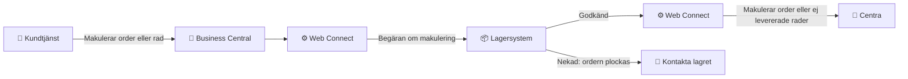

#### Makulering i Business Central

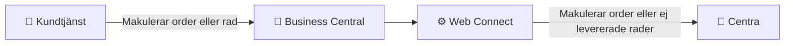

När Centra makulerar en order kan den också häva betalningsauktoriseringen och mejla kunden.

Berikning av produkter (bilder, texter, kategorier och SEO), kunder och B2B-konton, stores, markets och prislistor underhålls alltid i Centra.

## Det här behöver du

- Microsoft Dynamics 365 Business Central, Essentials eller Premium
- Web Connect installerat från Microsoft AppSource, med en aktiverad licens för Web Connect
- Appen Web Connect Ready Integrations installerad i samma Business Central-miljö. Centra-integrationen ingår i den
- Ditt godkännande av att Web Connect installeras och agerar i din Business Central-miljö
- En Integration API-token från Centra (skapas under System, API Tokens i Centra), med behörighet för order, leveranser, produkter, lagersaldo, betalningar och konton

## Så kommer du igång

1. Bestäm vilka flöden ni ska använda och vilket alternativ ni väljer för vart och ett, se [Välj upplägg](#choose-your-setup).
2. Installera Web Connect i Business Central, aktivera licensen och ge ditt godkännande.
3. Installera appen Web Connect Ready Integrations i samma miljö och aktivera Centra-integrationen.
4. Skapa en Integration API-token i Centra och spara den i [Secret Value Storage](../../general/secret-value-storage.md) i Web Connect.
5. Ställ in valen i konfigurationen nedan.
6. Testa hela orderflödet i en sandlåda i Business Central mot Centra QA innan ni går live.

## Konfigurera själv i Business Central

All konfiguration och logik i integrationen syns och går att ändra i Business Central. Det finns ingen extern integrationsplattform där logiken är gömd.

| Det här kan du ändra | Var i Web Connect | Exempel |
|---|---|---|
| Styrning per försäljningskanal | [Condition List](../../general/condition-list.md) | Hantera order från grossistbutiken på ett annat sätt än order från konsumentbutiken |
| Kund per market | [Text Mapping](../../general/text-mapping.md) | Mappa varje market i Centra till en kund i Business Central |
| Fältmappning på order | [Incoming Data mapping](../../general/incoming-data/mapping.md) | Mappa ett fält på ordern i Centra till ett fält på försäljningsordern |
| Vad som startar uppdateringar av lagersaldot | [Outgoing Sync Triggers](../../general/outgoing-mapping/outgoing-sync-triggers.md) | Skicka lagersaldo när försäljnings-, inköps- eller flyttorderrader ändras |
| Vilket lagersaldo som skickas | [Item Inventory](../../general/item-inventory.md) och [Destinations](../../general/destinations.md) | Beräkna tillgängligt lagersaldo bara för utvalda lagerställen |
| Övervakning och omsändning | [Entries](../../general/entries.md) | Se varje order och uppdatering, och [skicka ett meddelande igen](../../../../how-to/web-connect/resend-outgoing-message.md) |

## Val i konfigurationen

- **Försäljningskanaler:** vilka stores och markets som finns i Centra (butik, grossist, marknadsplatser) och hur var och en känns igen med ett villkor.
- **Kundmappning:** vilken kund i Business Central varje market i Centra mappas till. Grossistorder kan i stället använda B2B-kontot på ordern.
- **Matchning av artiklar:** hur produkter i Centra matchas mot artiklar och varianter i Business Central, oftast på EAN eller SKU.
- **Fraktavgifter:** om fraktkostnaden på order från Centra bokförs på ett redovisningskonto, som en artikelrad eller som ett artikeltillägg.
- **Ekonomiska mappningar:** momsrörelsebokföringsmallar per land, betalningsmetoder och speditörer.
- **Beräkning av lagersaldo:** vilka lagerställen som räknas med och om reserverade antal dras av. Negativt lagersaldo skickas som 0.
- **Vilka order som importeras:** order som väntar på betalning eller är pausade i Centra importeras inte.

## Begränsningar

- **Storlekstabeller i Centra går inte att ändra** när de väl kopplats till en produkt. Produkten måste tas bort och skapas på nytt i Centra. Planera storleksstrukturen innan produkterna synkas.
- **API-token i Centra går ut**, och Centra varnar inte i förväg. Förnyelsen görs manuellt.
- **Slutförda order går inte att makulera** i Centra, och på order som behandlas går det bara att makulera de ej levererade raderna.
- **Order som lagret har börjat med går inte att makulera** när en lagerintegration används. Lagersystemet nekar begäran, och ni måste kontakta lagret.
- **Leveranser kräver en bekräftad order.** En order som aldrig bekräftades i Centra kan inte få några leveranser.
- **Berikningen av produkter stannar i Centra.** Bilder, texter, kategorier och SEO skickas inte från Business Central.

## Vanliga frågor

### Går det att integrera Business Central med Centra?

Ja. Web Connect kopplar Business Central till Centra via Centras GraphQL Integration API. Order hämtas in till Business Central, och leveranser, lagersaldo, produkter, priser, dragning av betalningen och makuleringar kan skickas till Centra.

### Stöder integrationen både DTC och wholesale i Centra?

Ja. Web Connect känner igen Centras store och market på varje order med villkor. Därför kan order från butik (DTC), grossist (B2B) och marknadsplatser styras till olika kunder och inställningar i Business Central.

### Kan vi själva ändra vad som skickas mellan Business Central och Centra?

Ja. Fältmappningar, villkor, triggers och vilka flöden som är aktiva konfigureras i Web Connect i ditt eget Business Central. Du kan se och ändra dem utan att be en leverantör ändra i en extern plattform.

### Vad händer när API-token för Centra går ut?

Alla anrop till Centra misslyckas med 401 Unauthorized. Skapa en ny Integration API-token i Centra och uppdatera den sparade hemligheten i Web Connect. Centra varnar inte innan en token går ut, så lägg in en påminnelse.

### Varför syns inte leveransen i Centra?

Centra tar bara emot leveranser på order som är bekräftade. Kontrollera att ordern bekräftades i Centra efter att den skapades i Business Central, och titta sedan på felet i Web Connect Entries.

### Kan vi makulera en Centra-order som lagret har börjat plocka?

Inte från Business Central. Med en lagerintegration skickar Web Connect först en begäran om makulering till lagersystemet, innan något makuleras i Centra. Har ordern kommit för långt, till exempel om den plockas, nekar lagersystemet begäran. Kontakta lagret för att stoppa ordern.

### Dras betalningen automatiskt när vi skickar?

Det kan den göra. Web Connect kan be Centra dra betalningen när leveransen skapas, och Centras betalleverantör gör dragningen. Använder du PSP Connect från N3 Vision görs dragningen oftast i Business Central i stället, nära bokföringen.

## Relaterat

- Flöden: [Order in](flows/order-inbound.md) · [Leverans](flows/shipment.md) · [Lagersaldo](flows/stock-update.md) · [Produktdata](flows/product-data.md) · [Makulering](flows/cancellation.md)
- Instruktioner: [Skicka ett utgående meddelande igen](../../../../how-to/web-connect/resend-outgoing-message.md) · [Integrationerna körs inte](../../../../how-to/web-connect/integration-not-running.md) · [401 efter att jobbkön stoppats](../../../../how-to/web-connect/unauthorized-after-job-queue-stopped.md)
- [Allmän dokumentation för Web Connect](../../general/README.md)
- [Centras dokumentation för Integration API](https://docs.centraapis.com/)

## Om Web Connect

Web Connect är en integrationsplattform för Microsoft Dynamics 365 Business Central, utvecklad av CombineIT. Den installeras i ditt eget Business Central och kopplar det till e-handelsplattformar, lagersystem, kassasystem, returer, marknadsplatser och EDI. Varje flöde, mappning och regel konfigureras i Business Central, där du kan se och ändra det själv, utan specialkod för varje integration. [Web Connect på Microsoft AppSource](https://marketplace.microsoft.com/sv-se/product/PUBID.martitab1633951001710%7CAID.webconnect%7CPAPPID.9f3a7223-19db-4ac7-832f-cf8e4699186f?tab=Overview) · [Kontakta CombineIT](https://www.combineit.se/contact/)
