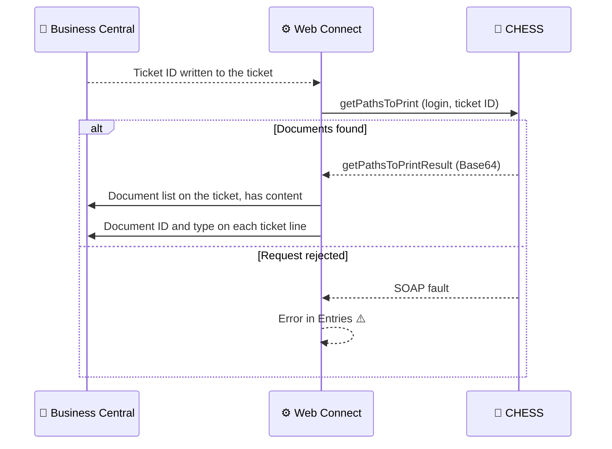

# CHESS to Business Central: safety data sheets

When CHESS has returned a ticket ID, Web Connect asks CHESS for the documents to print for that ticket. CHESS answers with the safety data sheets it holds for the items on the shipment. The answer is stored on the ticket in Business Central, and each document ID and document type is written to the ticket line for its shipment line.

| | |
|---|---|
| **Direction** | CHESS → Business Central |
| **Trigger** | The ticket ID is written to the CHESS ticket in Business Central (outgoing sync trigger on that field) |
| **Result** | The document list on the ticket, the ticket marked as having content, and the document ID and document type on the ticket line for each shipment line |
| **Part of** | [Business Central and CHESS chemical management integration](../overview.md) |

## Step by step

1. The [shipment tickets](shipment-ticket.md) flow writes the CHESS ticket ID to the ticket (Web Connect).
2. The change starts a `getPathsToPrint` call to the CHESS DocMan and SDS service, with the login and the ticket ID (Web Connect).
3. CHESS answers with the documents for the ticket, encoded in Base64 (CHESS).
4. Web Connect decodes the answer, stores it on the ticket and marks the ticket as having content (Web Connect).
5. The ticket lines are the lines of the shipment. Each document in the answer is written to its line, with document ID and document type (Web Connect).

## Data mapping

| CHESS element | Business Central field | Note |
|---|---|---|
| `loginXml` | Fixed values | The same login as for the ticket, sent as CDATA |
| `ticketId` | Ticket ID (CHESS ticket) | |
| `getPathsToPrintResult` | Document content (CHESS ticket) | Decoded from Base64 |
| | Has Content (CHESS ticket) | Set to true when the answer is stored |
| Document ID per document | Document ID (CHESS ticket line) | Used by [Set to Printed](set-to-printed.md) |
| Document type per document | Document Type (CHESS ticket line) | Used by [Set to Printed](set-to-printed.md) |

## Web Connect objects

| Object | Role |
|---|---|
| `CHE_PATHSTOPRINT` | The `getPathsToPrint` call, started when the ticket ID is written |
| `CHE_ENVELOPE_PATHTOPRINT` | Reads the answer and passes the document list on to the ticket lines |
| `CHE_LOGIN` | The login XML, shared with the other CHESS calls |

## Error handling

| Situation | What happens | What to do |
|---|---|---|
| CHESS answers with a SOAP fault | The call is logged as an error in Entries, and the ticket lines get no document IDs | Check the login and the ticket ID, then [resend the message](../../../../../how-to/web-connect/resend-outgoing-message.md) |
| No item on the shipment has a safety data sheet in CHESS | The ticket lines get no document IDs | Connect the safety data sheet to the item number in CHESS, or leave such shipments out of the selection |

## Frequently asked questions

### What if an item on the shipment has no safety data sheet?

CHESS only returns the documents it holds for the item numbers on the ticket. An item without a safety data sheet in CHESS gets no document ID on its ticket line.

## Related

- [Business Central and CHESS chemical management integration](../overview.md)
- [Shipment tickets](shipment-ticket.md) · [Documents marked as printed](set-to-printed.md)
- [Incoming Data](../../../general/incoming-data/README.md)
