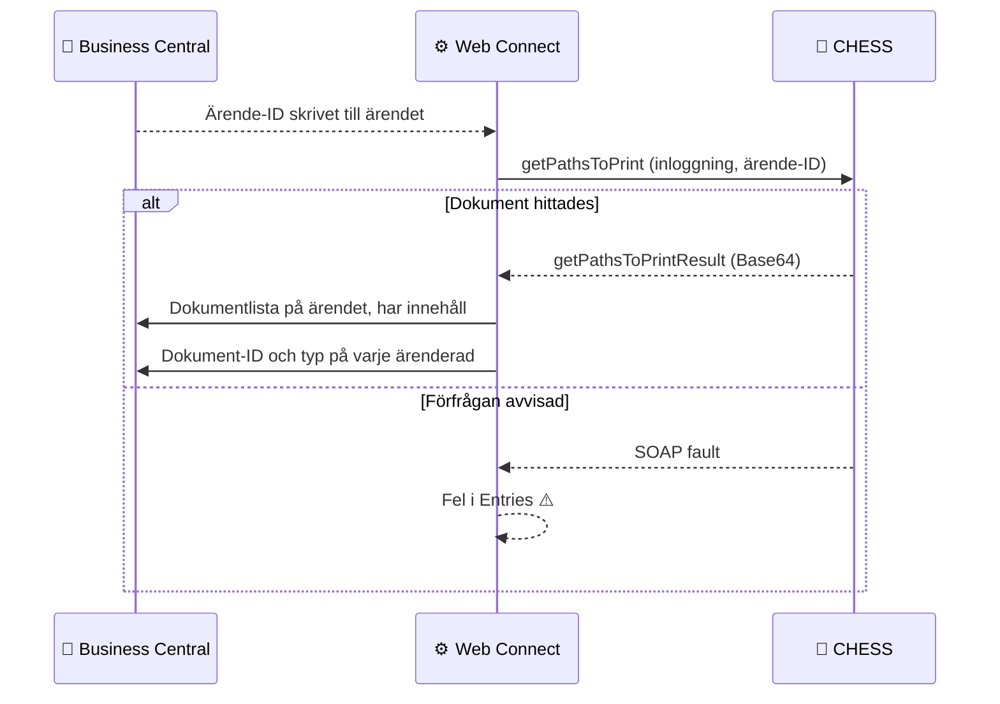

# Från CHESS till Business Central: säkerhetsdatablad

När CHESS har returnerat ett ärende-ID frågar Web Connect CHESS efter de dokument som ska skrivas ut för ärendet. CHESS svarar med de säkerhetsdatablad som finns för artiklarna på leveransen. Svaret sparas på ärendet i Business Central, och varje dokument-ID och dokumenttyp skrivs till ärenderaden för sin leveransrad.

| | |
|---|---|
| **Riktning** | CHESS → Business Central |
| **Startas av** | Ärende-ID:t skrivs till CHESS-ärendet i Business Central (utgående synktrigger på det fältet) |
| **Resultat** | Dokumentlistan på ärendet, ärendet markerat som att det har innehåll, och dokument-ID och dokumenttyp på ärenderaden för varje leveransrad |
| **Del av** | [Business Central och CHESS: integration](../overview.md) |

## Steg för steg

1. Flödet för [ärenden för leveranser](shipment-ticket.md) skriver ärende-ID:t från CHESS till ärendet (Web Connect).
2. Ändringen startar ett anrop till `getPathsToPrint` i DocMan- och SDS-tjänsten i CHESS, med inloggningen och ärende-ID:t (Web Connect).
3. CHESS svarar med dokumenten för ärendet, kodade i Base64 (CHESS).
4. Web Connect avkodar svaret, sparar det på ärendet och markerar att ärendet har innehåll (Web Connect).
5. Ärenderaderna är leveransens rader. Varje dokument i svaret skrivs till sin rad, med dokument-ID och dokumenttyp (Web Connect).

## Mappning av data

| Element i CHESS | Fält i Business Central | Kommentar |
|---|---|---|
| `loginXml` | Fasta värden | Samma inloggning som för ärendet, skickas som CDATA |
| `ticketId` | Ticket ID (CHESS ticket) | |
| `getPathsToPrintResult` | Document content (CHESS ticket) | Avkodas från Base64 |
| | Has Content (CHESS ticket) | Sätts till true när svaret har sparats |
| Dokument-ID per dokument | Document ID (CHESS ticket line) | Används av [Set to Printed](set-to-printed.md) |
| Dokumenttyp per dokument | Document Type (CHESS ticket line) | Används av [Set to Printed](set-to-printed.md) |

## Objekt i Web Connect

| Objekt | Roll |
|---|---|
| `CHE_PATHSTOPRINT` | Anropet `getPathsToPrint`, som startar när ärende-ID:t skrivs |
| `CHE_ENVELOPE_PATHTOPRINT` | Läser svaret och för dokumentlistan vidare till ärenderaderna |
| `CHE_LOGIN` | Inloggnings-XML:en, som delas med de andra anropen till CHESS |

## Felhantering

| Situation | Vad som händer | Vad du gör |
|---|---|---|
| CHESS svarar med en SOAP fault | Anropet loggas som ett fel i Entries, och ärenderaderna får inga dokument-ID:n | Kontrollera inloggningen och ärende-ID:t, och [skicka sedan om meddelandet](../../../../../how-to/web-connect/resend-outgoing-message.md) |
| Ingen artikel på leveransen har säkerhetsdatablad i CHESS | Ärenderaderna får inga dokument-ID:n | Koppla säkerhetsdatabladet till artikelnumret i CHESS, eller lämna sådana leveranser utanför urvalet |

## Vanliga frågor

### Vad händer om en artikel på leveransen saknar säkerhetsdatablad?

CHESS returnerar bara de dokument som finns för artikelnumren på ärendet. En artikel utan säkerhetsdatablad i CHESS får inget dokument-ID på sin ärenderad.

## Relaterat

- [Business Central och CHESS: integration](../overview.md)
- [Ärenden för leveranser](shipment-ticket.md) · [Dokument markerade som utskrivna](set-to-printed.md)
- [Incoming Data](../../../general/incoming-data/README.md)
