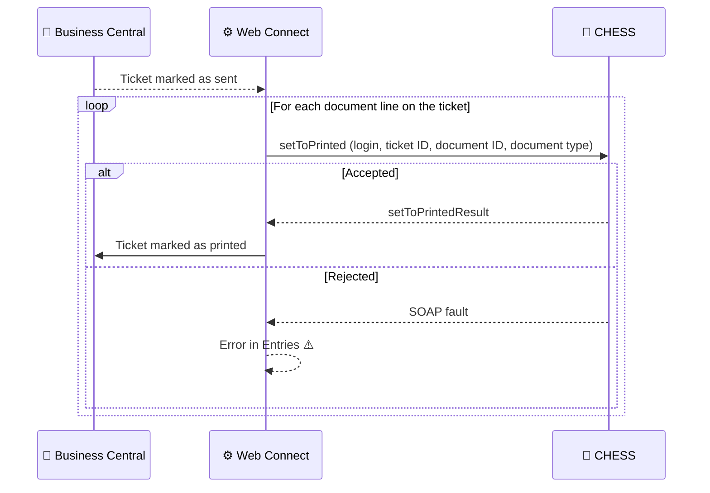

# Business Central to CHESS: documents marked as printed

When a CHESS ticket in Business Central is marked as sent, Web Connect sends one Set to Printed call to CHESS for each document line on the ticket. CHESS marks the document as printed, and the ticket leaves the queue in CHESS when all its documents are printed. The answer from CHESS marks the ticket as printed in Business Central.

| | |
|---|---|
| **Direction** | Business Central → CHESS |
| **Trigger** | The ticket is marked as sent in Business Central when the safety data sheets have been e-mailed to the customer. The trigger is set on that field of the ticket and sends each of its lines |
| **Result** | Every document on the ticket is printed in CHESS, and the ticket is marked as printed in Business Central |
| **Part of** | [Business Central and CHESS chemical management integration](../overview.md) |

## Step by step

1. The safety data sheets are e-mailed to the customer, and the ticket is marked as sent (Business Central).
2. The change on the ticket starts one call for each ticket line, through the relation between ticket and ticket line (Web Connect).
3. Each call sends `setToPrinted` to the CHESS DocMan and SDS service, with the login, the ticket ID from the ticket and the document ID and document type from the line (Web Connect).
4. CHESS marks the document as printed and answers (CHESS).
5. The answer is written back to the ticket, found by its shipment number, and the ticket is marked as printed (Web Connect).

## Data mapping

| CHESS element | Business Central field | Note |
|---|---|---|
| `loginXml` | Fixed values | The same login as for the ticket, sent as CDATA |
| `ticketId` | Ticket ID (CHESS ticket) | Read from the ticket through the relation from the line. Without the relation the call gets the wrong ticket ID |
| `documentIds` | Document ID (CHESS ticket line) | One document per call |
| `documentTypes` | Document Type (CHESS ticket line) | One document per call |
| `setToPrintedResult` | Marked as Printed (CHESS ticket) | Set to true from the answer. The ticket is found by the shipment number |

## Web Connect objects

| Object | Role |
|---|---|
| `CHE_SETTOPRINTED_TICKETLINE` | The `setToPrinted` call, one per ticket line |
| `CHE_SETTOPRINTED` | Carries the trigger on the ticket that starts the calls for its lines |
| `CHE_TICKET_ID` | Reads the ticket ID from the ticket |
| `CHE_SET_VALUE_ON_CHESSTICKET` | Writes the answer back to the ticket and marks it as printed |
| `CHE_LOGIN` | The login XML, shared with the other CHESS calls |

## Error handling

| Situation | What happens | What to do |
|---|---|---|
| CHESS answers with a SOAP fault | The call for that document is logged as an error in Entries, and the document stays in the CHESS queue | Check the ticket ID and the document ID, then [resend the message](../../../../../how-to/web-connect/resend-outgoing-message.md) |
| The answer cannot be written back to the ticket | The document is printed in CHESS, but the ticket is not marked as printed in Business Central. The error is shown in incoming data | Correct the cause and process the incoming data again |

## Frequently asked questions

### Why is Set to Printed sent once per document?

CHESS only marks the documents named in the call. Every document on the ticket has to be reported, or the ticket stays in the CHESS queue. One call per document line makes sure that all of them are sent, however many safety data sheets the shipment has.

## Related

- [Business Central and CHESS chemical management integration](../overview.md)
- [Shipment tickets](shipment-ticket.md) · [Safety data sheets](safety-data-sheets.md)
- [Resend an outgoing message](../../../../../how-to/web-connect/resend-outgoing-message.md)
