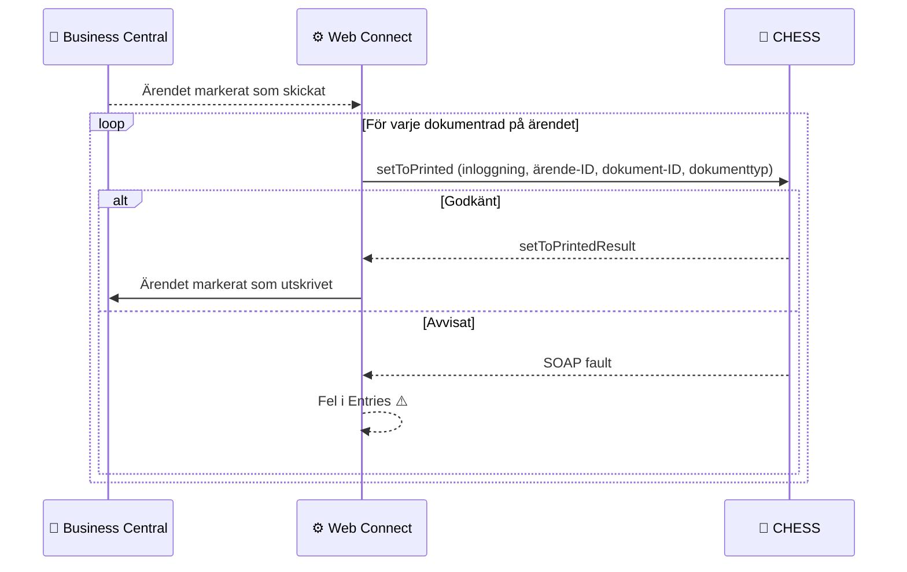

# Från Business Central till CHESS: dokument markerade som utskrivna

När ett CHESS-ärende i Business Central markeras som skickat skickar Web Connect ett Set to Printed-anrop till CHESS för varje dokumentrad på ärendet. CHESS markerar dokumentet som utskrivet, och ärendet lämnar kön i CHESS när alla dess dokument är utskrivna. Svaret från CHESS markerar ärendet som utskrivet i Business Central.

| | |
|---|---|
| **Riktning** | Business Central → CHESS |
| **Startas av** | Ärendet markeras som skickat i Business Central när säkerhetsdatabladen har mejlats till kunden. Triggern ligger på det fältet på ärendet och skickar var och en av ärendets rader |
| **Resultat** | Varje dokument på ärendet är utskrivet i CHESS, och ärendet är markerat som utskrivet i Business Central |
| **Del av** | [Business Central och CHESS: integration](../overview.md) |

## Steg för steg

1. Säkerhetsdatabladen mejlas till kunden, och ärendet markeras som skickat (Business Central).
2. Ändringen på ärendet startar ett anrop för varje ärenderad, via relationen mellan ärende och ärenderad (Web Connect).
3. Varje anrop skickar `setToPrinted` till DocMan- och SDS-tjänsten i CHESS, med inloggningen, ärende-ID:t från ärendet och dokument-ID och dokumenttyp från raden (Web Connect).
4. CHESS markerar dokumentet som utskrivet och svarar (CHESS).
5. Svaret skrivs tillbaka till ärendet, som hittas via sitt leveransnummer, och ärendet markeras som utskrivet (Web Connect).

## Mappning av data

| Element i CHESS | Fält i Business Central | Kommentar |
|---|---|---|
| `loginXml` | Fasta värden | Samma inloggning som för ärendet, skickas som CDATA |
| `ticketId` | Ticket ID (CHESS ticket) | Läses från ärendet via relationen från raden. Utan relationen får anropet fel ärende-ID |
| `documentIds` | Document ID (CHESS ticket line) | Ett dokument per anrop |
| `documentTypes` | Document Type (CHESS ticket line) | Ett dokument per anrop |
| `setToPrintedResult` | Marked as Printed (CHESS ticket) | Sätts till true utifrån svaret. Ärendet hittas via leveransnumret |

## Objekt i Web Connect

| Objekt | Roll |
|---|---|
| `CHE_SETTOPRINTED_TICKETLINE` | Anropet `setToPrinted`, ett per ärenderad |
| `CHE_SETTOPRINTED` | Bär triggern på ärendet som startar anropen för dess rader |
| `CHE_TICKET_ID` | Läser ärende-ID:t från ärendet |
| `CHE_SET_VALUE_ON_CHESSTICKET` | Skriver tillbaka svaret till ärendet och markerar det som utskrivet |
| `CHE_LOGIN` | Inloggnings-XML:en, som delas med de andra anropen till CHESS |

## Felhantering

| Situation | Vad som händer | Vad du gör |
|---|---|---|
| CHESS svarar med en SOAP fault | Anropet för det dokumentet loggas som ett fel i Entries, och dokumentet ligger kvar i kön i CHESS | Kontrollera ärende-ID:t och dokument-ID:t, och [skicka sedan om meddelandet](../../../../../how-to/web-connect/resend-outgoing-message.md) |
| Svaret går inte att skriva tillbaka till ärendet | Dokumentet är utskrivet i CHESS, men ärendet markeras inte som utskrivet i Business Central. Felet visas i inkommande data | Rätta orsaken och bearbeta inkommande data igen |

## Vanliga frågor

### Varför skickas Set to Printed en gång per dokument?

CHESS markerar bara de dokument som anges i anropet. Varje dokument på ärendet måste rapporteras, annars ligger ärendet kvar i kön i CHESS. Ett anrop per dokumentrad ser till att alla skickas, hur många säkerhetsdatablad leveransen än har.

## Relaterat

- [Business Central och CHESS: integration](../overview.md)
- [Ärenden för leveranser](shipment-ticket.md) · [Säkerhetsdatablad](safety-data-sheets.md)
- [Skicka om ett utgående meddelande](../../../../../how-to/web-connect/resend-outgoing-message.md)
