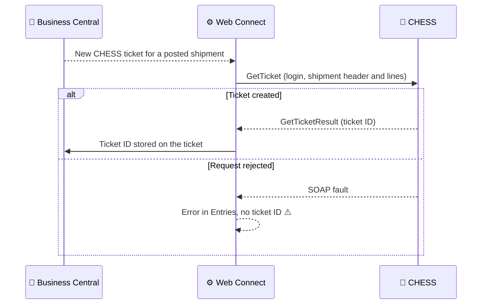

# Business Central to CHESS: shipment tickets

When a CHESS ticket is created in Business Central for a posted sales shipment, Web Connect sends the shipment to CHESS at once. The customer number, the recipient's e-mail address, the document language and the item numbers on the shipment lines are sent. CHESS returns a ticket ID, which is stored on the ticket and starts the next flow.

| | |
|---|---|
| **Direction** | Business Central → CHESS |
| **Trigger** | A new CHESS ticket in Business Central (outgoing sync trigger on insert). Tickets are created by a job for the posted sales shipments that match the selection |
| **Result** | A ticket in CHESS for the shipment, and the CHESS ticket ID on the ticket in Business Central |
| **Part of** | [Business Central and CHESS chemical management integration](../overview.md) |

## Step by step

1. A sales shipment is posted in Business Central (Business Central).
2. A job creates a CHESS ticket for the shipment if it matches the selection (Business Central).
3. The new ticket starts the call. Web Connect builds a SOAP request with the login and the shipment data, with the header and the lines of the posted sales shipment (Web Connect).
4. The request is sent to the CHESS client validation service, `GetTicket` (Web Connect).
5. CHESS creates the ticket and returns its ID (CHESS).
6. The ticket ID is written to the ticket in Business Central, which starts the [safety data sheets](safety-data-sheets.md) flow (Web Connect).

## Data mapping

| CHESS element | Business Central field | Note |
|---|---|---|
| `LoginXML` | Fixed values | The CHESS login for the web services, sent as CDATA |
| `DOCMANCUSTOMERID` | Sell-to Customer No. (posted sales shipment) | |
| `DOCMANPRINTERNAME` | Sell-to E-Mail (posted sales shipment) | The recipient of the documents |
| `DOCMANLANGUAGE` | Ship-to Country/Region Code (posted sales shipment) | Translated with a mapping, for example SE to sv-SE, DK to da-DK, FI to fi-FI and NO to no-NO |
| `DELIVERNOTEFROMCOMPANY` | Fixed value | Your company name as sender |
| `CMDDOCUMENT` | Fixed value | The DocMan command for the ticket |
| `DGITEM` / `ARTICLENO` | No. (posted sales shipment line) | One element per line. Hyphens are removed so the number matches CHESS |
| `GetTicketResult` | Ticket ID (CHESS ticket) | Written back from the answer |

## Web Connect objects

| Object | Role |
|---|---|
| `CHE_GETTICKET` | The `GetTicket` call, started when a CHESS ticket is created |
| `CHE_LOGIN` | The login XML, reused by every CHESS call |
| `CHE_DATA` | The shipment header in the ticket data |
| `CHE_DATALINE` | One item per shipment line |
| `CHE_TICKET_ENVELOPE` and its child objects | Read the answer from CHESS |

## Error handling

| Situation | What happens | What to do |
|---|---|---|
| CHESS answers with a SOAP fault | The call is logged as an error in Entries and the ticket gets no ticket ID, so no documents are fetched | Check the login and the data in the request, then [resend the message](../../../../../how-to/web-connect/resend-outgoing-message.md) |
| A ship-to country is not in the language mapping | [ATT FYLLA I: what CHESS does when the ticket has no document language] | Add the country to the mapping |

## Frequently asked questions

### How does CHESS know which language to use?

Web Connect translates the ship-to country on the shipment to a document language, for example SE to sv-SE, and sends it with the ticket. The translation is a mapping in Web Connect that you can change.

## Related

- [Business Central and CHESS chemical management integration](../overview.md)
- [Safety data sheets](safety-data-sheets.md) · [Documents marked as printed](set-to-printed.md)
- [Resend an outgoing message](../../../../../how-to/web-connect/resend-outgoing-message.md)
