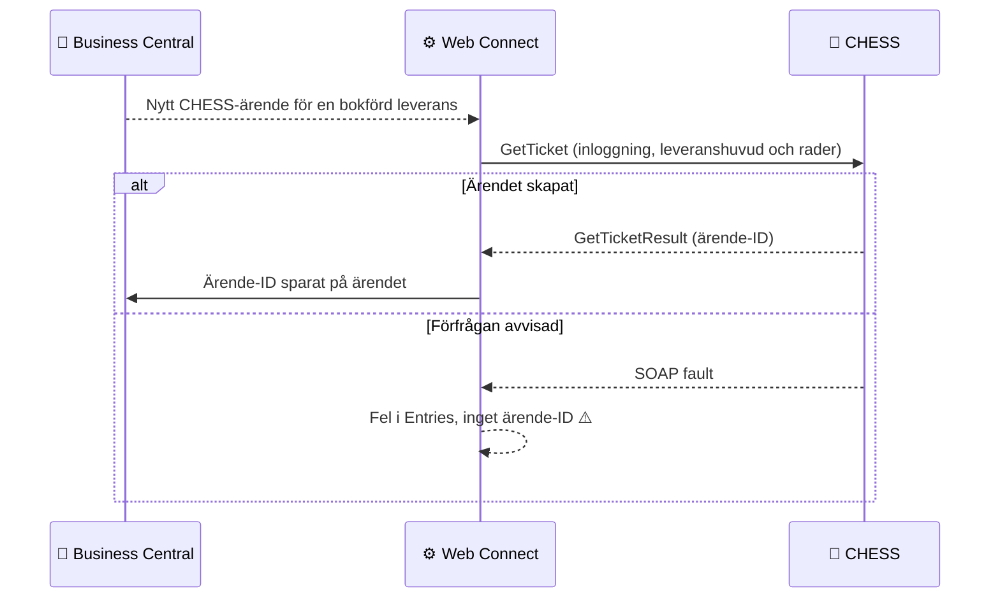

# Från Business Central till CHESS: ärenden för leveranser

När ett CHESS-ärende skapas i Business Central för en bokförd försäljningsleverans skickar Web Connect leveransen till CHESS direkt. Kundnumret, mottagarens e-postadress, dokumentspråket och artikelnumren på leveransraderna skickas. CHESS returnerar ett ärende-ID, som sparas på ärendet och startar nästa flöde.

| | |
|---|---|
| **Riktning** | Business Central → CHESS |
| **Startas av** | Ett nytt CHESS-ärende i Business Central (utgående synktrigger vid insättning). Ärendena skapas av ett jobb för de bokförda försäljningsleveranser som matchar urvalet |
| **Resultat** | Ett ärende i CHESS för leveransen, och ärende-ID:t från CHESS på ärendet i Business Central |
| **Del av** | [Business Central och CHESS: integration](../overview.md) |

## Steg för steg

1. En försäljningsleverans bokförs i Business Central (Business Central).
2. Ett jobb skapar ett CHESS-ärende för leveransen om den matchar urvalet (Business Central).
3. Det nya ärendet startar anropet. Web Connect bygger en SOAP-förfrågan med inloggningen och leveransdata, med huvudet och raderna från den bokförda försäljningsleveransen (Web Connect).
4. Förfrågan skickas till tjänsten för klientvalidering i CHESS, `GetTicket` (Web Connect).
5. CHESS skapar ärendet och returnerar dess ID (CHESS).
6. Ärende-ID:t skrivs till ärendet i Business Central, vilket startar flödet för [säkerhetsdatablad](safety-data-sheets.md) (Web Connect).

## Mappning av data

| Element i CHESS | Fält i Business Central | Kommentar |
|---|---|---|
| `LoginXML` | Fasta värden | Inloggningen i CHESS för webbtjänsterna, skickas som CDATA |
| `DOCMANCUSTOMERID` | Sell-to Customer No. (bokförd försäljningsleverans) | |
| `DOCMANPRINTERNAME` | Sell-to E-Mail (bokförd försäljningsleverans) | Elementet i DocMan för vart dokumenten ska. Integrationen skickar e-postadressen |
| `DOCMANLANGUAGE` | Ship-to Country/Region Code (bokförd försäljningsleverans) | Översätts med en mappning, till exempel SE till sv-SE, DK till da-DK, FI till fi-FI och NO till no-NO |
| `DELIVERNOTEFROMCOMPANY` | Fast värde | Ert företagsnamn som avsändare |
| `CMDDOCUMENT` | Fast värde | Kommandot i DocMan för ärendet |
| `DGITEM` / `ARTICLENO` | No. (bokförd försäljningsleveransrad) | Ett element per rad. Bindestreck tas bort så att numret stämmer med CHESS |
| `GetTicketResult` | Ticket ID (CHESS ticket) | Skrivs tillbaka från svaret |

## Objekt i Web Connect

| Objekt | Roll |
|---|---|
| `CHE_GETTICKET` | Anropet `GetTicket`, som startar när ett CHESS-ärende skapas |
| `CHE_LOGIN` | Inloggnings-XML:en, som återanvänds av alla anrop till CHESS |
| `CHE_DATA` | Leveranshuvudet i ärendedata |
| `CHE_DATALINE` | En artikel per leveransrad |
| `CHE_TICKET_ENVELOPE` och dess underobjekt | Läser svaret från CHESS |

## Felhantering

| Situation | Vad som händer | Vad du gör |
|---|---|---|
| CHESS svarar med en SOAP fault | Anropet loggas som ett fel i Entries och ärendet får inget ärende-ID, så inga dokument hämtas | Kontrollera inloggningen och uppgifterna i förfrågan, och [skicka sedan om meddelandet](../../../../../how-to/web-connect/resend-outgoing-message.md) |

## Vanliga frågor

### Hur vet CHESS vilket språk som ska användas?

Web Connect översätter leveranslandet på leveransen till ett dokumentspråk, till exempel SE till sv-SE, och skickar det med ärendet. Översättningen är en mappning i Web Connect som du kan ändra.

## Relaterat

- [Business Central och CHESS: integration](../overview.md)
- [Säkerhetsdatablad](safety-data-sheets.md) · [Dokument markerade som utskrivna](set-to-printed.md)
- [Skicka om ett utgående meddelande](../../../../../how-to/web-connect/resend-outgoing-message.md)
