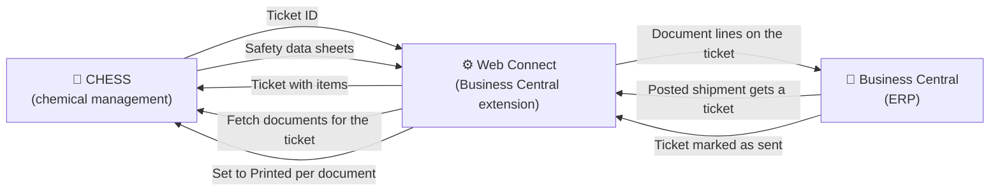
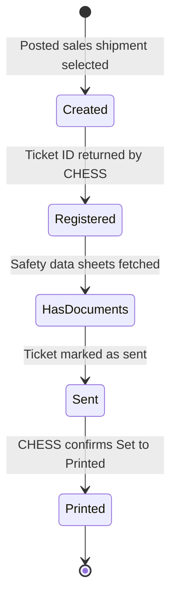
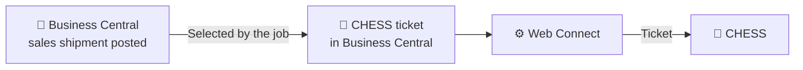
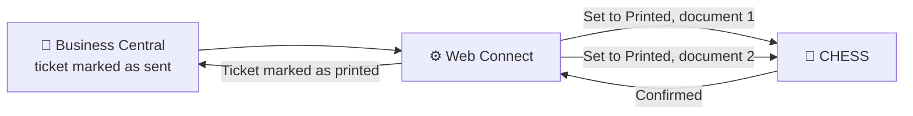

# Business Central and CHESS chemical management integration

Web Connect by CombineIT connects Microsoft Dynamics 365 Business Central with CHESS, the chemical management system from Bureau Veritas. A posted sales shipment becomes a ticket in CHESS, the safety data sheets for the items on the shipment come back to Business Central, and CHESS is told when the documents have been sent. All mappings and rules live in your own Business Central, where you can see and change them yourself.

## At a glance

| | |
|---|---|
| **System** | CHESS from Bureau Veritas (chemical management, with the DocMan module for distributing safety data sheets) |
| **Integration product** | Web Connect for Microsoft Dynamics 365 Business Central |
| **Runs in** | Your own Business Central environment, as an extension. Every call starts in Business Central: a new CHESS ticket for a posted shipment is sent at once, the safety data sheets are fetched when CHESS has returned the ticket ID, and Set to Printed is sent when the ticket is marked as sent. There are no incoming webhooks. All processing and configuration stays in Business Central. |
| **Configured by** | You, in Business Central: mappings, conditions, triggers and flows. You can do all of it yourself. If you want, CombineIT takes part in any step, as a sounding board or by doing the work. |
| **Connection** | SOAP web services with XML on DGOffice.net: the client validation service for tickets, and the DocMan and SDS service for documents |
| **CHESS API** | [ATT FYLLA I: whether Bureau Veritas publishes documentation for the DocMan web services, or only gives the service description to customers] |
| **Data flows** | 3: shipment tickets, safety data sheets and documents marked as printed |
| **Business Central editions** | All editions, Essentials and Premium, including the latest version |
| **Available from** | [Web Connect on Microsoft AppSource](https://marketplace.microsoft.com/sv-se/product/PUBID.martitab1633951001710%7CAID.webconnect%7CPAPPID.9f3a7223-19db-4ac7-832f-cf8e4699186f?tab=Overview). [ATT FYLLA I: whether CHESS is part of the Web Connect Ready Integrations app] |

## What can be synchronized

Web Connect has three data flows between Business Central and CHESS.

| Data | Direction | What happens |
|---|---|---|
| [Shipment tickets](flows/shipment-ticket.md) | Business Central → CHESS | A posted sales shipment is sent to CHESS as a ticket, with the customer, the recipient's e-mail address, the document language and the item numbers. CHESS returns a ticket ID |
| [Safety data sheets](flows/safety-data-sheets.md) | CHESS → Business Central | The documents CHESS holds for the items on the ticket are fetched and stored on the ticket in Business Central, one line per document |
| [Documents marked as printed](flows/set-to-printed.md) | Business Central → CHESS | When the ticket is marked as sent, each document on it is reported to CHESS as printed, and the ticket in Business Central is marked as printed |

The three flows work as one chain, and all three are used in the one CHESS integration in production today. See [Choose your setup](#choose-your-setup).

## How it works

Web Connect keeps a CHESS ticket in Business Central for each posted sales shipment that should have safety data sheets. When a ticket is created, Web Connect sends the shipment to CHESS and stores the ticket ID that CHESS returns. The new ticket ID starts the next call, which fetches the list of documents for the ticket. When the ticket has been marked as sent, Web Connect tells CHESS that each document is printed, so the ticket leaves the queue in CHESS. Every call and answer is logged in Web Connect [Entries](../../general/entries.md), where it can be inspected and resent.

### Ticket status in Business Central

## Choose your setup

Each flow has to fit how your business works: which system owns the data, where people do their work, and what the accounting needs. That is why the flows are decided together when a new integration is set up. The options below are the ones Web Connect customers use today. **Common setup** marks the option most Web Connect customers with CHESS use. **Recommended** marks CombineIT's best practice, where there is one.

Only one Web Connect customer runs CHESS today, so no option is marked as common setup. Each area below shows how that integration is set up.

### Which shipments get a ticket

| Option | How it works | When it fits |
|---|---|---|
| **Selected posted sales shipments** | A job in Business Central creates a CHESS ticket for posted sales shipments that match the selection set at setup, for example customer groups that should receive safety data sheets | Only some customers, such as business customers, need safety data sheets with their deliveries |

#### Which shipments get a ticket: selected posted sales shipments

### Reporting documents as printed

| Option | How it works | When it fits |
|---|---|---|
| **One call per document** | When the ticket is marked as sent, Web Connect sends one Set to Printed call for each document line on the ticket. The answer from CHESS marks the ticket as printed in Business Central | Shipments can carry several safety data sheets, and every one of them has to leave the CHESS queue |

#### Reporting documents as printed with one call per document

The safety data sheets themselves, their versions and their languages are always maintained in CHESS.

## What you need

- Microsoft Dynamics 365 Business Central, any edition (Essentials or Premium), including the latest version
- Web Connect installed from Microsoft AppSource, with an activated Web Connect license
- Your approval for Web Connect to be installed and to act in your Business Central environment
- A CHESS account with the DocMan module, and the login details for the web services, which are created in CHESS
- The CHESS ticket tables in Business Central, with ticket and ticket line, and a job that creates tickets for posted sales shipments. They come from an extension that CombineIT installs at setup
- Safety data sheets connected to your item numbers in CHESS
- An e-mail address on the posted sales shipments that should get safety data sheets

## Setting it up

1. Decide which shipments should get safety data sheets, see [Choose your setup](#choose-your-setup).
2. Install Web Connect in Business Central, activate the license and give your approval.
3. Import the CHESS configuration with the integration turned off, together with the extension for the CHESS ticket tables.
4. Enter the CHESS login details for the web services.
5. Translate ship-to countries to CHESS document languages in the mapping.
6. Set the selection for the job that creates tickets.
7. Test with shipments that have one and several safety data sheets before going live.

## Configure it yourself in Business Central

All configuration and logic in the integration is visible and editable in Business Central. There is no external integration platform where the logic is hidden.

| What you can change | Where in Web Connect | Example |
|---|---|---|
| What is sent on the ticket | [Outgoing Mapping](../../general/outgoing-mapping/README.md) | Send the customer number and the sell-to e-mail address, and remove hyphens from item numbers |
| Document language | [Mapping](../../general/incoming-data/mapping.md) | Translate the ship-to country SE to sv-SE and DK to da-DK |
| What starts each call | [Outgoing Sync Triggers](../../general/outgoing-mapping/outgoing-sync-triggers.md) | Send Set to Printed for each document line when the ticket is marked as sent |
| What is written back from CHESS | [Incoming Data](../../general/incoming-data/README.md) | Mark the ticket as printed when CHESS confirms Set to Printed |
| Monitoring and resending | [Entries](../../general/entries.md) | See every ticket and document call, and [resend a message](../../../../how-to/web-connect/resend-outgoing-message.md) |

## Configuration choices

- **Selection:** which posted sales shipments get a CHESS ticket.
- **Recipient:** which e-mail address on the shipment is sent to CHESS.
- **Language:** how each ship-to country is translated to a document language in CHESS.
- **Sender:** the company name shown as sender on the delivery note information in CHESS.
- **Item numbers:** characters that are removed from item numbers so they match the item numbers in CHESS.
- **Sending of documents:** [ATT FYLLA I: whether the safety data sheets are e-mailed to the customer from Business Central or by CHESS DocMan, and what the user does to mark a ticket as sent]

## Limitations

- **The ticket tables are not part of Web Connect itself.** They come from a separate extension from CombineIT, which is installed with the integration.
- **Tickets are only created for posted sales shipments.** Orders, invoices and returns do not get safety data sheets through the integration.
- **CHESS returns only the documents it holds for the item numbers.** An item that has no safety data sheet in CHESS gives no document line.
- **No webhooks.** CHESS does not tell Business Central about changes. A new version of a safety data sheet is only fetched for new tickets.
- **The login details for the CHESS web services are part of the mapping**, not stored in Secret Value Storage. [ATT FYLLA I: confirm whether the CHESS login can be moved to Secret Value Storage]

## Frequently asked questions

### Can Business Central be integrated with CHESS?

Yes. Web Connect connects Business Central with CHESS through the CHESS DocMan web services. Posted sales shipments are sent to CHESS as tickets, the safety data sheets for the shipped items come back to Business Central, and CHESS is told when the documents have been sent.

### Which safety data sheets does the customer get?

CHESS decides. Web Connect sends the item numbers on the shipment, and CHESS returns the safety data sheets it holds for those items, in the language that matches the ship-to country.

### Why does CHESS need to know that the documents are sent?

A ticket stays in the CHESS queue until every document on it is marked as printed. Web Connect sends Set to Printed for each document on the ticket, so the ticket leaves the queue.

### Can we change what is sent to CHESS ourselves?

Yes. The field mapping, the language translation and the triggers are configured in Web Connect inside your own Business Central. You can see and change them without asking a supplier to change an external platform.

## Related

- Flows: [Shipment tickets](flows/shipment-ticket.md) · [Safety data sheets](flows/safety-data-sheets.md) · [Documents marked as printed](flows/set-to-printed.md)
- How-to: [Resend an outgoing message](../../../../how-to/web-connect/resend-outgoing-message.md) · [Integrations not running](../../../../how-to/web-connect/integration-not-running.md)
- Web Connect: [Outgoing Mapping](../../general/outgoing-mapping/README.md) · [Incoming Data](../../general/incoming-data/README.md) · [Entries](../../general/entries.md)
- [Web Connect general documentation](../../general/README.md)
- [CHESS from Bureau Veritas](https://www.bureauveritas.dk/en/needs/software-chess-dgdoc)

## About Web Connect

Web Connect is an integration platform for Microsoft Dynamics 365 Business Central, developed by CombineIT. It is installed in your own Business Central and connects it with e-commerce platforms, warehouse systems, POS, returns, marketplaces and EDI. Every flow, mapping and rule is configured in Business Central, where you can see and change it yourself, without custom code for each integration. [Web Connect on Microsoft AppSource](https://marketplace.microsoft.com/sv-se/product/PUBID.martitab1633951001710%7CAID.webconnect%7CPAPPID.9f3a7223-19db-4ac7-832f-cf8e4699186f?tab=Overview) · [Contact CombineIT](https://www.combineit.se/contact/)
