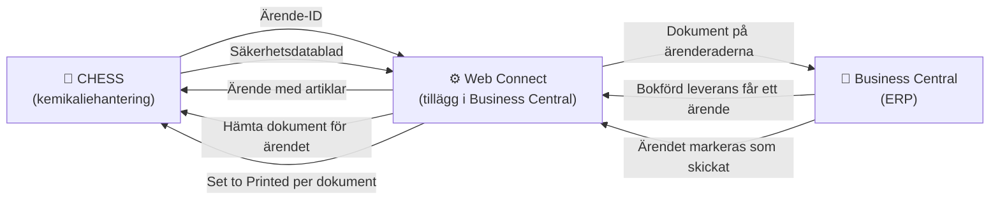
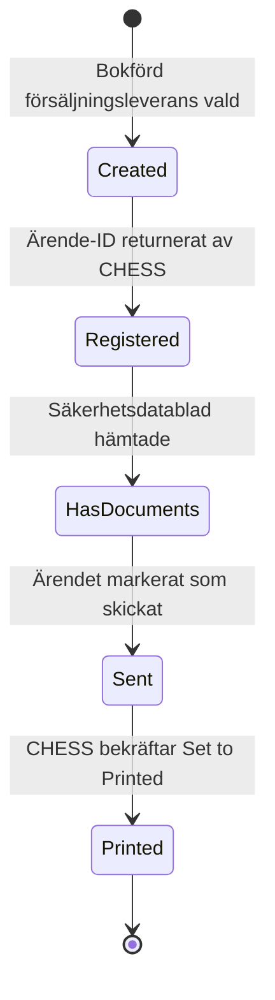
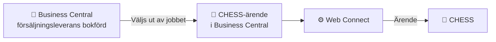
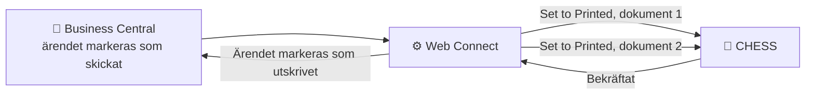

# Business Central och CHESS: integration

Web Connect från CombineIT kopplar Microsoft Dynamics 365 Business Central till CHESS, systemet för kemikaliehantering från Bureau Veritas. En bokförd försäljningsleverans blir ett ärende (ticket) i CHESS, säkerhetsdatabladen för artiklarna på leveransen kommer tillbaka till Business Central, och CHESS får veta när dokumenten har skickats. Alla mappningar och regler finns i ditt eget Business Central, där du själv kan se och ändra dem.

## I korthet

| | |
|---|---|
| **System** | CHESS från Bureau Veritas (kemikaliehantering, med modulen DocMan för att distribuera säkerhetsdatablad) |
| **Integrationsprodukt** | Web Connect för Microsoft Dynamics 365 Business Central |
| **Körs i** | Din egen Business Central-miljö, som ett tillägg. Varje anrop startar i Business Central: ett nytt ärende för en bokförd leverans skickas till CHESS direkt, säkerhetsdatabladen hämtas när CHESS har returnerat ärende-ID:t, och Set to Printed skickas när ärendet markeras som skickat. Det finns inga inkommande webhooks. All bearbetning och konfiguration stannar i Business Central. |
| **Konfigureras av** | Dig, i Business Central: mappningar, villkor, triggers och flöden. Du kan göra allt själv. Vill du kan CombineIT vara med i vilket steg som helst, som bollplank eller genom att göra jobbet. |
| **Koppling** | SOAP-webbtjänster med XML på DGOffice.net: tjänsten för klientvalidering för ärenden, och DocMan- och SDS-tjänsten för dokument |
| **API för CHESS** | Det finns ingen publicerad API-guide. Webbtjänsterna visar sina operationer och sin tjänstebeskrivning (WSDL) öppet: [DocMan- och SDS-tjänsten](https://www.dgoffice.net/webservice/DGMDocManAndSDS/DocManAndSDS.asmx) och [tjänsten för klientvalidering](https://www.dgoffice.net/webservice/RemoteValidater/DGMclientvalidate.asmx). XML-formatet för ärendedata beskrivs i [dokumentationen för DgXML](https://www.dgoffice.net/download/software/dgoffice/webremote/XML_Dg_documentation.htm) |
| **Dataflöden** | 3: ärenden för leveranser, säkerhetsdatablad och dokument markerade som utskrivna |
| **Business Central-utgåvor** | Alla utgåvor, Essentials och Premium, även den senaste versionen |
| **Finns på** | [Web Connect på Microsoft AppSource](https://marketplace.microsoft.com/sv-se/product/PUBID.martitab1633951001710%7CAID.webconnect%7CPAPPID.9f3a7223-19db-4ac7-832f-cf8e4699186f?tab=Overview). Integrationen med CHESS ingår inte i appen Web Connect Ready Integrations. Den sätts upp som en konfiguration i Web Connect |

## Det här kan synkas

Web Connect har tre dataflöden mellan Business Central och CHESS.

| Data | Riktning | Vad som händer |
|---|---|---|
| [Ärenden för leveranser](flows/shipment-ticket.md) | Business Central → CHESS | En bokförd försäljningsleverans skickas till CHESS som ett ärende, med kunden, mottagarens e-postadress, dokumentspråket och artikelnumren. CHESS returnerar ett ärende-ID |
| [Säkerhetsdatablad](flows/safety-data-sheets.md) | CHESS → Business Central | De dokument som CHESS har för artiklarna på ärendet hämtas, och varje dokument skrivs till sin leveransrad på ärendet i Business Central |
| [Dokument markerade som utskrivna](flows/set-to-printed.md) | Business Central → CHESS | När ärendet markeras som skickat rapporteras varje dokument på det till CHESS som utskrivet, och ärendet i Business Central markeras som utskrivet |

De tre flödena fungerar som en kedja, och alla tre används i den enda integrationen med CHESS som är i drift i dag. Se [Välj upplägg](#choose-your-setup).

## Så fungerar det

Web Connect håller ett CHESS-ärende i Business Central för varje bokförd försäljningsleverans som ska ha säkerhetsdatablad. När ett ärende skapas skickar Web Connect leveransen till CHESS och sparar ärende-ID:t som CHESS returnerar. Det nya ärende-ID:t startar nästa anrop, som hämtar listan med dokument för ärendet. Säkerhetsdatabladen mejlas till kunden från Business Central, och ärendet markeras som skickat. Web Connect meddelar sedan CHESS att varje dokument är utskrivet, så att ärendet lämnar kön i CHESS. Varje anrop och svar loggas i Web Connect [Entries](../../general/entries.md), där det går att granska och skicka om.

### Ärendestatus i Business Central

## Välj upplägg

Varje flöde måste passa hur ert företag arbetar: vilket system som äger informationen, var medarbetarna gör sitt jobb och vad redovisningen behöver. Därför bestämmer vi flödena tillsammans när en ny integration sätts upp. Alternativen nedan är de som Web Connect-kunder använder i dag. **Vanligt upplägg** markerar det alternativ som flest Web Connect-kunder med CHESS använder. **Rekommenderas** markerar CombineIT:s bästa praxis, där det finns en.

Bara en Web Connect-kund använder CHESS i dag, så inget alternativ är markerat som vanligt upplägg. Varje område nedan visar hur den integrationen är uppsatt.

### Vilka leveranser som får ett ärende

| Alternativ | Så fungerar det | När det passar |
|---|---|---|
| **Utvalda bokförda försäljningsleveranser** | Ett jobb i Business Central skapar ett CHESS-ärende för de bokförda försäljningsleveranser som matchar urvalet som bestämts vid uppsättningen, till exempel kundgrupper som ska få säkerhetsdatablad | Bara vissa kunder, till exempel företagskunder, behöver säkerhetsdatablad med sina leveranser |

#### Vilka leveranser som får ett ärende: utvalda bokförda försäljningsleveranser

### Rapportera dokument som utskrivna

| Alternativ | Så fungerar det | När det passar |
|---|---|---|
| **Ett anrop per dokument** | När ärendet markeras som skickat skickar Web Connect ett Set to Printed-anrop för varje dokumentrad på ärendet. Svaret från CHESS markerar ärendet som utskrivet i Business Central | En leverans kan ha flera säkerhetsdatablad, och vart och ett av dem måste lämna kön i CHESS |

#### Rapportera dokument som utskrivna med ett anrop per dokument

Själva säkerhetsdatabladen, deras versioner och språk underhålls alltid i CHESS.

## Det här behöver du

- Microsoft Dynamics 365 Business Central, valfri utgåva (Essentials eller Premium), även den senaste versionen
- Web Connect installerat från Microsoft AppSource, med en aktiverad licens för Web Connect
- Ditt godkännande av att Web Connect installeras och agerar i din Business Central-miljö
- Ett konto i CHESS med modulen DocMan, och inloggningsuppgifterna för webbtjänsterna, som skapas i CHESS
- Tabellerna för CHESS-ärenden i Business Central, med ärende och ärenderad, och ett jobb som skapar ärenden för bokförda försäljningsleveranser. De kommer från ett tillägg som CombineIT installerar vid uppsättningen
- Säkerhetsdatablad kopplade till era artikelnummer i CHESS
- En e-postadress på de bokförda försäljningsleveranser som ska få säkerhetsdatablad

## Så kommer du igång

1. Bestäm vilka leveranser som ska få säkerhetsdatablad, se [Välj upplägg](#choose-your-setup).
2. Installera Web Connect i Business Central, aktivera licensen och ge ditt godkännande.
3. Importera konfigurationen för CHESS med integrationen avstängd, tillsammans med tillägget för tabellerna för CHESS-ärenden.
4. Fyll i inloggningsuppgifterna för webbtjänsterna i CHESS.
5. Översätt leveransländer till dokumentspråk i CHESS i mappningen.
6. Ställ in urvalet för jobbet som skapar ärenden.
7. Testa med leveranser som har ett och flera säkerhetsdatablad innan ni går live.

## Konfigurera själv i Business Central

All konfiguration och logik i integrationen går att se och ändra i Business Central. Det finns ingen extern integrationsplattform där logiken är dold.

| Det här kan du ändra | Var i Web Connect | Exempel |
|---|---|---|
| Vad som skickas på ärendet | [Outgoing Mapping](../../general/outgoing-mapping/README.md) | Skicka kundnumret och e-postadressen för försäljningskunden, och ta bort bindestreck ur artikelnummer |
| Dokumentspråk | [Mapping](../../general/incoming-data/mapping.md) | Översätt leveranslandet SE till sv-SE och DK till da-DK |
| Vad som startar varje anrop | [Outgoing Sync Triggers](../../general/outgoing-mapping/outgoing-sync-triggers.md) | Skicka Set to Printed för varje dokumentrad när ärendet markeras som skickat |
| Vad som skrivs tillbaka från CHESS | [Incoming Data](../../general/incoming-data/README.md) | Markera ärendet som utskrivet när CHESS bekräftar Set to Printed |
| Övervakning och omsändning | [Entries](../../general/entries.md) | Se varje anrop för ärenden och dokument, och [skicka om ett meddelande](../../../../how-to/web-connect/resend-outgoing-message.md) |

## Val i konfigurationen

- **Urval:** vilka bokförda försäljningsleveranser som får ett CHESS-ärende.
- **Mottagare:** vilken e-postadress på leveransen som skickas till CHESS.
- **Språk:** hur varje leveransland översätts till ett dokumentspråk i CHESS.
- **Avsändare:** företagsnamnet som visas som avsändare i följesedelsuppgifterna i CHESS.
- **Artikelnummer:** tecken som tas bort ur artikelnumren så att de stämmer med artikelnumren i CHESS.
- **Utskick av dokument:** säkerhetsdatabladen mejlas till kunden från Business Central, och ärendet markeras som skickat där. Det är det som startar Set to Printed.

## Begränsningar

- **Ärendetabellerna ingår inte i själva Web Connect.** De kommer från ett separat tillägg från CombineIT, som installeras tillsammans med integrationen.
- **Ärenden skapas bara för bokförda försäljningsleveranser.** Order, fakturor och returer får inga säkerhetsdatablad via integrationen.
- **CHESS returnerar bara de dokument som finns för artikelnumren.** En artikel som saknar säkerhetsdatablad i CHESS får inget dokument.
- **Inga webhooks.** CHESS meddelar inte Business Central om ändringar. En ny version av ett säkerhetsdatablad hämtas bara för nya ärenden.

## Vanliga frågor

### Går det att koppla ihop Business Central med CHESS?

Ja. Web Connect kopplar Business Central till CHESS via webbtjänsterna i CHESS DocMan. Bokförda försäljningsleveranser skickas till CHESS som ärenden, säkerhetsdatabladen för de levererade artiklarna kommer tillbaka till Business Central, och CHESS får veta när dokumenten har skickats.

### Vilka säkerhetsdatablad får kunden?

Det avgör CHESS. Web Connect skickar artikelnumren på leveransen, och CHESS returnerar de säkerhetsdatablad som finns för artiklarna, på det språk som hör till leveranslandet.

### Varför behöver CHESS veta att dokumenten har skickats?

Ett ärende ligger kvar i kön i CHESS tills alla dokument på det är markerade som utskrivna. Web Connect skickar Set to Printed för varje dokument på ärendet, så att ärendet lämnar kön.

### Kan vi själva ändra vad som skickas till CHESS?

Ja. Fältmappningen, språköversättningen och triggers konfigureras i Web Connect i ditt eget Business Central. Du kan se och ändra dem utan att be en leverantör ändra i en extern plattform.

## Relaterat

- Flöden: [Ärenden för leveranser](flows/shipment-ticket.md) · [Säkerhetsdatablad](flows/safety-data-sheets.md) · [Dokument markerade som utskrivna](flows/set-to-printed.md)
- Instruktioner: [Skicka om ett utgående meddelande](../../../../how-to/web-connect/resend-outgoing-message.md) · [Integrationer som inte körs](../../../../how-to/web-connect/integration-not-running.md)
- Web Connect: [Outgoing Mapping](../../general/outgoing-mapping/README.md) · [Incoming Data](../../general/incoming-data/README.md) · [Entries](../../general/entries.md)
- [Allmän dokumentation för Web Connect](../../general/README.md)
- [CHESS från Bureau Veritas](https://www.bureauveritas.dk/en/needs/software-chess-dgdoc)

## Om Web Connect

Web Connect är en integrationsplattform för Microsoft Dynamics 365 Business Central, utvecklad av CombineIT. Den installeras i ditt eget Business Central och kopplar det till e-handelsplattformar, lagersystem, kassasystem, returlösningar, marknadsplatser och EDI. Varje flöde, mappning och regel konfigureras i Business Central, där du själv kan se och ändra dem, utan specialkod för varje integration. [Web Connect på Microsoft AppSource](https://marketplace.microsoft.com/sv-se/product/PUBID.martitab1633951001710%7CAID.webconnect%7CPAPPID.9f3a7223-19db-4ac7-832f-cf8e4699186f?tab=Overview) · [Kontakta CombineIT](https://www.combineit.se/contact/)
