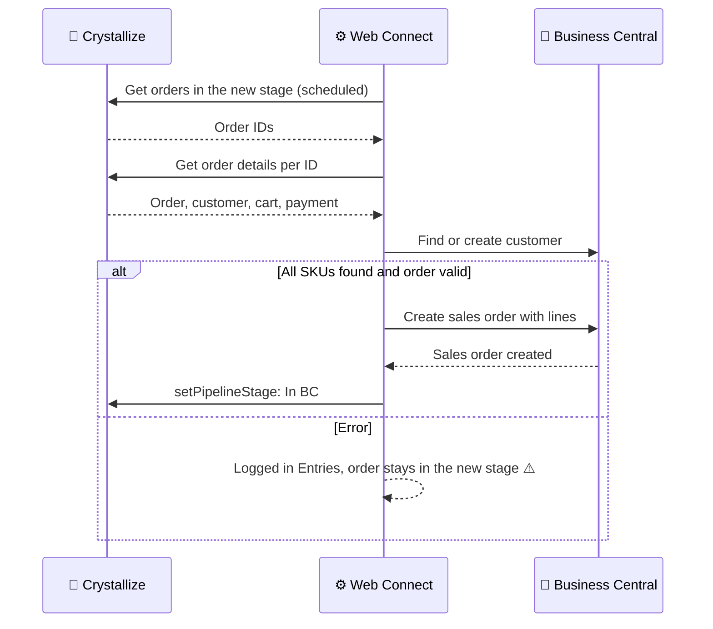

# Crystallize to Business Central: orders

Web Connect fetches the orders that are in a chosen stage of the Crystallize order pipeline on a schedule. For each order it finds or creates the customer, creates a sales order in Business Central and moves the order to the next stage in Crystallize, so it is not fetched again.

| | |
|---|---|
| **Direction** | Crystallize → Business Central |
| **Trigger** | Schedule in the Business Central job queue. [ATT FYLLA I: how often the job runs] |
| **Result** | A customer and a sales order in Business Central. The order is in the stage "In BC" in Crystallize |
| **Part of** | [Business Central and Crystallize integration](../overview.md) |

## Step by step

1. A customer places an order in Crystallize, and the order is placed in the stage for new orders in the order pipeline.
2. On its next scheduled run, Web Connect asks Crystallize for the orders in that stage (`order.getMany`, filtered on pipeline and stage, a set number of orders per run).
3. For each order ID, Web Connect fetches the full order (`order.get`): customer, addresses, cart lines, totals, payment and meta fields.
4. Web Connect finds the customer in Business Central by the Crystallize customer identifier. If there is none, the customer is created from a customer template chosen by the delivery country.
5. Web Connect creates the sales order with lines. Each SKU is looked up in Web Connect Item SKU to get the item number and variant code.
6. Web Connect moves the order to the stage "In BC" in Crystallize, so it is not fetched again.

## Data mapping

### Customer

| Crystallize field | Business Central field | Note |
|---|---|---|
| `customer.identifier` | Customer E-Mail | Used to find an existing customer |
| `customer.companyName` | Customer Name | Companies only. Whether the order is from a company is decided by a condition on the company name |
| `customer.firstName` and `lastName` | Customer Name | Private customers only |
| `customer.taxNumber` | VAT Registration No. | Companies only |
| Billing address (`type == 'billing'`) | Address, Address 2, City, Post Code, Country/Region Code, Phone No. | Companies |
| Delivery address (`type == 'delivery'`) | Address, Address 2, City, Post Code, Country/Region Code, Phone No. | Private customers. The country also chooses the customer template for new customers |

### Sales order header

| Crystallize field | Business Central field | Note |
|---|---|---|
| `id` | Crystallize order ID on the sales order | Used when order status is sent back |
| Meta field `orderNumber` | No. | The Crystallize order number becomes the sales order number. Can also be mapped to a dimension |
| `createdAt` | Order Date | |
| `total.currency` | Currency Code | Local currency is left blank |
| Fixed value | Prices Including VAT | Always yes |
| `payment.provider` and payment properties | Payment Method Code | Mapped with a text mapping |
| Payment transaction ID | External Document No. | |
| Delivery address on company orders | Ship-to fields and e-mail | Companies only |
| Meta fields such as a customer message or a reference | Work Description or other fields | Optional, chosen per implementation |

### Sales lines

| Crystallize field | Business Central field | Note |
|---|---|---|
| `sku` | No. and Variant Code | Looked up in Web Connect Item SKU |
| `name` and a description meta field | Description | |
| `quantity` | Quantity | |
| `price.gross` | Unit Price | Including VAT |
| Line meta field `warehouse` | Location Code | Mapped with a text mapping |

Lines without an item number are created as lines without type, so text in the cart still reaches the sales order.

## Web Connect objects

| Object | Role |
|---|---|
| `CRYST-COLLECT-ORDERS-NOT-IN-BC` | Gets the IDs of the orders in the stage for new orders |
| `CRYST-GET-EXISTING-ORDER` | Gets the full order by ID |
| `CR_ORDER` | Creates the sales order header |
| `CR_CUSTOMER` and `CR_ADDRESSES` | Find or create the customer |
| `CR_CART`, `CR_PRICE` | Create the sales lines |
| `CR_PAYMENT`, `CRYST-PROPERTIES` | Payment method and transaction ID |
| `CRYST-SET-ORDER-IN-BC-PIPELINE` | Moves the order to the stage "In BC" |

## Error handling

| Situation | What happens | What to do |
|---|---|---|
| SKU not found in Web Connect Item SKU | The sales order is not created, and the error is logged in Entries | Add the SKU, run [product matching](product-matching.md) and resend the entry |
| Job queue stopped | No orders are fetched. The orders stay in the new stage in Crystallize and are fetched on the next run | See [Integrations not running](../../../../../how-to/web-connect/integration-not-running.md) |
| Crystallize API error | The run fails and is logged in Entries | Check the access token and the error in Entries |
| Order moved out of the new stage in Crystallize before the run | The order is not fetched | Move the order back to the stage for new orders |

## Frequently asked questions

### Why is a Crystallize order not imported into Business Central?

Web Connect only fetches orders that are in the pipeline stage for new orders. Check that the order is in that stage in Crystallize, then check the error on the order in Web Connect Entries, for example a SKU that is missing in Web Connect Item SKU.

## Related

- [Business Central and Crystallize integration](../overview.md)
- [Order status](order-status.md) · [Product matching](product-matching.md)
- [Incoming Data mapping](../../../general/incoming-data/mapping.md)
