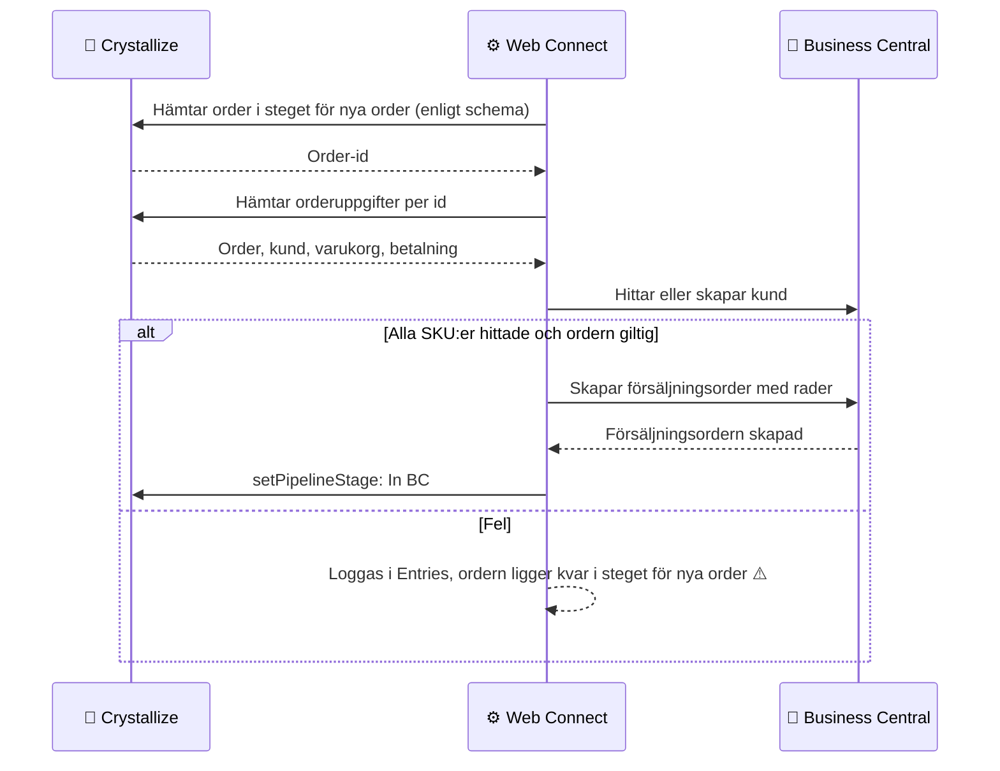

# Från Crystallize till Business Central: order

Web Connect hämtar enligt schema de order som ligger i ett valt steg i orderpipelinen i Crystallize. För varje order hittar eller skapar Web Connect kunden, skapar en försäljningsorder i Business Central och flyttar ordern till nästa steg i Crystallize, så att den inte hämtas igen.

| | |
|---|---|
| **Riktning** | Crystallize → Business Central |
| **Startas av** | Schema i jobbkön i Business Central. Hur ofta den körs kan anpassas efter vad ert företag behöver |
| **Resultat** | En kund och en försäljningsorder i Business Central. Ordern ligger i steget "In BC" i Crystallize |
| **Del av** | [Business Central och Crystallize: integration](../overview.md) |

## Steg för steg

1. En kund lägger en order i Crystallize, och ordern hamnar i steget för nya order i orderpipelinen.
2. Vid nästa schemalagda körning frågar Web Connect Crystallize efter orderna i det steget (`order.getMany`, filtrerat på pipeline och steg, ett bestämt antal order per körning).
3. För varje order-id hämtar Web Connect hela ordern (`order.get`): kund, adresser, varukorgsrader, summor, betalning och metafält.
4. Web Connect letar upp kunden i Business Central på kundidentifieraren i Crystallize. Finns ingen skapas kunden från en kundmall som väljs utifrån leveranslandet.
5. Web Connect skapar försäljningsordern med rader. Varje SKU slås upp i Web Connect Item SKU för att få artikelnummer och variantkod.
6. Web Connect flyttar ordern till steget "In BC" i Crystallize, så att den inte hämtas igen.

## Mappning av data

### Kund

| Fält i Crystallize | Fält i Business Central | Kommentar |
|---|---|---|
| `customer.identifier` | Customer E-Mail | Används för att hitta en befintlig kund |
| `customer.companyName` | Customer Name | Bara företag. Om ordern kommer från ett företag avgörs av ett villkor på företagsnamnet |
| `customer.firstName` och `lastName` | Customer Name | Bara privatkunder |
| `customer.taxNumber` | VAT Registration No. | Bara företag |
| Faktureringsadress (`type == 'billing'`) | Address, Address 2, City, Post Code, Country/Region Code, Phone No. | Företag |
| Leveransadress (`type == 'delivery'`) | Address, Address 2, City, Post Code, Country/Region Code, Phone No. | Privatkunder. Landet styr också vilken kundmall nya kunder får |

### Försäljningsorderns huvud

| Fält i Crystallize | Fält i Business Central | Kommentar |
|---|---|---|
| `id` | Crystallizes order-id på försäljningsordern | Används när orderstatus skickas tillbaka |
| Metafältet `orderNumber` | No. | Ordernumret i Crystallize blir försäljningsorderns nummer. Kan också mappas till en dimension |
| `createdAt` | Order Date | |
| `total.currency` | Currency Code | Lokal valuta lämnas tom |
| Fast värde | Prices Including VAT | Alltid ja |
| `payment.provider` och betalningsegenskaper | Payment Method Code | Mappas med en textmappning |
| Transaktions-id för betalningen | External Document No. | |
| Leveransadress på företagsorder | Leveransfälten (Ship-to) och e-post | Bara företag |
| Metafält som ett meddelande från kunden eller en referens | Work Description eller andra fält | Valfritt, väljs per implementation |

### Försäljningsrader

| Fält i Crystallize | Fält i Business Central | Kommentar |
|---|---|---|
| `sku` | No. och Variant Code | Slås upp i Web Connect Item SKU |
| `name` och ett metafält för beskrivning | Description | |
| `quantity` | Quantity | |
| `price.gross` | Unit Price | Inklusive moms |
| Radens metafält `warehouse` | Location Code | Mappas med en textmappning |

Rader utan artikelnummer skapas som rader utan typ, så att text i varukorgen ändå kommer med till försäljningsordern.

## Objekt i Web Connect

| Objekt | Roll |
|---|---|
| `CRYST-COLLECT-ORDERS-NOT-IN-BC` | Hämtar id för orderna i steget för nya order |
| `CRYST-GET-EXISTING-ORDER` | Hämtar hela ordern på id |
| `CR_ORDER` | Skapar försäljningsorderns huvud |
| `CR_CUSTOMER` och `CR_ADDRESSES` | Hittar eller skapar kunden |
| `CR_CART`, `CR_PRICE` | Skapar försäljningsraderna |
| `CR_PAYMENT`, `CRYST-PROPERTIES` | Betalningsmetod och transaktions-id |
| `CRYST-SET-ORDER-IN-BC-PIPELINE` | Flyttar ordern till steget "In BC" |

## Felhantering

| Situation | Vad som händer | Vad du gör |
|---|---|---|
| SKU:n finns inte i Web Connect Item SKU | Försäljningsordern skapas inte, och felet loggas i Entries | Lägg till SKU:n, kör [produktmatchningen](product-matching.md) och skicka posten igen |
| Jobbkön har stannat | Inga order hämtas. Orderna ligger kvar i steget för nya order i Crystallize och hämtas vid nästa körning | Se [Integrationerna körs inte](../../../../../how-to/web-connect/integration-not-running.md) |
| Fel i Crystallizes API | Körningen misslyckas och loggas i Entries | Kontrollera åtkomsttoken och felet i Entries |
| Ordern flyttades ut ur steget för nya order i Crystallize före körningen | Ordern hämtas inte | Flytta tillbaka ordern till steget för nya order |

## Vanliga frågor

### Varför kommer inte en order från Crystallize in i Business Central?

Web Connect hämtar bara order som ligger i steget för nya order i pipelinen. Kontrollera att ordern ligger i det steget i Crystallize, och titta sedan på felet för ordern i Web Connect Entries, till exempel en SKU som saknas i Web Connect Item SKU.

## Relaterat

- [Business Central och Crystallize: integration](../overview.md)
- [Orderstatus](order-status.md) · [Produktmatchning](product-matching.md)
- [Incoming Data mapping](../../../general/incoming-data/mapping.md)
