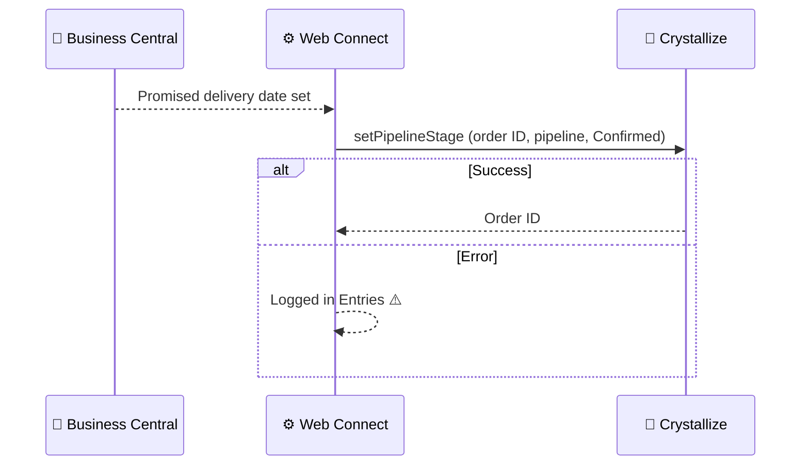

# Business Central to Crystallize: order status

As an order is handled in Business Central, Web Connect moves it between stages in the Crystallize order pipeline. The stages are In BC, Confirmed, Shipment Booked, Shipped and Cancelled, and each is linked to Web Connect with an integration variable.

| | |
|---|---|
| **Direction** | Business Central → Crystallize |
| **Trigger** | A change on the sales order in Business Central, see the table below |
| **Result** | The order is in the matching stage of the Crystallize order pipeline |
| **Part of** | [Business Central and Crystallize integration](../overview.md) |

## Stages

| Stage in Crystallize | When Web Connect sets it | Business Central record |
|---|---|---|
| In BC | When the sales order has been created from the Crystallize order | Sales order |
| Confirmed | When the promised delivery date is set on the sales order or on a sales line | Sales order and sales line |
| Shipment Booked | [ATT FYLLA I: what triggers it, the export has no outgoing sync trigger for this object] | Sales order |
| Shipped | [ATT FYLLA I: what triggers it, the export has no outgoing sync trigger for this object] | Posted sales shipment |
| Cancelled | [ATT FYLLA I: what triggers it, for example when the sales order is deleted. The export has no outgoing sync trigger for this object] | Sales order |

Only sales orders that have a Crystallize order ID are sent.

## Step by step

1. Something changes on the sales order in Business Central, for example the promised delivery date is set.
2. The outgoing sync trigger creates an outgoing message for the order.
3. Web Connect sends a GraphQL mutation (`setPipelineStage`) to Crystallize with the order ID, the pipeline ID and the ID of the new stage.
4. Crystallize moves the order to the new stage.

## Data mapping

| Business Central | Crystallize field | Note |
|---|---|---|
| Crystallize order ID on the sales order | `orderId` | Saved when the order was imported |
| Integration variable for the pipeline | `pipelineId` | |
| Integration variable for the stage | `stageId` | One variable per stage |

## Web Connect objects

| Object | Role |
|---|---|
| `CRYST-SET-ORDER-IN-BC-PIPELINE` | Sets the stage In BC |
| `CRYST-SET-CONFIRMED-PIPELINE` | Sets the stage Confirmed. Triggered on the promised delivery date on the sales header and sales line |
| `CRYST-SET-SHIPMENT-BOOKED` | Sets the stage Shipment Booked |
| `CRYST-SET-FULLFILLMENT` | Sets the stage Shipped, from the posted sales shipment |
| `CRYST-SET-ORDER-CANCELLED-PIPELINE` | Sets the stage Cancelled |

## Error handling

| Situation | What happens | What to do |
|---|---|---|
| A stage ID is wrong or has been removed in Crystallize | The call fails and is logged in Entries | Update the integration variable with the right stage ID and [resend the message](../../../../../how-to/web-connect/resend-outgoing-message.md) |
| The sales order has no Crystallize order ID | Nothing is sent | Expected for orders that did not come from Crystallize |

## Frequently asked questions

### When is a Crystallize order moved to Confirmed?

When the promised delivery date is set on the sales order or a sales line in Business Central. An outgoing sync trigger on that field moves the order to the stage Confirmed in Crystallize.

## Related

- [Business Central and Crystallize integration](../overview.md)
- [Orders](order-inbound.md)
- [Outgoing Sync Triggers](../../../general/outgoing-mapping/outgoing-sync-triggers.md)
