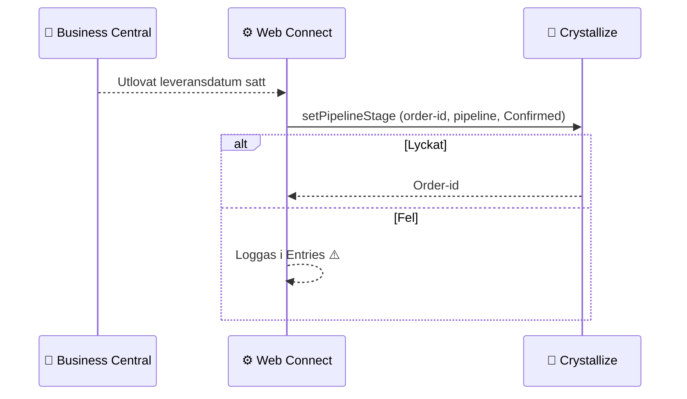

# Från Business Central till Crystallize: orderstatus

I takt med att en order hanteras i Business Central flyttar Web Connect den mellan stegen i orderpipelinen i Crystallize. Stegen är In BC, Confirmed, Shipment Booked, Shipped och Cancelled, och vart och ett kopplas till Web Connect med en integrationsvariabel.

| | |
|---|---|
| **Riktning** | Business Central → Crystallize |
| **Startas av** | En ändring på försäljningsordern i Business Central, se tabellen nedan |
| **Resultat** | Ordern ligger i motsvarande steg i orderpipelinen i Crystallize och har det förväntade leveransdatumet |
| **Del av** | [Business Central och Crystallize: integration](../overview.md) |

## Steg i pipelinen

| Steg i Crystallize | När Web Connect sätter det | Post i Business Central |
|---|---|---|
| In BC | När försäljningsordern har skapats från ordern i Crystallize | Försäljningsorder |
| Confirmed | När det utlovade leveransdatumet sätts på försäljningsordern eller på en försäljningsrad | Försäljningsorder och försäljningsrad |
| Shipment Booked | En utgående synktrigger som ställs in per integration, till exempel när leveransen bokas hos transportören | Försäljningsorder |
| Shipped | En utgående synktrigger som ställs in per integration, till exempel när försäljningsleveransen bokförs | Bokförd försäljningsleverans |
| Cancelled | En utgående synktrigger som ställs in per integration, till exempel när försäljningsordern makuleras i Business Central | Försäljningsorder |

Utgående synktriggers ställs in per integration efter vad företaget behöver, och de är flexibla. Oftast är de fält som skickas till Crystallize också triggerfälten, så att en ändring i något av dem skickar posten igen. Bara försäljningsorder som har ett order-id från Crystallize skickas.

## Steg för steg

1. Något ändras på försäljningsordern i Business Central, till exempel sätts det utlovade leveransdatumet.
2. Den utgående synktriggern skapar ett utgående meddelande för ordern.
3. Web Connect skickar en GraphQL-mutation (`setPipelineStage`) till Crystallize med order-id, pipeline-id och id för det nya steget.
4. Crystallize flyttar ordern till det nya steget.

## Förväntat leveransdatum

När det utlovade leveransdatumet sätts på en försäljningsorder som kom från Crystallize skickar Web Connect också datumet till ordern i Crystallize. Det sparas som metadata på ordern med nyckeln `expectedDeliveryDate`, så att webbshopen kan visa det för kunden. Anropet går till Crystallize Order API (`orders.setMetadata`), inte till PIM API, och använder samma åtkomsttoken.

| Fält i Business Central | Fält i Crystallize | Kommentar |
|---|---|---|
| Crystallizes order-id på försäljningsordern | `id` | |
| Promised Delivery Date | Metadata `expectedDeliveryDate` | Skickas när det utlovade leveransdatumet ändras |

## Mappning av data

| Business Central | Fält i Crystallize | Kommentar |
|---|---|---|
| Crystallizes order-id på försäljningsordern | `orderId` | Sparades när ordern importerades |
| Integrationsvariabel för pipelinen | `pipelineId` | |
| Integrationsvariabel för steget | `stageId` | En variabel per steg |

## Objekt i Web Connect

| Objekt | Roll |
|---|---|
| `CRYST-SET-ORDER-IN-BC-PIPELINE` | Sätter steget In BC |
| `CRYST-SET-CONFIRMED-PIPELINE` | Sätter steget Confirmed. Startas av det utlovade leveransdatumet på försäljningshuvudet och försäljningsraden |
| `CRYST-SET-SHIPMENT-BOOKED` | Sätter steget Shipment Booked |
| `CRYST-SET-SHIPMENTDATE` | Skickar det utlovade leveransdatumet som förväntat leveransdatum, via Crystallize Order API. Startas av det utlovade leveransdatumet |
| `CRYST-SET-FULLFILLMENT` | Sätter steget Shipped, utifrån den bokförda försäljningsleveransen |
| `CRYST-SET-ORDER-CANCELLED-PIPELINE` | Sätter steget Cancelled |

## Felhantering

| Situation | Vad som händer | Vad du gör |
|---|---|---|
| Ett steg-id är fel eller har tagits bort i Crystallize | Anropet misslyckas och loggas i Entries | Uppdatera integrationsvariabeln med rätt steg-id och [skicka meddelandet igen](../../../../../how-to/web-connect/resend-outgoing-message.md) |
| Försäljningsordern har inget order-id från Crystallize | Inget skickas | Väntat för order som inte kom från Crystallize |

## Vanliga frågor

### När flyttas en order i Crystallize till Confirmed?

När det utlovade leveransdatumet sätts på försäljningsordern eller på en försäljningsrad i Business Central. En utgående synktrigger på det fältet flyttar ordern till steget Confirmed i Crystallize.

## Relaterat

- [Business Central och Crystallize: integration](../overview.md)
- [Order](order-inbound.md)
- [Outgoing Sync Triggers](../../../general/outgoing-mapping/outgoing-sync-triggers.md)
