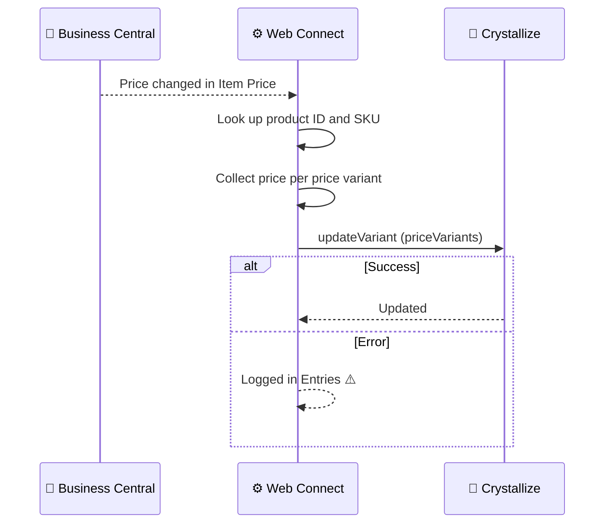

# Business Central to Crystallize: prices

Prices are calculated from the Business Central price lists in Web Connect Item Price. When a price changes, Web Connect sets it on the price variants of the matching Crystallize product variant, one price variant per currency, in a single call.

| | |
|---|---|
| **Direction** | Business Central → Crystallize |
| **Trigger** | A change of price in Web Connect Item Price (outgoing sync trigger) |
| **Result** | The price variants on the Crystallize product variant have the Business Central prices |
| **Part of** | [Business Central and Crystallize integration](../overview.md) |

## Step by step

1. A price changes in a Business Central price list.
2. Web Connect recalculates the price in Web Connect Item Price, and the outgoing sync trigger reacts to the change.
3. Web Connect finds the Crystallize product ID and SKU in Web Connect Item SKU, with or without variant.
4. Web Connect collects the price for each price variant with dynamic flow fields, one per currency.
5. Web Connect sends all prices with a GraphQL mutation (`updateVariant` with `priceVariants`).

## Data mapping

| Business Central | Crystallize field | Note |
|---|---|---|
| Product ID in Web Connect Item SKU | `productId` | From [product matching](product-matching.md) |
| SKU in Web Connect Item SKU | `sku` | With or without variant |
| Dynamic flow field per currency | `priceVariants.identifier` | The identifier of the Crystallize price variant |
| Price in Web Connect Item Price | `priceVariants.price` | One per price variant |

The language of the product variant is set in the query. [ATT FYLLA I: whether more than one language is needed and how it is handled]

## Web Connect objects

| Object | Role |
|---|---|
| `CRYST-PRICEUPDATE` | Sends all price variants for a product variant in one call, from Web Connect Item Price |
| `CRYST-UPDATE-PRICE` | Sends one price variant per call, from Web Connect Item SKU, with the price variant chosen from the customer price group. [ATT FYLLA I: whether this object is still in use or replaced by `CRYST-PRICEUPDATE`] |

## Error handling

| Situation | What happens | What to do |
|---|---|---|
| No product ID for the SKU | Crystallize cannot match the product | Run [product matching](product-matching.md) and resend |
| The price variant does not exist in Crystallize | The call fails and is logged in Entries | Create the price variant in Crystallize or change the mapping |

## Frequently asked questions

### Can Business Central send prices in several currencies to Crystallize?

Yes. Each Crystallize price variant is mapped to a price from Business Central, for example one per currency, and all of them are set on the product variant in one call.

## Related

- [Business Central and Crystallize integration](../overview.md)
- [Web Connect Item Price](../../../general/outgoing-mapping/item-price.md) · [Dynamic Flow Fields](../../../general/dynamic-flow-fields.md)
