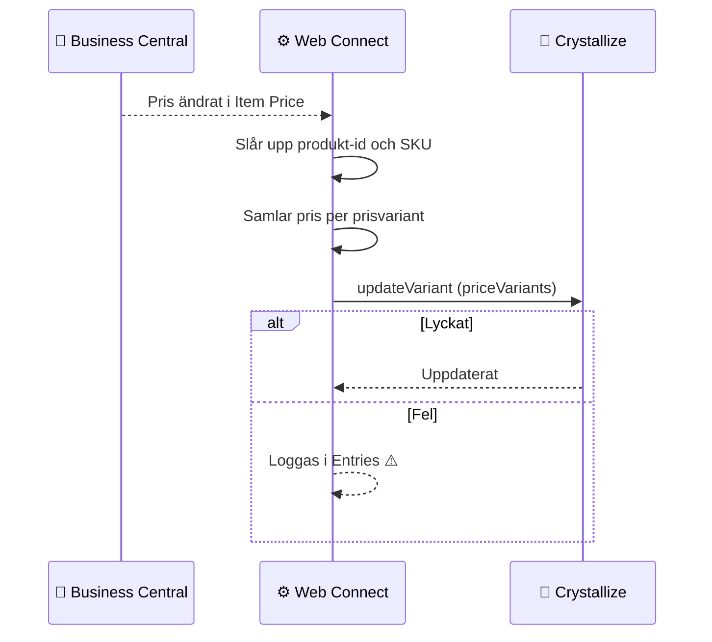

# Från Business Central till Crystallize: priser

Priserna räknas fram från prislistorna i Business Central i Web Connect Item Price. När ett pris ändras sätter Web Connect det på prisvarianterna för motsvarande produktvariant i Crystallize, en prisvariant per valuta, i ett enda anrop.

| | |
|---|---|
| **Riktning** | Business Central → Crystallize |
| **Startas av** | En prisändring i Web Connect Item Price (utgående synktrigger) |
| **Resultat** | Prisvarianterna på produktvarianten i Crystallize har priserna från Business Central |
| **Del av** | [Business Central och Crystallize: integration](../overview.md) |

## Steg för steg

1. Ett pris ändras i en prislista i Business Central.
2. Web Connect räknar om priset i Web Connect Item Price, och den utgående synktriggern reagerar på ändringen.
3. Web Connect hittar produkt-id och SKU för Crystallize i Web Connect Item SKU, med eller utan variant.
4. Web Connect samlar ihop priset för varje prisvariant med dynamiska flödesfält, en per valuta.
5. Web Connect skickar alla priser med en GraphQL-mutation (`updateVariant` med `priceVariants`).

## Mappning av data

| Business Central | Fält i Crystallize | Kommentar |
|---|---|---|
| Produkt-id i Web Connect Item SKU | `productId` | Från [produktmatchningen](product-matching.md) |
| SKU i Web Connect Item SKU | `sku` | Med eller utan variant |
| Dynamiskt flödesfält per valuta | `priceVariants.identifier` | Identifieraren för prisvarianten i Crystallize |
| Pris i Web Connect Item Price | `priceVariants.price` | Ett per prisvariant |

Produktvariantens språk anges i frågan. Ett språk används.

## Objekt i Web Connect

| Objekt | Roll |
|---|---|
| `CRYST-PRICEUPDATE` | Skickar alla prisvarianter för en produktvariant i ett anrop, från Web Connect Item Price |

## Felhantering

| Situation | Vad som händer | Vad du gör |
|---|---|---|
| Inget produkt-id för SKU:n | Crystallize kan inte matcha produkten | Kör [produktmatchningen](product-matching.md) och skicka igen |
| Prisvarianten finns inte i Crystallize | Anropet misslyckas och loggas i Entries | Skapa prisvarianten i Crystallize eller ändra mappningen |

## Vanliga frågor

### Kan Business Central skicka priser i flera valutor till Crystallize?

Ja. Varje prisvariant i Crystallize mappas mot ett pris från Business Central, till exempel en per valuta, och alla sätts på produktvarianten i ett och samma anrop.

## Relaterat

- [Business Central och Crystallize: integration](../overview.md)
- [Web Connect Item Price](../../../general/outgoing-mapping/item-price.md) · [Dynamic Flow Fields](../../../general/dynamic-flow-fields.md)
