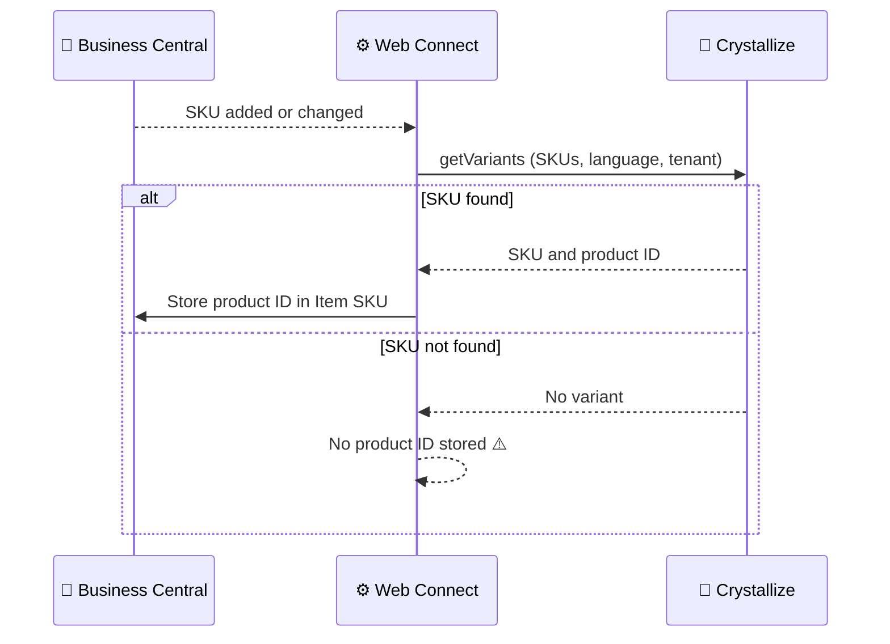

# Crystallize to Business Central: product matching

Products are created in Crystallize, and the items exist in Business Central with the same SKU. Web Connect looks up each SKU in Crystallize and stores the Crystallize product ID in Web Connect Item SKU, so stock and prices can be sent to the right product variant.

| | |
|---|---|
| **Direction** | Crystallize → Business Central, started from Business Central |
| **Trigger** | A SKU is added or changed in Web Connect Item SKU (outgoing sync trigger). It can also be run from the item |
| **Result** | The Crystallize product ID is stored on the SKU in Web Connect Item SKU |
| **Part of** | [Business Central and Crystallize integration](../overview.md) |

## Step by step

1. A SKU is registered in Web Connect Item SKU for an item, with or without variant.
2. Web Connect asks Crystallize for the product variants with that SKU (`product.getVariants`).
3. Crystallize returns the SKU and the product ID.
4. Web Connect stores the product ID on the SKU in Web Connect Item SKU.

## Data mapping

| Crystallize field | Business Central field | Note |
|---|---|---|
| `sku` | SKU in Web Connect Item SKU | Used to find the line |
| `product.id` | Product ID in Web Connect Item SKU | Used by stock and prices |

Web Connect Item SKU is also used the other way: when an order is imported, the SKU on the order line gives the item number and the variant code.

## Web Connect objects

| Object | Role |
|---|---|
| `CRYST-GET-ITEMSKUS` | Looks up SKUs from Web Connect Item SKU and stores the product ID. Triggered when the SKU changes |
| `CRYST-GET-ITEMS` | Looks up the SKU of an item from the item card |

## Error handling

| Situation | What happens | What to do |
|---|---|---|
| The SKU does not exist in Crystallize | No product ID is stored, and stock and prices cannot be sent for it | Create the product variant in Crystallize with the same SKU and run the lookup again |
| The SKU differs between the systems | Same as above | Correct the SKU in one of the systems |

## Frequently asked questions

### Does Web Connect create products in Crystallize?

No. Products and variants are created in Crystallize. Web Connect matches them to Business Central items by SKU and stores the Crystallize product ID in Business Central.

## Related

- [Business Central and Crystallize integration](../overview.md)
- [Stock](stock-update.md) · [Prices](prices.md) · [Orders](order-inbound.md)
