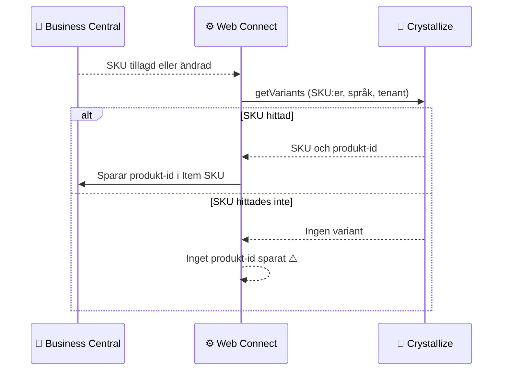

# Från Crystallize till Business Central: produktmatchning

Produkterna skapas i Crystallize, och artiklarna finns i Business Central med samma SKU. Web Connect slår upp varje SKU i Crystallize och sparar produkt-id från Crystallize i Web Connect Item SKU, så att lagersaldo och priser kan skickas till rätt produktvariant.

| | |
|---|---|
| **Riktning** | Crystallize → Business Central, startas från Business Central |
| **Startas av** | En SKU läggs till eller ändras i Web Connect Item SKU (utgående synktrigger). Det går också att köra från artikeln |
| **Resultat** | Produkt-id från Crystallize sparas på SKU:n i Web Connect Item SKU |
| **Del av** | [Business Central och Crystallize: integration](../overview.md) |

## Steg för steg

1. En SKU registreras i Web Connect Item SKU för en artikel, med eller utan variant.
2. Web Connect frågar Crystallize efter produktvarianterna med den SKU:n (`product.getVariants`).
3. Crystallize svarar med SKU och produkt-id.
4. Web Connect sparar produkt-id på SKU:n i Web Connect Item SKU.

## Mappning av data

| Fält i Crystallize | Fält i Business Central | Kommentar |
|---|---|---|
| `sku` | SKU i Web Connect Item SKU | Används för att hitta raden |
| `product.id` | Produkt-id i Web Connect Item SKU | Används av lagersaldo och priser |

Web Connect Item SKU används också åt andra hållet: när en order importeras ger SKU:n på orderraden artikelnumret och variantkoden.

## Objekt i Web Connect

| Objekt | Roll |
|---|---|
| `CRYST-GET-ITEMSKUS` | Slår upp SKU:er från Web Connect Item SKU och sparar produkt-id. Startas när SKU:n ändras |
| `CRYST-GET-ITEMS` | Slår upp SKU:n för en artikel från artikelkortet |

## Felhantering

| Situation | Vad som händer | Vad du gör |
|---|---|---|
| SKU:n finns inte i Crystallize | Inget produkt-id sparas, och lagersaldo och priser kan inte skickas för den | Skapa produktvarianten i Crystallize med samma SKU och kör uppslagningen igen |
| SKU:n skiljer sig mellan systemen | Samma som ovan | Rätta SKU:n i ett av systemen |

## Vanliga frågor

### Skapar Web Connect produkter i Crystallize?

Nej. Produkter och varianter skapas i Crystallize. Web Connect matchar dem mot artiklar i Business Central på SKU och sparar produkt-id från Crystallize i Business Central.

## Relaterat

- [Business Central och Crystallize: integration](../overview.md)
- [Lagersaldo](stock-update.md) · [Priser](prices.md) · [Order](order-inbound.md)
